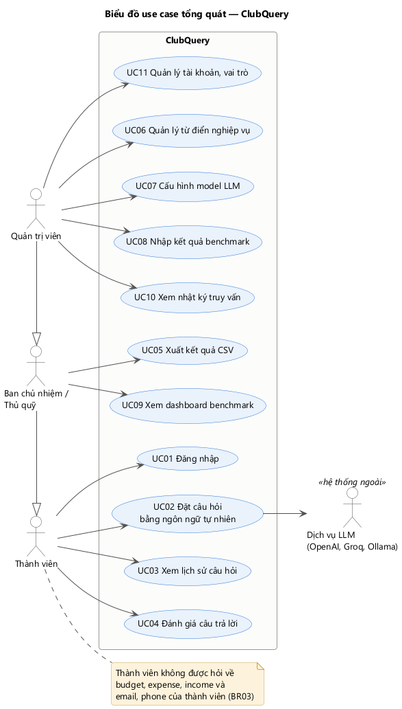
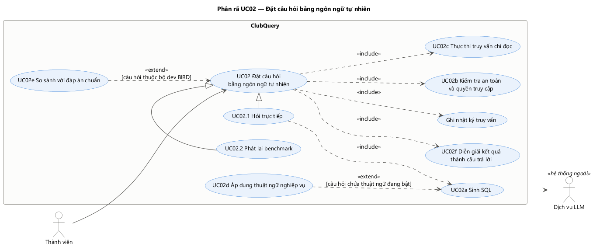

# 2. Mô hình use case

## 2.1. Biểu đồ use case tổng quát

Quan hệ tổng quát hoá giữa các tác nhân: Quản trị viên → Ban chủ nhiệm → Thành viên. Tác nhân cấp trên làm được mọi use case của cấp dưới.

## 2.2. Phân rã UC02 — Đặt câu hỏi

- *include*: mọi câu hỏi đều qua **kiểm tra an toàn và quyền**, **thực thi chỉ đọc** và **ghi nhật ký**. Hỏi trực tiếp thì có thêm **sinh SQL**.
- *extend*: **áp dụng thuật ngữ** khi câu hỏi chứa thuật ngữ đang bật; **so với đáp án chuẩn** khi câu hỏi thuộc bộ dev BIRD.

## 2.3. Đặc tả use case

### UC02 — Đặt câu hỏi bằng ngôn ngữ tự nhiên

| Mục | Nội dung |
|---|---|
| Tác nhân chính | Thành viên (và các tác nhân kế thừa) |
| Tác nhân phụ | Dịch vụ LLM |
| Mô tả | Người dùng hỏi bằng ngôn ngữ tự nhiên; hệ thống sinh SQL, kiểm tra, thực thi chỉ đọc theo quyền và trả về kết quả |
| Tiền điều kiện | Đã đăng nhập; có ít nhất một model đang bật (hỏi trực tiếp) hoặc một lượt benchmark (phát lại) |
| Hậu điều kiện | Một bản ghi `query_log` với trạng thái kết thúc được tạo (BR04) |
| Quy tắc áp dụng | BR01, BR02, BR03, BR04 |

**Luồng chính (hỏi trực tiếp):**
1. Người dùng chọn chế độ "Hỏi trực tiếp", chọn model, nhập câu hỏi (hoặc chọn câu hỏi mẫu) rồi bấm "Hỏi".
2. Hệ thống ghép evidence của câu mẫu (nếu có và người dùng bật).
3. Hệ thống tìm các thuật ngữ đang bật xuất hiện trong câu hỏi và ghép định nghĩa vào evidence (UC02d).
4. Hệ thống chuẩn hoá các hàm giả trong evidence (`DIVIDE`, `YEAR`…) sang SQLite hợp lệ.
5. Hệ thống dựng prompt theo khuôn của BIRD, với schema chỉ gồm bảng/cột vai trò được xem.
6. Hệ thống gửi prompt tới Dịch vụ LLM và nhận về văn bản chứa SQL.
7. Hệ thống tách SQL, kiểm tra đúng một câu `SELECT` (BR01).
8. Hệ thống thực thi SQL trên CSDL nguồn ở chế độ chỉ đọc, kèm authorizer theo vai trò và timeout 10 giây (BR02, BR03).
9. Nếu câu hỏi thuộc bộ dev, hệ thống chạy SQL đáp án chuẩn và so tập kết quả để đánh dấu đúng/sai (UC02e).
10. Hệ thống ghi `query_log` và hiển thị trạng thái, SQL, bảng kết quả, đúng/sai.

**Luồng thay thế:**
- **A1 — Phát lại benchmark** (bước 1–6): người dùng chọn lượt benchmark và câu hỏi mẫu; hệ thống lấy SQL model đã sinh trong lượt đó, không gọi Dịch vụ LLM, rồi tiếp tục từ bước 7.
- **A2 — Kết quả quá 1000 dòng** (bước 10): chỉ hiển thị 1000 dòng đầu và ghi chú đã cắt.

**Luồng ngoại lệ:**

| Mã | Điều kiện | Xử lý | Trạng thái log |
|---|---|---|---|
| E1 | Gọi model lỗi (mạng, khoá API, model chưa cài) | Báo "Không sinh được SQL" kèm lý do | `FAILED_GENERATION` |
| E2 | Model trả văn bản không phải SQL | Báo không sinh được truy vấn | `FAILED_GENERATION` |
| E3 | SQL có nhiều câu lệnh, hoặc là lệnh ghi/DDL | Từ chối, không thực thi | `REJECTED_UNSAFE` |
| E4 | SQL đọc bảng/cột vai trò không được xem | Từ chối, nêu dữ liệu bị cấm | `REJECTED_PERMISSION` |
| E5 | Quá 10 giây | Huỷ truy vấn | `TIMEOUT` |
| E6 | Lỗi cú pháp, sai tên cột | Hiện thông báo lỗi của SQLite | `EXEC_ERROR` |

### UC06 — Quản lý từ điển nghiệp vụ

| Mục | Nội dung |
|---|---|
| Tác nhân | Quản trị viên |
| Mô tả | Duy trì danh sách thuật ngữ nghiệp vụ và định nghĩa SQL tương ứng; thuật ngữ đang bật được ghép vào prompt như evidence |
| Tiền điều kiện | Đăng nhập với vai trò quản trị |
| Hậu điều kiện | `glossary_term` được cập nhật; câu hỏi sau đó dùng từ điển mới |
| Quy tắc | BR05; thuật ngữ không trùng (không phân biệt hoa thường) |

**Luồng chính:** (1) Mở màn Từ điển → (2) nhập thuật ngữ và định nghĩa, bấm Thêm → (3) hệ thống kiểm tra quyền và tính duy nhất → (4) lưu và làm mới danh sách.
**Luồng thay thế:** bật/tắt hoặc xoá thuật ngữ có sẵn (xoá cần xác nhận).
**Ngoại lệ:** thuật ngữ đã tồn tại → báo lỗi 409; không phải quản trị viên → 403, form thêm bị ẩn với vai trò khác.

### UC08 — Nhập kết quả benchmark

| Mục | Nội dung |
|---|---|
| Tác nhân | Quản trị viên |
| Mô tả | Nạp file JSON do `app/scripts/per_db_ex.py` sinh ra (đã chấm bằng `evaluation.py` của BIRD) để phục vụ phát lại và dashboard |
| Tiền điều kiện | Model của các lượt chạy đã có trong cấu hình model |
| Hậu điều kiện | `dev_question`, `benchmark_run`, `benchmark_item` được cập nhật; lượt cũ cùng model và cấu hình bị thay thế |

**Luồng chính:** (1) Chọn file → (2) bấm Nhập → (3) hệ thống kiểm tra định dạng → (4) ghi câu hỏi, từng lượt chạy và kết quả từng câu trong một giao dịch → (5) báo số lượt đã nhập.
**Ngoại lệ:** thiếu `questions`/`runs` → báo sai định dạng; model chưa cấu hình → huỷ toàn bộ giao dịch, báo tên model.

### UC09 — Xem dashboard benchmark

| Mục | Nội dung |
|---|---|
| Tác nhân | Ban chủ nhiệm, Quản trị viên |
| Mô tả | Xem EX trên 158 câu `student_club` theo model × cấu hình (không evidence, có evidence, evidence chuẩn hoá) × độ khó, đặt cạnh EX toàn dev |
| Hậu điều kiện | Không thay đổi dữ liệu |

**Luồng chính:** (1) Mở tab Benchmark → (2) hệ thống tổng hợp `benchmark_item` theo lượt chạy và độ khó → (3) hiển thị biểu đồ cột nhóm (rê chuột xem chi tiết) và bảng số liệu.
**Ngoại lệ:** Thành viên không thấy tab này (API trả 403).

### UC11 — Quản lý tài khoản và vai trò

| Mục | Nội dung |
|---|---|
| Tác nhân | Quản trị viên |
| Mô tả | Thêm tài khoản, đổi vai trò, khoá/mở tài khoản |
| Quy tắc | Mật khẩu ≥ 6 ký tự, lưu dạng băm; tên đăng nhập duy nhất; quản trị viên không tự hạ quyền hoặc tự khoá mình |

**Luồng chính:** (1) Nhập tên đăng nhập, họ tên, mật khẩu, vai trò → (2) bấm Thêm → (3) hệ thống kiểm tra, băm mật khẩu, lưu.
**Luồng thay thế:** đổi vai trò hoặc trạng thái hoạt động của tài khoản có sẵn, bấm Lưu. Tài khoản bị khoá không đăng nhập được, và phiên đang mở cũng bị từ chối ngay ở yêu cầu kế tiếp.
**Ngoại lệ:** trùng tên đăng nhập → 409; mật khẩu ngắn → 422; tự hạ quyền → 422.
