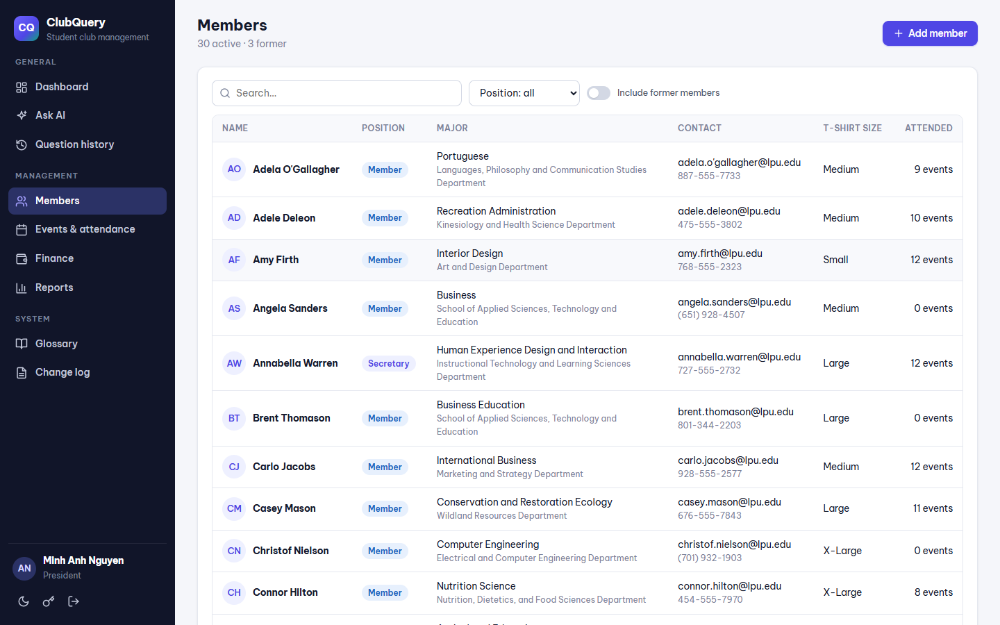
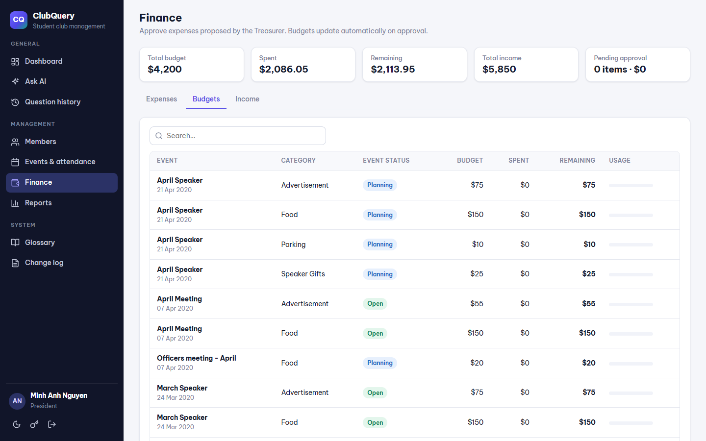
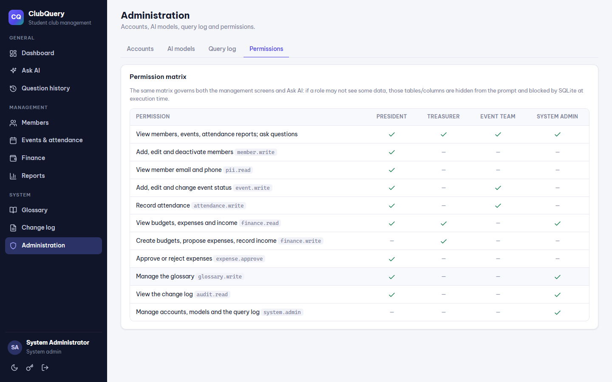

# 3. Phân tích và thiết kế

## 3.1. Biểu đồ phân rã chức năng (BFD)


Bảy nhóm chức năng tương ứng các nhóm use case ở mục 1.6 của [01_khao_sat_yeu_cau.md](01_khao_sat_yeu_cau.md) và các mục menu của giao diện (mục 3.9).

## 3.2. Biểu đồ hoạt động

**UC02 — Hỏi đáp.** Người dùng có thể chọn câu hỏi mẫu BIRD (điền sẵn câu hỏi và evidence) và/hoặc tự nhập tri thức ngoài. Tri thức ngoài (nguyên văn) và thuật ngữ từ điển (đã chuẩn hoá) được nối thành dòng `-- External Knowledge`; nếu cả hai rỗng thì prompt không có dòng này, đúng như prompt "không evidence" của BIRD. Mọi nhánh, kể cả nhánh bị từ chối, đều hội tụ về bước ghi nhật ký (BR04). Riêng trường hợp model không tồn tại/đang tắt bị chặn ngay ở đầu vào nên không tạo log.


**UC11 → UC12 — Đề xuất và duyệt khoản chi.** Ba làn: Thủ quỹ đề xuất, Hệ thống kiểm tra và ghi, Chủ nhiệm quyết định. Mỗi thao tác ghi là một giao dịch kèm nhật ký thay đổi.


## 3.3. Biểu đồ tuần tự

**Hỏi đáp (UC02).** Đoạn `opt` đầu biểu đồ là việc chọn câu hỏi mẫu BIRD (`GET /api/sample-questions`). Phân quyền được kiểm hai lần: schema trong prompt đã lọc theo vai trò, và authorizer ở tầng engine SQLite chặn mọi đường đọc bảng/cột bị cấm.


**Duyệt khoản chi (UC12).** `appdb.connect()` mở `app.sqlite` làm CSDL `main` và `ATTACH` `club.sqlite` thành `club`, nên cập nhật khoản chi, tính lại ngân sách (ở `club`), ghi `expense_review` và `audit_log` (ở `main`) nằm trong **một giao dịch**: hoặc tất cả được ghi, hoặc không gì cả.


**Quản lý từ điển (UC06)**


## 3.4. Biểu đồ lớp phân tích


| Lớp phân tích | Cài đặt |
|---|---|
| Các lớp boundary màn hình | `app/frontend/` (HTML, JS, CSS) |
| `LLMGateway` | `app/backend/llm.py` |
| `XacThucControl` | `login`, `logout`, `change_password` trong `main.py`; `current_user`, `need` trong `deps.py` |
| `MaTranQuyen` | `PERMISSIONS`, `can()`, `restrictions()` trong `config.py` |
| `HoiDapControl` | `app/backend/service.py` (`ask`, `match_glossary`, `build_knowledge`) |
| `PromptBuilder` | `app/backend/prompt.py` |
| `QueryGuard` | `app/backend/guard.py` |
| `AnswerBuilder` | `app/backend/answer.py` |
| `ThanhVienControl`, `SuKienControl`, `TaiChinhControl`, `BaoCaoControl` | các nhóm API trong `app/backend/club_api.py` |
| `AuditLogger` | `appdb.audit()` |
| Các lớp entity | bảng trong `club.sqlite` và `app.sqlite` (mục 3.6); `CauHoiMau` = bảng `sample_question` |

## 3.5. Biểu đồ trạng thái

**Một truy vấn (QueryLog).** `Received`, `Generated`, `Validated` là trạng thái trung gian trong bộ nhớ; `query_log.status` lưu một trong sáu trạng thái kết thúc.


**Khoản chi.** Trạng thái được suy ra từ cột `expense.approved`: `'pending'` → PENDING, `'true'` (hoặc NULL ở dữ liệu cũ) → APPROVED, còn lại (`'false'`) → REJECTED.


**Sự kiện.** Vòng đời một chiều (BR11); trạng thái quyết định có được điểm danh (BR12) và đề xuất chi hay không.


## 3.6. Thiết kế dữ liệu

| CSDL | Nội dung | Cách mở |
|---|---|---|
| `student_club.sqlite` (BIRD) | Dữ liệu gốc | Chỉ đọc một lần để chép sang `club.sqlite`; không bao giờ bị sửa |
| `app/data/club.sqlite` | Dữ liệu nghiệp vụ CLB (8 bảng của BIRD, giữ nguyên lược đồ) | Chức năng quản lý: đọc ghi qua kết nối chung (ATTACH as `club`). Hỏi đáp: kết nối riêng `?mode=ro` + authorizer |
| `app/data/app.sqlite` | Dữ liệu ứng dụng (8 bảng) | Kết nối chính (`main`) |

Lý do tách:
- SQL do model sinh chạy trên một kết nối **chỉ đọc chỉ thấy `club.sqlite`**, nên không bao giờ chạm được vào tài khoản, nhật ký hay quy trình duyệt.
- Giữ nguyên lược đồ BIRD cho dữ liệu nghiệp vụ, nên prompt vẫn đúng khuôn BIRD và kết quả nghiên cứu áp dụng trực tiếp được. Thông tin chỉ ứng dụng cần (ai đề xuất, ai duyệt, lý do) để ở `expense_review` bên `app.sqlite`.
- `python -m app.backend.appdb` tạo lại cả hai file từ dữ liệu gốc; `app.sqlite` có `PRAGMA user_version = 4`; file của phiên bản cũ được tạo lại tự động. Bảng `sample_question` được nạp từ `src/DAMO-ConvAI/bird/data/dev.json` (lọc `db_id = student_club`) khi khởi tạo.


Phần `club.sqlite` được **đảo ngược** từ khoá ngoại thật trong file SQLite (`PRAGMA foreign_key_list`). Hệ thống dùng thêm giá trị `'pending'`, `'false'` cho cột `expense.approved` (dữ liệu gốc chỉ có `'true'` và một NULL), và giữ `budget.event_status` đồng bộ với `event.status`.

### Từ điển dữ liệu `app.sqlite`

| Bảng | Cột | Kiểu | Ràng buộc / ý nghĩa |
|---|---|---|---|
| `user_account` | `id` | INTEGER | PK |
| | `username` | TEXT | NOT NULL, UNIQUE |
| | `full_name` | TEXT | NOT NULL |
| | `password_hash` | TEXT | `salt$pbkdf2_sha256` (100.000 vòng) |
| | `role` | TEXT | CHECK ∈ {president, treasurer, event, admin} |
| | `is_active` | INTEGER | 1 = hoạt động, 0 = khoá |
| `model_config` | `id`, `name` | INTEGER, TEXT | PK; `name` UNIQUE |
| | `provider` | TEXT | CHECK ∈ {groq, openrouter, ollama} |
| | `model_tag`, `base_url` | TEXT | Tên model gửi trong request; địa chỉ API chuẩn Chat Completions (vd. `http://localhost:11434/v1`) |
| | `api_key_env` | TEXT | **Tên biến môi trường** chứa khoá API (vd. `GROQ_API_KEY`; NULL với Ollama), không lưu khoá |
| | `is_active`, `is_default` | INTEGER | Chỉ một model mặc định; model mặc định phải đang bật |
| `glossary_term` | `id` | INTEGER | PK |
| | `term` | TEXT | UNIQUE COLLATE NOCASE; API so thêm bằng `casefold()` cho chữ có dấu |
| | `definition` | TEXT | Định nghĩa dạng SQL/tiếng Anh, ghép vào prompt |
| | `is_active` | INTEGER | Chỉ thuật ngữ đang bật được ghép vào prompt |
| | `updated_by`, `updated_at` | INTEGER, TEXT | FK → `user_account`; thời điểm sửa |
| `query_log` | `id` | INTEGER | PK |
| | `user_id`, `model_id` | INTEGER | FK → `user_account`, `model_config` |
| | `question` | TEXT | Câu hỏi gốc |
| | `sample_id` | INTEGER | FK → `sample_question`; câu mẫu BIRD đã chọn (NULL nếu tự hỏi; mã không tồn tại thì bỏ qua) |
| | `evidence` | TEXT | Tri thức ngoài người dùng nhập/chọn (≤ 2000 ký tự) |
| | `glossary_used` | TEXT | Các thuật ngữ đã ghép vào prompt, phân cách `; ` |
| | `generated_sql`, `answer` | TEXT | SQL model sinh (đã làm sạch); câu trả lời |
| | `status` | TEXT | EXECUTED, FAILED_GENERATION, REJECTED_UNSAFE, REJECTED_PERMISSION, TIMEOUT, EXEC_ERROR |
| | `error` | TEXT | Thông báo lỗi nếu có |
| | `latency_ms`, `row_count` | INTEGER | Độ trễ toàn luồng; số dòng kết quả |
| | `created_at` | TEXT | ISO 8601 |
| `feedback` | `id` | INTEGER | PK |
| | `query_log_id`, `user_id` | INTEGER | FK; UNIQUE(`query_log_id`, `user_id`) — đánh giá lại thì ghi đè |
| | `rating` | INTEGER | CHECK ∈ {−1, 1} |
| | `comment`, `created_at` | TEXT | |
| `expense_review` | `expense_id` | TEXT | PK, = `club.expense.expense_id` (liên kết logic khác CSDL, không có FK) |
| | `proposed_by`, `proposed_at` | INTEGER, TEXT | Người, thời điểm đề xuất (FK → `user_account`) |
| | `reviewed_by`, `reviewed_at` | INTEGER, TEXT | Người, thời điểm duyệt/từ chối; NULL khi còn chờ |
| | `note` | TEXT | Ghi chú duyệt / lý do từ chối |
| `sample_question` | `id` | INTEGER | PK = `question_id` của câu hỏi trong `dev.json` của BIRD |
| | `question` | TEXT | Câu hỏi tiếng Anh |
| | `evidence` | TEXT | Evidence (tri thức ngoài) của BIRD, giữ nguyên văn; NULL ở 12 câu không có |
| | `difficulty` | TEXT | CHECK ∈ {simple, moderate, challenging} |
| `audit_log` | `id` | INTEGER | PK |
| | `user_id` | INTEGER | FK → `user_account` |
| | `action` | TEXT | CHECK ∈ {CREATE, UPDATE, DELETE, APPROVE, REJECT} |
| | `entity`, `entity_id` | TEXT | member, event, attendance, budget, expense, income, glossary; mã bản ghi |
| | `summary` | TEXT | Mô tả ngắn, vd. `Duyệt khoản chi "<mô tả>" $<số tiền>` |
| | `detail` | TEXT | JSON `{before, after}` |
| | `created_at` | TEXT | ISO 8601 |

Dữ liệu khởi tạo: 4 tài khoản demo (mỗi vai trò một tài khoản: Minh Anh Nguyen, Thu Ha Tran, Quoc Bao Le, System Administrator), 4 model (Qwen2.5-Coder qua Ollama là mặc định; DeepSeek-Coder-V2, Gemma3 qua Ollama; GPT-OSS-20B qua Groq), 11 thuật ngữ mẫu tiếng Anh (vd. `meeting` → `event.type = 'Meeting'`, `active member` → `member.position <> 'Inactive'`, `pending expense` → `expense.approved = 'pending'`, `remaining budget` → `budget.remaining`); 158 câu hỏi mẫu BIRD.

## 3.7. Kiến trúc


- **Phân tầng:** giao diện (HTML/JS) → API (FastAPI: `main.py`, `club_api.py`; xác thực và phân quyền trong `deps.py`) → nghiệp vụ (`service.py` cho hỏi đáp, các hàm trong `club_api.py` cho quản lý) → dịch vụ (`prompt`, `guard`, `llm`, `answer`) → dữ liệu (`appdb.py`).
- **Một ma trận quyền cho hai đường truy cập dữ liệu:** API quản lý gọi `need(quyền)`; hỏi đáp gọi `restrictions(role)` để lọc schema và cấu hình authorizer. Sửa ma trận ở một chỗ thì cả hai cùng đổi.
- **Tái sử dụng mã nghiên cứu:** `ollama_request.extract_sql()` (tách SQL khỏi khối ```` ```sql ```` trong câu trả lời model), `normalize_pseudo_sql()` (Gap 3: chuẩn hoá evidence). Prompt giữ khuôn của BIRD (schema `CREATE TABLE` + `-- External Knowledge` + câu hỏi), kết thúc bằng một câu yêu cầu kiểu chat dùng chung cho mọi nhà cung cấp: *"Respond with the final SQLite query only, inside a ```sql code block…"*.
- **Một giao diện cho mọi nhà cung cấp:** Ollama (chạy nội bộ, mặc định), Groq và OpenRouter đều có API chuẩn Chat Completions, gọi qua cùng một thư viện client (gói Python `openai`, chỉ dùng làm client); thêm model chỉ cần thêm một dòng `model_config`. Ứng dụng không dùng dịch vụ OpenAI.
- **Giao dịch:** mỗi yêu cầu mở một kết nối (`deps.db()`), mọi lệnh ghi và `audit()` chạy trước một `commit()` duy nhất; lỗi (HTTPException) thì kết nối đóng không commit.

### Thiết kế an toàn truy vấn (hỏi đáp)

| Lớp | Cơ chế | Chặn được |
|---|---|---|
| 1 | Prompt chỉ chứa schema mà vai trò được xem | Model không biết bảng/cột bị cấm nên ít khi sinh truy vấn vào đó |
| 2 | `check_select()`: tách câu lệnh bằng `sqlparse`, chỉ nhận đúng một `SELECT`/`WITH` | Nhiều câu lệnh, `DELETE`, `DROP`, `PRAGMA`, `ATTACH`… |
| 3 | Kết nối riêng tới `club.sqlite` với `mode=ro` | Mọi thao tác ghi |
| 4 | `sqlite3.set_authorizer` theo vai trò | Đọc bảng/cột bị cấm, kể cả `COUNT(*)`, `SELECT *`; lệnh ghi giấu trong CTE |
| 5 | `set_progress_handler` với hạn chót 10 giây | Truy vấn chạy quá lâu |
| 6 | Bước diễn giải chỉ nhận tối đa 30 dòng **đã qua kiểm tra quyền** | Model không thể "kể" dữ liệu vai trò không được xem |

Tri thức ngoài do người dùng nhập chỉ đi vào **prompt**, không đi vào SQL; dù nó chứa gì, SQL sinh ra vẫn phải qua lớp 2–5, nên tri thức ngoài không mở rộng được quyền đọc dữ liệu.

## 3.8. Danh sách API

| Phương thức | Đường dẫn | Use case | Quyền |
|---|---|---|---|
| POST | `/api/login`, `/api/logout` | UC01 | — |
| GET | `/api/me`, `/api/roles` | UC01 | Đã đăng nhập |
| POST | `/api/me/password` | UC01 | Đã đăng nhập |
| POST | `/api/ask` — body `question`, `model_id?`, `evidence?` (≤ 2000 ký tự), `sample_id?` | UC02 | Đã đăng nhập |
| GET | `/api/sample-questions` | UC02h | Đã đăng nhập |
| GET | `/api/models` | UC02, UC17 | Đã đăng nhập (người không phải quản trị chỉ thấy model đang bật) |
| GET | `/api/history` | UC03 | Đã đăng nhập (câu của mình) |
| POST | `/api/feedback` | UC04 | Người đặt câu hỏi |
| GET | `/api/export/{log_id}` | UC05 | Người đặt câu hỏi |
| GET | `/api/glossary` | UC06 | Đã đăng nhập |
| POST, PUT, DELETE | `/api/glossary`, `/api/glossary/{id}` | UC06 | `glossary.write` |
| GET | `/api/lookups` | (danh mục cho form) | Đã đăng nhập |
| GET | `/api/members`, `/api/members/{id}` | UC07 | Đã đăng nhập (che liên lạc nếu thiếu `pii.read`) |
| POST, PUT, DELETE | `/api/members`, `/api/members/{id}` | UC07 | `member.write` |
| GET | `/api/events`, `/api/events/{id}` | UC08 | Đã đăng nhập (kèm ngân sách nếu có `finance.read`) |
| POST, PUT, DELETE | `/api/events`, `/api/events/{id}` | UC08 | `event.write` |
| PUT | `/api/events/{id}/attendance` | UC09 | `attendance.write` |
| GET | `/api/budgets` | UC10 | `finance.read` |
| POST, PUT, DELETE | `/api/budgets`, `/api/budgets/{id}` | UC10 | `finance.write` |
| GET | `/api/expenses` | UC11, UC12 | `finance.read` |
| POST, PUT, DELETE | `/api/expenses`, `/api/expenses/{id}` | UC11 | `finance.write` |
| POST | `/api/expenses/{id}/approve`, `/api/expenses/{id}/reject` | UC12 | `expense.approve` |
| GET | `/api/incomes` | UC13 | `finance.read` |
| POST, PUT, DELETE | `/api/incomes`, `/api/incomes/{id}` | UC13 | `finance.write` |
| GET | `/api/dashboard` | UC14 | Đã đăng nhập (khối tài chính nếu có `finance.read`) |
| GET | `/api/reports/attendance` | UC15 | Đã đăng nhập |
| GET | `/api/reports/finance` | UC15 | `finance.read` |
| GET | `/api/audit?entity=` | UC16 | `audit.read` |
| PUT | `/api/models/{id}` | UC17 | `system.admin` |
| GET, POST | `/api/users` | UC18 | `system.admin` |
| PUT | `/api/users/{id}` | UC18 | `system.admin` |
| GET | `/api/logs?status=` | UC19 | `system.admin` |

Mã lỗi thống nhất: 401 chưa đăng nhập/phiên hết hiệu lực; 403 thiếu quyền; 404 không tìm thấy; 409 vi phạm quy tắc nghiệp vụ (BR07, BR08, BR09, BR12, trùng dữ liệu, trạng thái không cho phép); 422 dữ liệu nhập không hợp lệ (kèm tên trường).

## 3.9. Giao diện

Giao diện một trang, **toàn bộ bằng tiếng Anh** (nhãn, thông báo lỗi, ngày dạng "07 Apr 2020", vai trò hiển thị President / Treasurer / Event team / System admin). Menu chia ba nhóm: **General** (Dashboard, Ask AI, Question history), **Management** (Members, Events & attendance, Finance, Reports), **System** (Glossary, Change log, Administration). Menu chỉ hiện mục vai trò có quyền; các nút thêm/sửa/duyệt hiện theo danh sách quyền trả về từ `/api/me` (vd. nút Sửa/Huỷ khoản chi chỉ hiện với người đề xuất).

| Màn hình | Nội dung | Vai trò thấy | Ảnh |
|---|---|---|---|
| Đăng nhập (Sign in) | Tên đăng nhập, mật khẩu | — |  |
| Dashboard (Tổng quan) | Thẻ chỉ số (thành viên hoạt động, sự kiện sắp tới, tham dự trung bình, ngân sách còn lại, khoản chờ duyệt), ô hỏi nhanh, thu chi theo tháng, sự kiện sắp tới, chi theo hạng mục, nguồn thu | Tất cả (tài chính: Chủ nhiệm, Thủ quỹ, Quản trị) |  |
| Ask AI (Hỏi đáp) | Ô câu hỏi; ô *External knowledge (optional)*; chọn model; nút **BIRD sample questions (158)**; câu hỏi gợi ý theo nhóm (Members / Events / Finance / Contacts); khung *Your data access* và *Recent questions*. Thẻ kết quả: trạng thái, model, độ trễ, số dòng, nhãn *BIRD sample #id*, dòng *Knowledge added to the prompt*, câu trả lời, biểu đồ, *Data table*, *External knowledge sent to the model*, SQL; **Correct / Wrong**, **CSV**, **Ask again** | Tất cả |  |
| BIRD sample questions | Hộp chọn câu hỏi mẫu: tìm theo câu hỏi/evidence, lọc *All / Simple / Moderate / Challenging*; mỗi câu hiện mã, độ khó, evidence (hoặc nhãn *no evidence*) | Tất cả |  |
| Question history (Lịch sử) | Câu hỏi của mình, trạng thái, đánh giá; hỏi lại (kèm tri thức ngoài) | Tất cả | — |
| Members (Thành viên) | Danh sách, chi tiết, **Add member** / Edit / Delete | Tất cả (ghi: Chủ nhiệm) |  |
| Events & attendance (Sự kiện, điểm danh) | Danh sách lọc theo trạng thái, **Create event**; hộp chi tiết sự kiện gồm *Budget* theo hạng mục (nếu có quyền; Thủ quỹ có nút **Add budget**, Chủ nhiệm thấy dòng nhắc ngân sách do Thủ quỹ lập) và *Attendance* có ô chọn, *Search members…*, *Select all* / *Clear*; nút **Edit**, **Open event** / **Close event**, **Save attendance**; sự kiện `Planning` hiện hướng dẫn mở sự kiện rồi điểm danh | Tất cả (ghi: Chủ nhiệm, Ban sự kiện) |  |
| Finance (Tài chính) | Thẻ *Total budget, Spent, Remaining, Total income, Pending approval*; ba tab **Expenses** (Propose expense, Approve, Reject) / **Budgets** (cột *Usage*) / **Income** (Record income) | Chủ nhiệm, Thủ quỹ, Quản trị |  |
| Reports (Báo cáo) | Tham dự theo thành viên và sự kiện; tài chính theo sự kiện | Tất cả (tài chính theo quyền) |  |
| Glossary (Từ điển) | Danh sách thuật ngữ; **Add term**, sửa, bật/tắt, xoá | Tất cả (ghi: Chủ nhiệm, Quản trị) |  |
| Change log (Nhật ký thay đổi) | Ai, lúc nào, hành động, đối tượng, giá trị trước/sau | Chủ nhiệm, Quản trị | — |
| Administration (Quản trị) | Bốn tab: **Accounts** / **AI models** / **Query log** / **Permissions** (ma trận quyền × vai trò, ảnh chụp tab này) | Quản trị |  |
| Trên điện thoại | Bố cục một cột, rộng 390px | — |  |
