# 3. Phân tích và thiết kế

## 3.1. Biểu đồ hoạt động

**UC02 — Đặt câu hỏi.** Mọi nhánh, kể cả nhánh bị từ chối, đều hội tụ về bước ghi nhật ký (BR04).

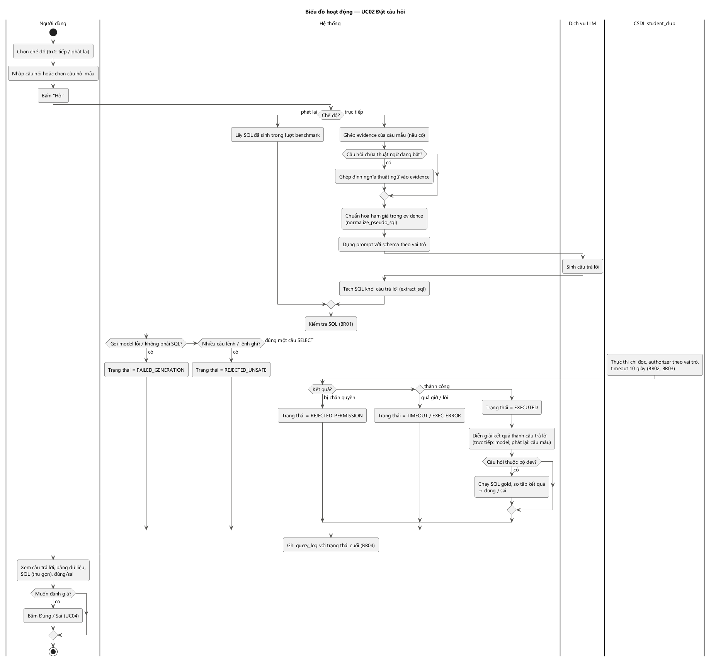

**UC08 — Nhập kết quả benchmark**

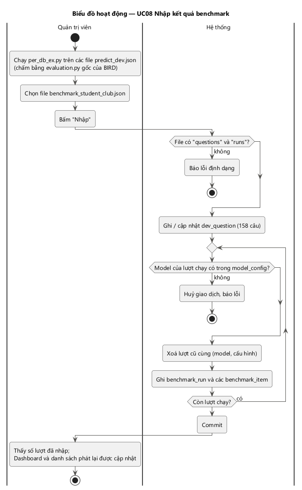

## 3.2. Biểu đồ tuần tự

**Hỏi trực tiếp (UC02.1).** Phân quyền được kiểm hai lần: schema trong prompt đã lọc, và authorizer ở tầng engine SQLite.

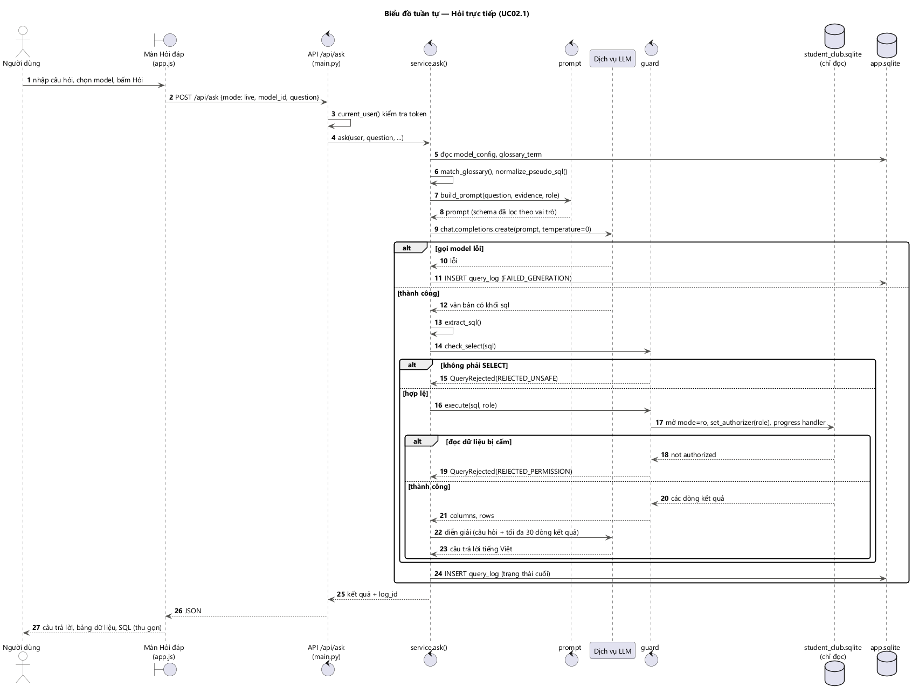

**Phát lại benchmark và so đáp án (UC02.2 + UC02e)**

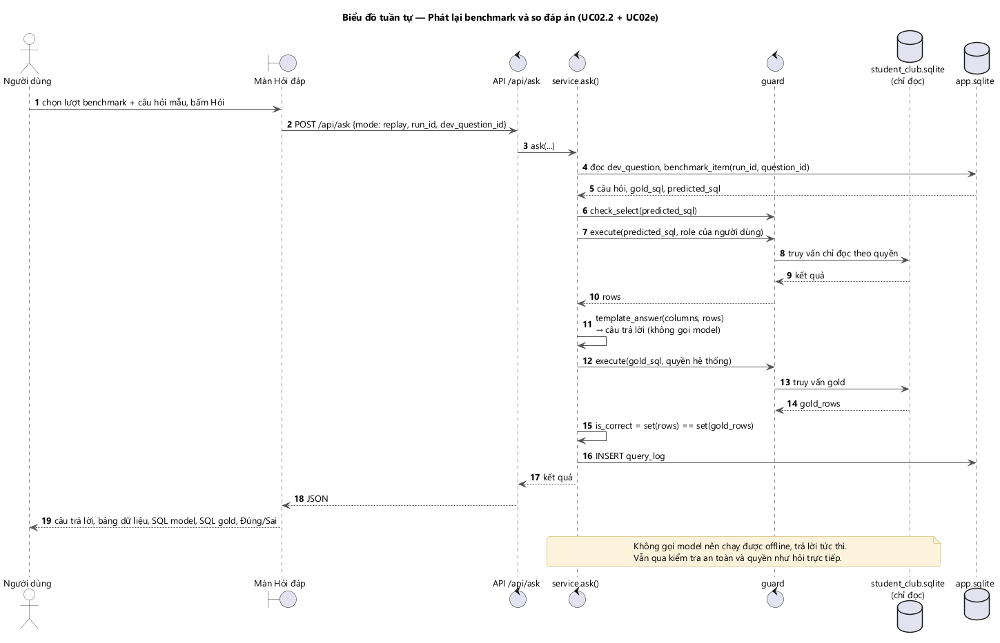

**Quản lý từ điển (UC06)**

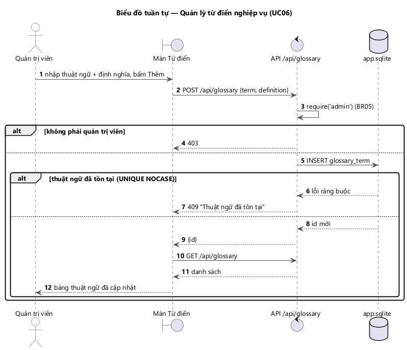

## 3.3. Biểu đồ lớp phân tích

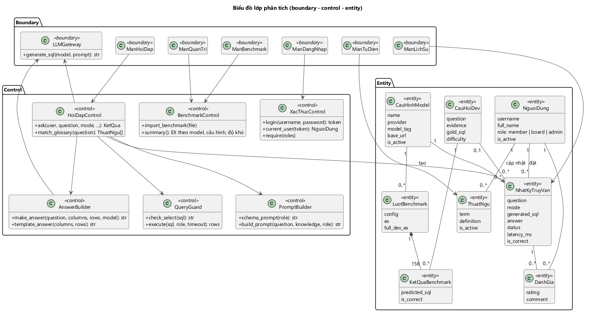

| Lớp phân tích | Cài đặt |
|---|---|
| Các lớp boundary màn hình | `app/frontend/index.html`, `app.js` |
| `LLMGateway` | `app/backend/llm.py` |
| `XacThucControl` | `login`, `current_user`, `require` trong `app/backend/main.py` |
| `HoiDapControl` | `app/backend/service.py` |
| `PromptBuilder` | `app/backend/prompt.py` |
| `QueryGuard` | `app/backend/guard.py` |
| `BenchmarkControl` | `import_benchmark` trong `appdb.py`, các API `/api/benchmark/*` |
| Các lớp entity | Bảng trong `app.sqlite` (mục 3.5) |

## 3.4. Biểu đồ trạng thái của một truy vấn

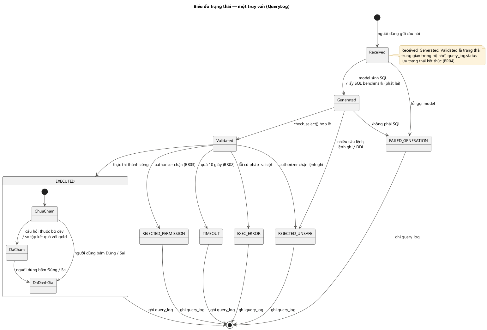

## 3.5. Thiết kế dữ liệu

Hệ thống dùng **hai CSDL tách biệt**:
- `student_club.sqlite` là dữ liệu nghiệp vụ, mở **chỉ đọc**.
- `app.sqlite` là dữ liệu của ứng dụng.

Tách như vậy để model không bao giờ chạm được vào bảng tài khoản hay nhật ký, và để thay CSDL nguồn mà không ảnh hưởng ứng dụng.

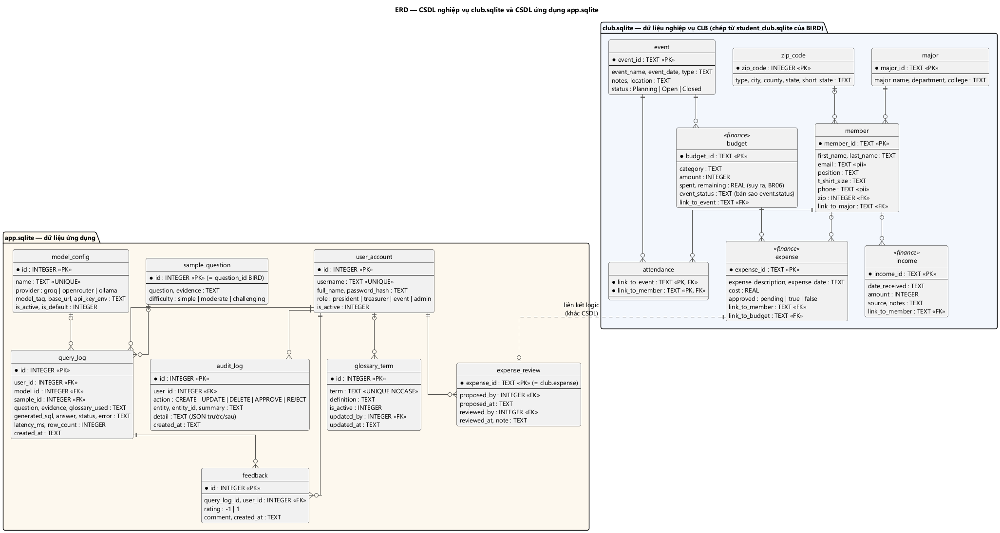

Phần `student_club` được **đảo ngược** từ khoá ngoại thật trong file SQLite (`PRAGMA foreign_key_list`).

### Từ điển dữ liệu `app.sqlite`

| Bảng | Cột chính | Ràng buộc |
|---|---|---|
| `user_account` | `username`, `full_name`, `password_hash`, `role`, `is_active` | `username` UNIQUE; `role` ∈ {member, board, admin} |
| `model_config` | `name`, `provider`, `model_tag`, `base_url`, `api_key_env`, `is_active` | `name` UNIQUE; `provider` ∈ {openai, groq, openrouter, ollama}. Chỉ lưu **tên biến môi trường** chứa khoá API, không lưu khoá |
| `glossary_term` | `term`, `definition`, `is_active`, `updated_by`, `updated_at` | `term` UNIQUE COLLATE NOCASE |
| `dev_question` | `id` (chỉ số trong `dev.json`), `question`, `evidence`, `gold_sql`, `difficulty` | `difficulty` ∈ {simple, moderate, challenging} |
| `benchmark_run` | `model_id`, `config`, `source`, `note`, `ex`, `full_dev_ex`, `imported_at` | UNIQUE(`model_id`, `config`); `config` ∈ {no_evidence, evidence, evidence_norm} |
| `benchmark_item` | `run_id`, `question_id`, `predicted_sql`, `is_correct` | PK(`run_id`, `question_id`); xoá theo lượt chạy (CASCADE) |
| `query_log` | `user_id`, `question`, `mode`, `model_id`, `run_id`, `dev_question_id`, `evidence_used`, `glossary_used`, `generated_sql`, `status`, `error`, `latency_ms`, `row_count`, `is_correct`, `created_at` | `mode` ∈ {live, replay}; `status` là trạng thái kết thúc |
| `feedback` | `query_log_id`, `user_id`, `rating`, `comment`, `created_at` | UNIQUE(`query_log_id`, `user_id`); `rating` ∈ {-1, 1} |

## 3.6. Kiến trúc

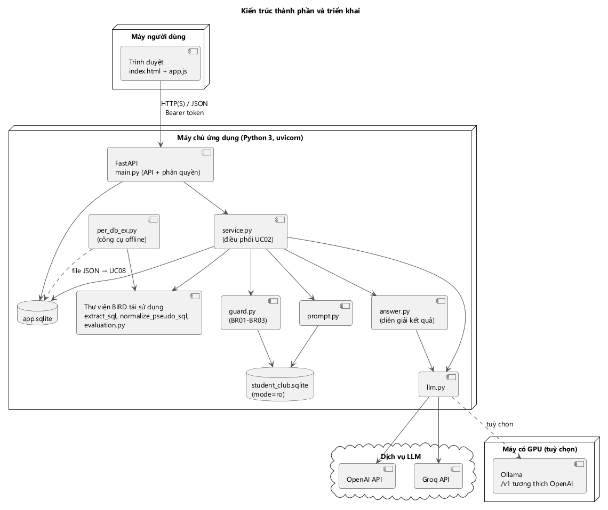

- **Phân tầng:** giao diện (HTML/JS) → API (FastAPI, xác thực và phân quyền) → nghiệp vụ (`service`) → các dịch vụ (`prompt`, `guard`, `llm`) → dữ liệu.
- **Tái sử dụng mã nghiên cứu:** `extract_sql()` (tách SQL khỏi câu trả lời model), `normalize_pseudo_sql()` (Gap 3: chuẩn hoá evidence), `evaluation.py` (bộ chấm EX của BIRD). Prompt giữ đúng khuôn của BIRD.
- **Một giao diện cho mọi nhà cung cấp:** OpenAI, Groq và Ollama đều gọi qua API tương thích OpenAI, nên thêm model chỉ cần thêm một dòng `model_config`.

### Danh sách API

| Phương thức | Đường dẫn | Use case | Quyền |
|---|---|---|---|
| POST | `/api/login`, `/api/logout`; GET `/api/me` | UC01 | — |
| POST | `/api/ask` | UC02 | đã đăng nhập |
| GET | `/api/dev-questions`, `/api/models`, `/api/benchmark/runs` | UC02 | đã đăng nhập |
| GET | `/api/history` | UC03 | đã đăng nhập |
| POST | `/api/feedback` | UC04 | chủ câu hỏi |
| GET | `/api/export/{log_id}` | UC05 | board, admin |
| GET / POST / PUT / DELETE | `/api/glossary[/{id}]` | UC06 | đọc: đã đăng nhập; ghi: admin |
| PUT | `/api/models/{id}` | UC07 | admin |
| POST | `/api/benchmark/import` | UC08 | admin |
| GET | `/api/benchmark/summary` | UC09 | board, admin |
| GET | `/api/logs` | UC10 | admin |
| GET / POST / PUT | `/api/users[/{id}]` | UC11 | admin |

## 3.7. Giao diện

| Màn hình | Ảnh |
|---|---|
| Đăng nhập | 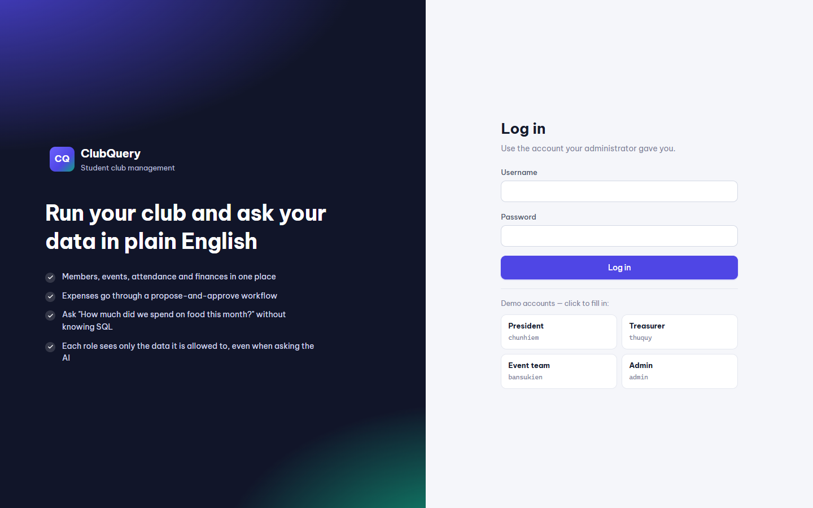 |
| Hỏi đáp, phát lại (Thủ quỹ) | 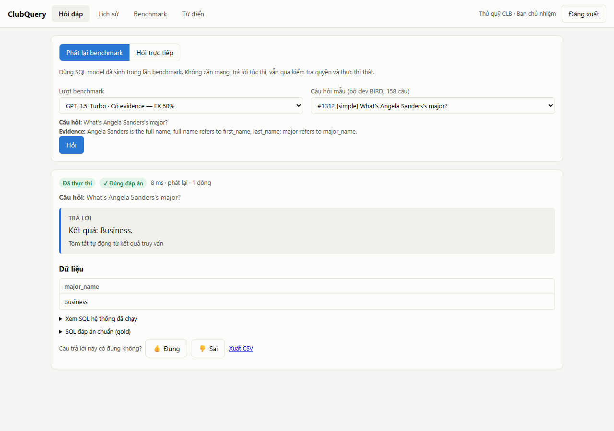 |
| Dashboard benchmark | 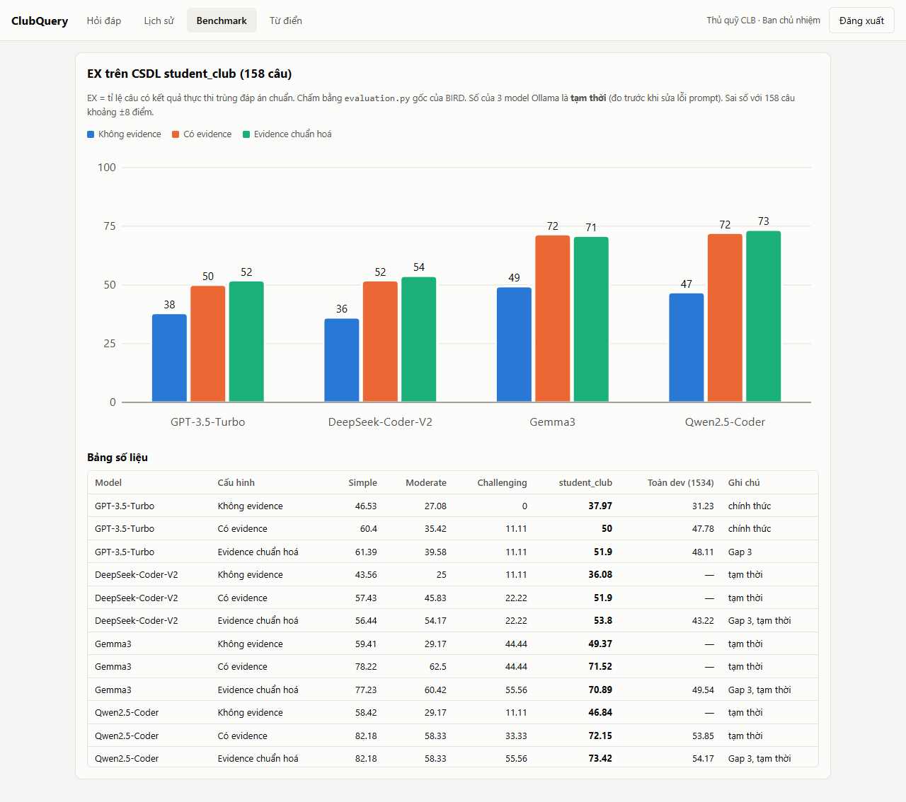 |
| Thành viên hỏi về tài chính, bị chặn | 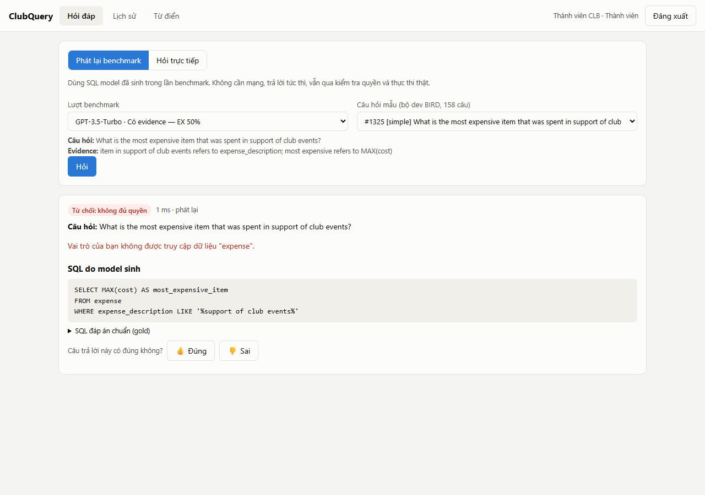 |
| Từ điển nghiệp vụ | 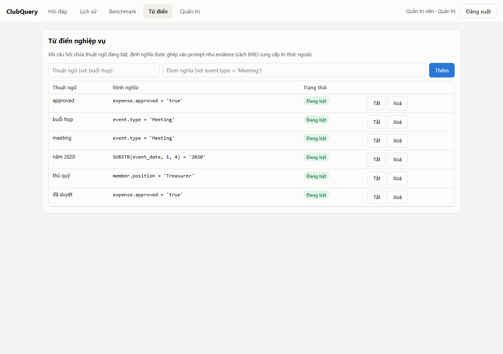 |
| Quản trị | 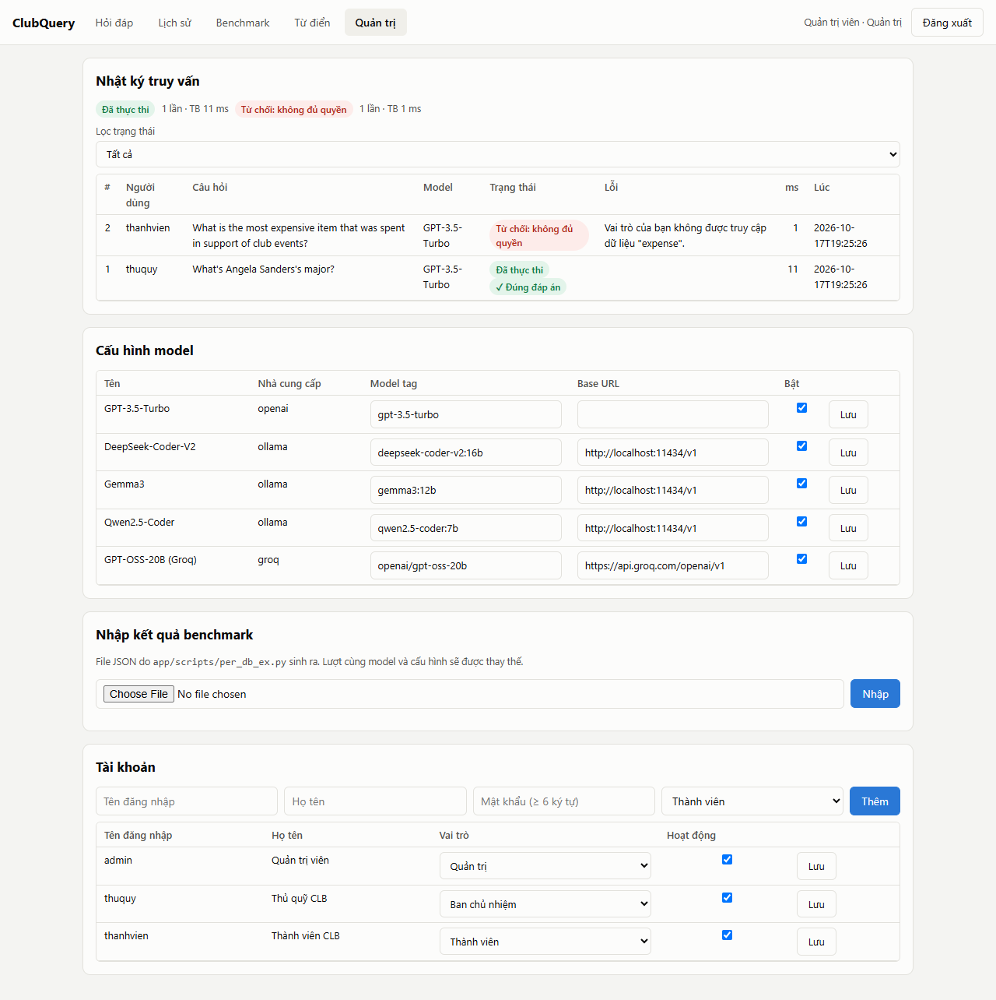 |
| Trên điện thoại | 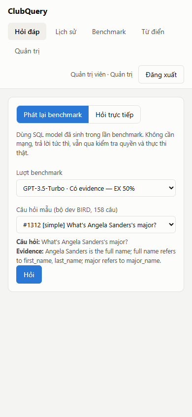 |
