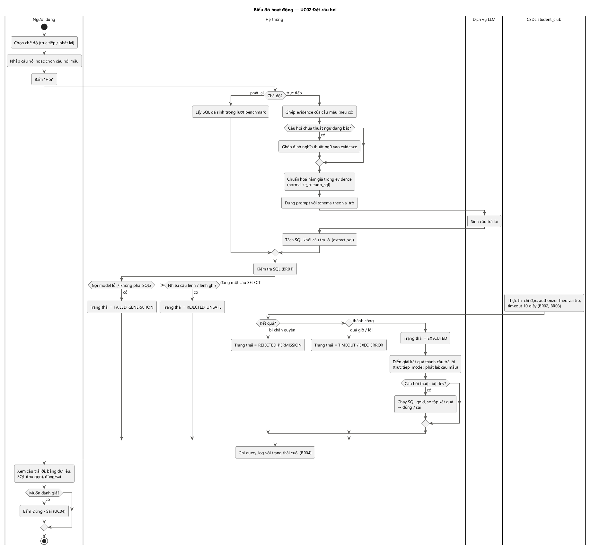
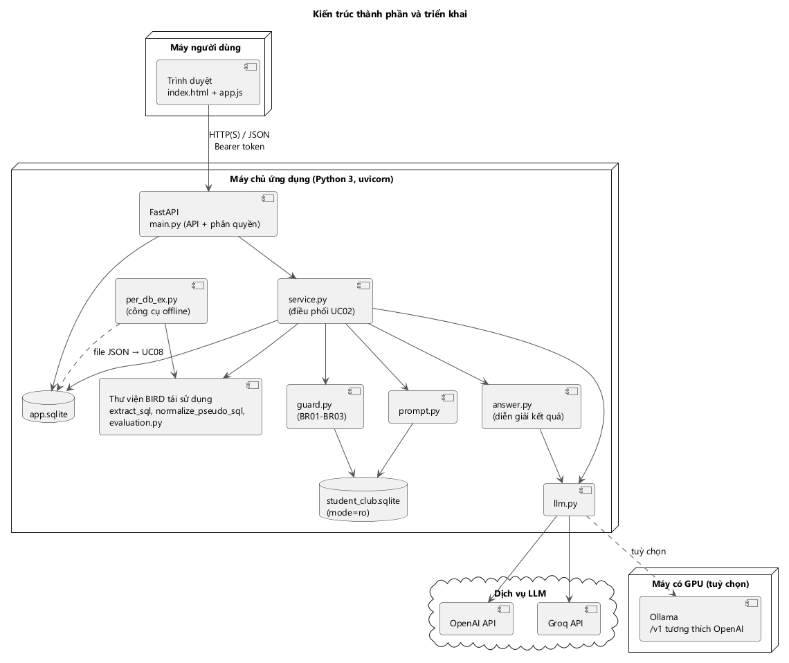
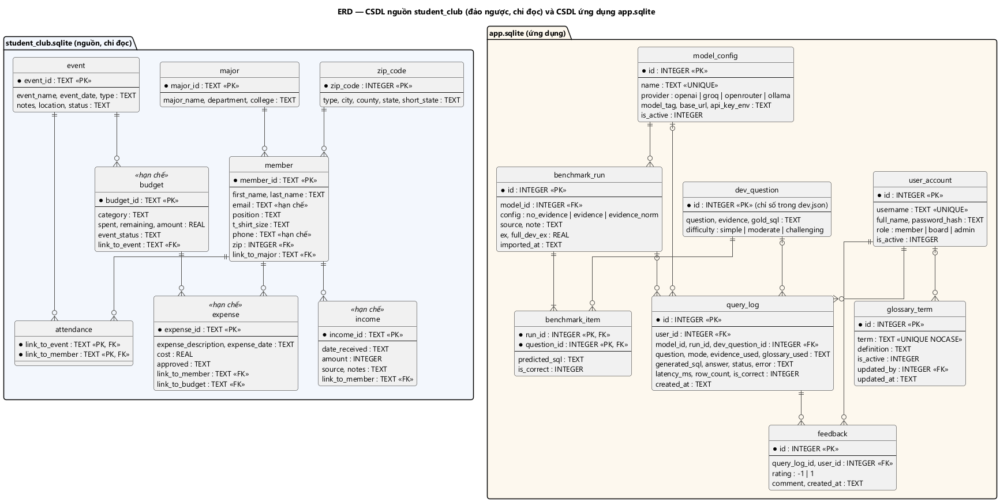
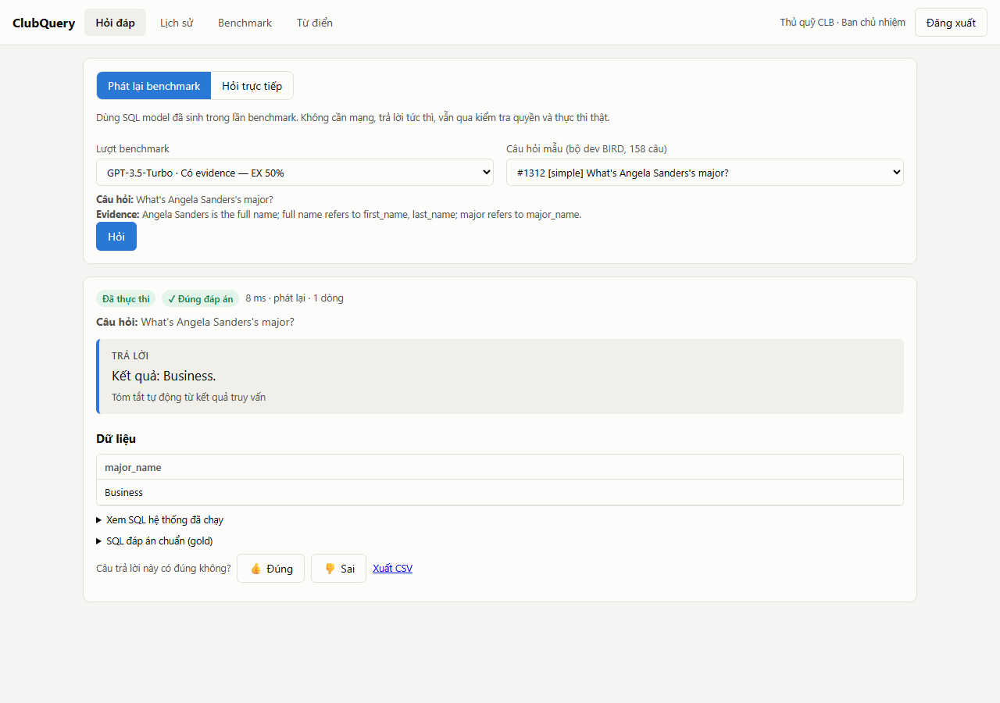
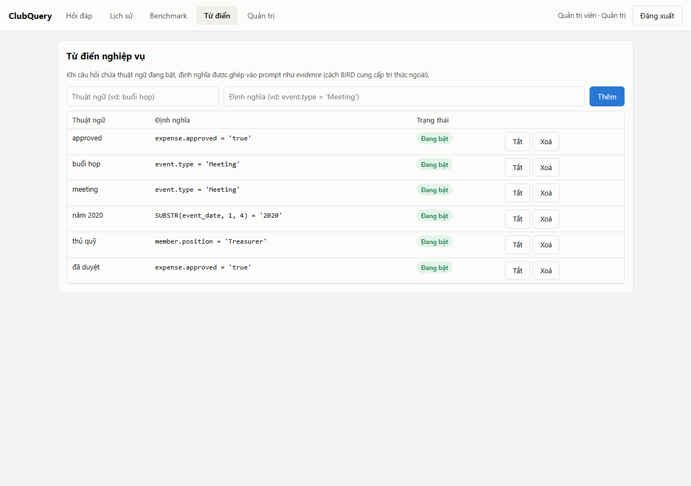
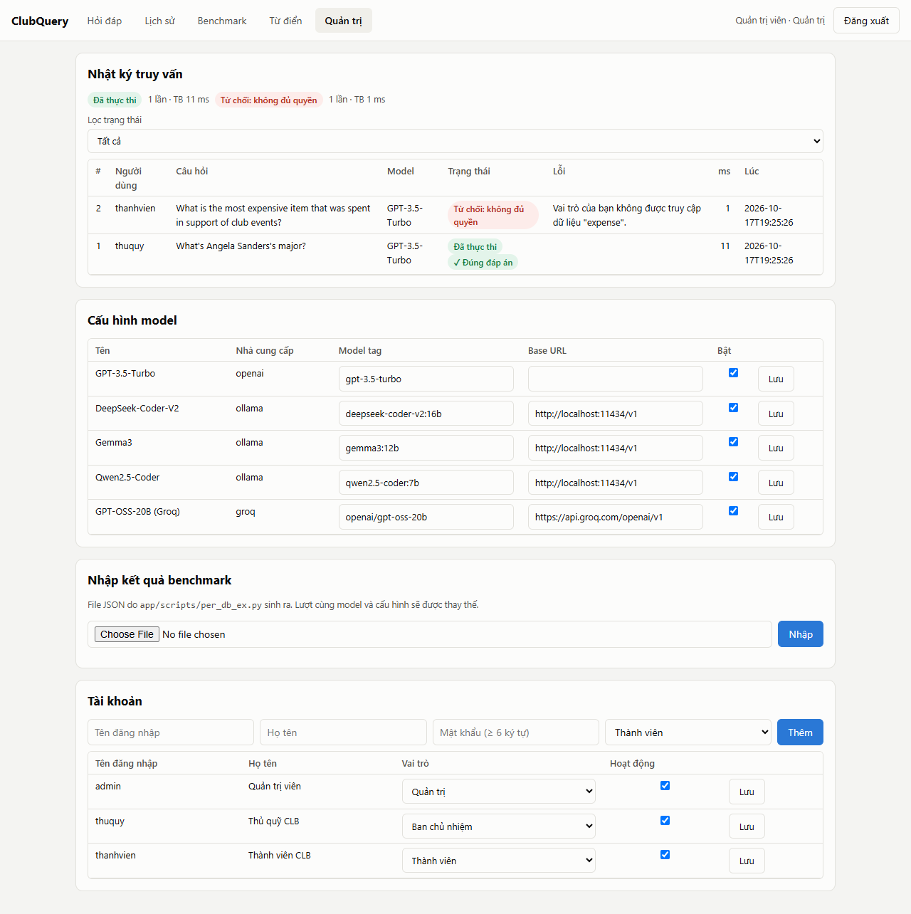

# BÁO CÁO ĐỒ ÁN MÔN PHÂN TÍCH THIẾT KẾ HỆ THỐNG THÔNG TIN

## ClubQuery — Hệ thống hỏi đáp dữ liệu câu lạc bộ sinh viên bằng ngôn ngữ tự nhiên: nghiên cứu bài báo BIRD và ứng dụng

| | |
|---|---|
| **Hướng đồ án** | Nghiên cứu bài báo và phát triển hệ thống minh họa |
| **Bài báo nghiên cứu** | Li et al., *Can LLM Already Serve as A Database Interface? A BIg Bench for Large-Scale Database Grounded Text-to-SQLs*, NeurIPS 2023 — https://arxiv.org/abs/2305.03111 |
| **Giảng viên hướng dẫn** | [Họ tên giảng viên] |
| **Sinh viên thực hiện** | [Họ tên] — [MSSV] |
| **Lớp** | [Lớp] |
| **Thời gian** | Tháng 10/2026 |

---

## Mục lục

1. [Giới thiệu](#1-giới-thiệu)
2. [Nghiên cứu bài báo BIRD](#2-nghiên-cứu-bài-báo-bird)
3. [Khảo sát và xác định yêu cầu](#3-khảo-sát-và-xác-định-yêu-cầu)
4. [Mô hình use case](#4-mô-hình-use-case)
5. [Phân tích hệ thống](#5-phân-tích-hệ-thống)
6. [Thiết kế hệ thống](#6-thiết-kế-hệ-thống)
7. [Cài đặt](#7-cài-đặt)
8. [Kiểm thử và đánh giá](#8-kiểm-thử-và-đánh-giá)
9. [Kết luận và hướng phát triển](#9-kết-luận-và-hướng-phát-triển)
10. [Tài liệu tham khảo](#10-tài-liệu-tham-khảo)
11. [Phụ lục](#11-phụ-lục)

---

## 1. Giới thiệu

### 1.1. Đặt vấn đề

Dữ liệu của phần lớn tổ chức nằm trong CSDL quan hệ, nhưng muốn khai thác thì phải viết SQL. Ở một câu lạc bộ sinh viên, ban chủ nhiệm thường cần trả lời những câu hỏi như *"năm 2020 trung bình mỗi buổi họp có bao nhiêu người tham dự?"* hay *"tổng chi cho hạng mục Food là bao nhiêu?"*. Hầu hết họ không biết SQL, nên phải nhờ người khác hoặc xuất dữ liệu ra bảng tính rồi tính tay.

Bài toán **Text-to-SQL** (chuyển câu hỏi tự nhiên thành SQL) nhắm đúng vào khoảng trống này. Các mô hình ngôn ngữ lớn (LLM) đã cải thiện bài toán rất nhiều. Bài báo BIRD (NeurIPS 2023) đặt câu hỏi: *LLM đã đủ sức làm giao diện cho CSDL thực tế chưa?* Câu trả lời của bài báo là **chưa**: trên dữ liệu thực tế, mô hình mạnh nhất lúc đó còn cách con người rất xa.

### 1.2. Mục tiêu đồ án

1. **Nghiên cứu bài báo BIRD:** đóng góp, phương pháp đánh giá (EX, VES), vai trò của tri thức ngoài (*evidence*) và các nhóm lỗi.
2. **Khảo nghiệm lại** phương pháp của bài báo với các model hiện có, và mở rộng một hướng cải tiến (chuẩn hoá evidence).
3. **Phân tích, thiết kế và xây dựng** hệ thống ClubQuery, đưa kết quả nghiên cứu vào một hệ thống thông tin có người dùng, phân quyền, nhật ký và quản trị, trên CSDL `student_club` của BIRD.
4. **Đánh giá** hệ thống bằng chính bộ câu hỏi và bộ chấm của BIRD.

### 1.3. Phạm vi

- **Dữ liệu:** CSDL `student_club` (8 bảng) trong tập dev của BIRD, cùng 158 câu hỏi có đáp án chuẩn của CSDL này.
- **Hệ thống chỉ đọc dữ liệu nghiệp vụ.** Hệ thống không thay thế phần mềm quản lý CLB, mà là lớp hỏi đáp đặt lên trên.
- **Model:** GPT-3.5-Turbo (OpenAI), DeepSeek-Coder-V2, Gemma3, Qwen2.5-Coder (mã nguồn mở, chạy qua Ollama), và GPT-OSS-20B qua Groq cho chế độ hỏi trực tiếp.

### 1.4. Lý do chọn lĩnh vực câu lạc bộ sinh viên

Tập dev của BIRD có 11 CSDL. `student_club` được chọn vì ba lý do:

- **Người xem tự kiểm chứng được:** ai cũng hiểu thành viên, sự kiện, điểm danh, thu chi.
- **Có đủ yếu tố nghiệp vụ** để phân tích thiết kế: nhiều tác nhân, dữ liệu nhạy cảm (tài chính, liên lạc) và quy tắc phân quyền.
- **Có sẵn bộ kiểm thử:** 158 câu hỏi kèm SQL đáp án, dùng làm test case cho chính hệ thống.

---

## 2. Nghiên cứu bài báo BIRD

### 2.1. Bối cảnh và đóng góp

Trước BIRD, các benchmark Text-to-SQL phổ biến như Spider dùng CSDL nhỏ, dữ liệu sạch, và tập trung vào độ khớp của schema. Mô hình đạt điểm cao trên các benchmark đó nhưng chưa chắc làm tốt trên dữ liệu thật. BIRD đóng góp:

- **Benchmark quy mô lớn, sát thực tế:** 12.751 cặp câu hỏi–SQL trên 95 CSDL (tổng 33,4 GB), thuộc 37 lĩnh vực chuyên môn. Chia thành train 9.428, dev 1.534, test 1.789 câu.
- **Dữ liệu "bẩn" như thật:** giá trị mã hoá, tên cột viết tắt, định dạng không nhất quán. Mô hình phải hiểu *nội dung* dữ liệu, không chỉ schema.
- **Tri thức ngoài (*evidence*)** đi kèm mỗi câu hỏi, gồm 4 loại: suy luận số học, tri thức lĩnh vực, từ đồng nghĩa, minh hoạ giá trị. Ví dụ: *"meetings in 2020 refers to type = 'Meeting' where YEAR(event_date) = 2020"*.
- **Đánh giá cả hiệu năng truy vấn**, không chỉ tính đúng sai.

### 2.2. Phương pháp đánh giá

**Execution Accuracy (EX).** Một câu được tính đúng khi tập kết quả thực thi SQL của model trùng tập kết quả của SQL đáp án:

$$EX = \frac{1}{N}\sum_{n=1}^{N} \mathbb{1}\big(V_n = \hat{V}_n\big)$$

trong đó $V_n$ và $\hat V_n$ là tập kết quả của SQL đáp án và SQL dự đoán. Cách chấm này so **kết quả**, không so chữ của câu SQL, nên chấp nhận nhiều cách viết khác nhau. Mặt trái là nó rất chặt về số cột: trả thừa một cột cũng bị tính sai.

**Valid Efficiency Score (VES).** Chỉ tính trên các câu đúng, có thưởng hoặc phạt theo thời gian chạy so với SQL đáp án:

$$VES = \frac{1}{N}\sum_{n=1}^{N} \mathbb{1}\big(V_n = \hat{V}_n\big)\cdot \sqrt{\frac{E(Y_n)}{E(\hat Y_n)}}$$

Bộ chấm gốc chạy mỗi câu 100 lần để thời gian đo được ổn định.

### 2.3. Kết quả chính của bài báo

- **Tác dụng của evidence:** GPT-4 trên tập dev đạt 30,90% EX khi không có evidence và 46,35% khi có. ChatGPT có evidence đạt 37,22% (42,24% trên bản dev đã làm sạch về sau).
- **Khoảng cách với con người** còn rất lớn: con người đạt 92,96% EX trên tập test.
- **Phân tích lỗi** trên các câu ChatGPT làm sai cho thấy nhóm lớn nhất là **liên kết schema sai** (41,6%), tiếp theo là **hiểu sai nội dung CSDL** (40,8%) và **hiểu sai evidence** (17,6%).

### 2.4. Nhận xét

- **Điểm mạnh:** benchmark sát thực tế; đánh giá bằng thực thi; tách riêng được tác động của tri thức ngoài.
- **Điểm hạn chế (nhóm phát hiện khi đọc mã nguồn và dữ liệu):**
  - Evidence do người viết dùng các hàm giả không có trong SQLite (`DIVIDE`, `SUBTRACT`, `YEAR`…). Model chép nguyên các hàm này thì câu SQL lỗi.
  - Hàm `few_shot()` (ví dụ chain-of-thought) bị comment trong code thật, không khớp với mô tả trong phụ lục bài báo.
  - Cơ chế thử lại `@backoff` trong code gọi model không hoạt động, vì `try/except` bên trong đã bắt hết lỗi.
  - Người gán nhãn được xem file mô tả CSDL, còn prompt gửi cho model thì không có. Đây là một bất đối xứng thông tin khi so sánh với con người.
- **Ý nghĩa với hệ thống thông tin:** evidence chính là **tri thức nghiệp vụ của tổ chức**. Một hệ thống hỏi đáp thực tế cần nơi để tổ chức tự duy trì tri thức này. ClubQuery hiện thực hoá ý đó bằng **từ điển nghiệp vụ**.

### 2.5. Khảo nghiệm lại với model hiện tại

Các model gốc của bài báo phần lớn đã ngừng hoạt động. `code-davinci-002`, Claude-2, PaLM-2 và mọi snapshot cố định của `gpt-3.5-turbo` đều không còn gọi được. Nhóm giữ nguyên cách dựng prompt và bộ chấm của bài báo, chỉ thay phần gọi model.

**Kết quả trên toàn bộ 1.534 câu dev:**

| Model | EX không evidence | EX có evidence | VES không evidence | VES có evidence |
|---|---|---|---|---|
| GPT-3.5-Turbo (prompt khớp bản gốc) | 31,23 | 47,78 | 33,88 | 53,88 |
| Qwen2.5-Coder 7B* | — | 53,85 | — | 60,19 |
| Gemma3 12B* | — | 48,31 | — | 50,90 |
| DeepSeek-Coder-V2 16B* | — | 41,98 | — | 45,52 |

\* Số tạm thời: đo trước khi sửa một lỗi prompt (mục 2.6), cần chạy lại.

GPT-3.5-Turbo hiện tại (47,78%) cao hơn cả hai mốc ChatGPT của bài báo (37,22% và 42,24%). Có hai nguyên nhân:
- **Model trôi:** tên `gpt-3.5-turbo` hiện trỏ tới model đã được cập nhật nhiều lần.
- **Dữ liệu trôi:** bộ dev đã được làm sạch sau khi bài báo ra.

### 2.6. Phát hiện khi khảo nghiệm

- **Kỹ thuật "mồi" `\nSELECT ` ở cuối prompt** chỉ hợp với Completion API đời cũ. Áp dụng cho các model chat mã nguồn mở thì EX tụt gần về 0, vì model hiểu nhầm là câu hỏi dang dở và trả lời bằng văn bản giải thích. Nhóm dùng prompt tường minh ("chỉ trả về SQL trong khối mã") cho các model này.
- **Chuẩn hoá evidence (hướng phát triển của nhóm, "Gap 3").** Hàm `normalize_pseudo_sql()` đổi các hàm giả sang SQLite hợp lệ *trước khi* ghép evidence vào prompt:
  - `DIVIDE(a, b)` → `CAST(a AS REAL) / b`
  - `YEAR(x)` → `CAST(STRFTIME('%Y', x) AS INTEGER)`

  Hàm đổi được 182/192 evidence có hàm giả. Thí nghiệm đối chứng chạy trên 182 câu bị ảnh hưởng, kiểm định McNemar:

| Model | EX đối chứng | EX chuẩn hoá | p |
|---|---|---|---|
| GPT-3.5-Turbo | 23,63 | 25,27 | 0,68 |
| DeepSeek-Coder-V2 | 23,08 | 32,42 | **0,009** |
| Gemma3 | 31,87 | 39,01 | **0,015** |
| Qwen2.5-Coder | 45,05 | 47,80 | 0,30 |

  Chuẩn hoá xoá gần hết lỗi chép hàm giả. Mức tăng có ý nghĩa thống kê ở hai model hay chép evidence nhất. Lỗi "hiểu sai evidence" vì vậy có hai lớp: **cú pháp** (nông, sửa được bằng luật) và **ngữ nghĩa** (sâu hơn). ClubQuery dùng lại hàm này cho evidence và cho từ điển nghiệp vụ.

---

## 3. Khảo sát và xác định yêu cầu

### 3.1. Hiện trạng và dữ liệu nguồn

CLB lưu dữ liệu trong CSDL `student_club`:

| Bảng | Số dòng | Nội dung |
|---|---|---|
| `member` | 33 | Thành viên: họ tên, email, chức vụ, size áo, số điện thoại, mã bưu chính, ngành |
| `major` | 113 | Ngành học, khoa, trường |
| `zip_code` | 41.877 | Mã bưu chính, thành phố, quận, bang |
| `event` | 42 | Sự kiện: tên, ngày, loại (Meeting, Election, Game, Guest Speaker…), địa điểm, trạng thái |
| `attendance` | 326 | Điểm danh, quan hệ nhiều–nhiều giữa `member` và `event` |
| `budget` | 52 | Ngân sách theo sự kiện và hạng mục (Food, Advertisement, Parking…) |
| `expense` | 32 | Khoản chi, cờ đã duyệt |
| `income` | 36 | Khoản thu (Dues, Fundraising, Sponsorship, School Appropriation) |

Những vấn đề của hiện trạng:
1. Chỉ người biết SQL mới khai thác được dữ liệu.
2. Không có cơ chế giới hạn ai được xem dữ liệu tài chính và thông tin liên lạc.
3. Không có nhật ký ai đã hỏi gì.
4. Tri thức nghiệp vụ (ví dụ "buổi họp" nghĩa là `type = 'Meeting'`) chỉ nằm trong đầu người cũ.

### 3.2. Ranh giới hệ thống

- **Trong phạm vi:** hỏi đáp bằng ngôn ngữ tự nhiên trên CSDL nguồn; quản lý người dùng và vai trò; nhật ký truy vấn; đánh giá câu trả lời; từ điển nghiệp vụ; cấu hình model; nhập và xem kết quả benchmark.
- **Ngoài phạm vi:** thêm, sửa, xoá dữ liệu CLB. CSDL nguồn mở ở chế độ chỉ đọc. Dịch vụ LLM là hệ thống ngoài.

### 3.3. Tác nhân

| Tác nhân | Mô tả | Quyền dữ liệu |
|---|---|---|
| Thành viên | Tra cứu sự kiện, điểm danh, thành viên | Không được đọc `budget`, `expense`, `income`, `member.email`, `member.phone` |
| Ban chủ nhiệm / Thủ quỹ | Kế thừa Thành viên; tra cứu tài chính, xuất CSV, xem dashboard | Toàn bộ, chỉ đọc |
| Quản trị viên | Kế thừa Ban chủ nhiệm; quản trị hệ thống | Toàn bộ, chỉ đọc |
| Dịch vụ LLM (hệ thống ngoài) | OpenAI, Groq hoặc Ollama; nhận prompt, trả SQL | — |

### 3.4. Yêu cầu chức năng

| Mã | Chức năng | Tác nhân |
|---|---|---|
| UC01 | Đăng nhập, đăng xuất | Tất cả |
| UC02 | Đặt câu hỏi bằng ngôn ngữ tự nhiên, gồm hỏi trực tiếp (gọi model) và phát lại benchmark (dùng SQL model đã sinh) | Thành viên trở lên |
| UC03 | Xem lịch sử câu hỏi của mình | Thành viên trở lên |
| UC04 | Đánh giá câu trả lời đúng/sai | Thành viên trở lên |
| UC05 | Xuất kết quả ra CSV | Ban chủ nhiệm trở lên |
| UC06 | Quản lý từ điển nghiệp vụ | Quản trị viên |
| UC07 | Cấu hình model LLM | Quản trị viên |
| UC08 | Nhập kết quả benchmark | Quản trị viên |
| UC09 | Xem dashboard benchmark | Ban chủ nhiệm trở lên |
| UC10 | Xem nhật ký truy vấn toàn hệ thống | Quản trị viên |
| UC11 | Quản lý tài khoản và vai trò | Quản trị viên |

### 3.5. Quy tắc nghiệp vụ

| Mã | Quy tắc |
|---|---|
| BR01 | Chỉ thực thi đúng một câu `SELECT` (hoặc `WITH … SELECT`) |
| BR02 | Mỗi truy vấn tối đa 10 giây; hiển thị tối đa 1000 dòng |
| BR03 | Thành viên không được đọc dữ liệu tài chính (`budget`, `expense`, `income`) và thông tin liên lạc (`member.email`, `member.phone`) |
| BR04 | Mọi câu hỏi đều được ghi nhật ký, kể cả khi bị từ chối hoặc lỗi |
| BR05 | Chỉ quản trị viên được sửa từ điển, cấu hình model, tài khoản và nhập benchmark |

### 3.6. Yêu cầu phi chức năng

| Mã | Yêu cầu | Chỉ tiêu |
|---|---|---|
| NFR1 | Độ chính xác | Báo cáo EX trên 158 câu `student_club`, chấm giống hệt `evaluation.py` của BIRD |
| NFR2 | Độ trễ | Phát lại dưới 1 giây; hỏi trực tiếp ghi lại độ trễ theo model |
| NFR3 | Sẵn sàng khi demo | Chế độ phát lại chạy được không cần mạng |
| NFR4 | An toàn dữ liệu | CSDL nguồn không thể bị sửa |
| NFR5 | Bảo mật tài khoản | Mật khẩu không lưu dạng rõ |
| NFR6 | Khả dụng | Dùng được trên điện thoại (rộng 390px) |

---

## 4. Mô hình use case

### 4.1. Biểu đồ use case tổng quát


Các tác nhân có quan hệ tổng quát hoá: Quản trị viên → Ban chủ nhiệm → Thành viên. Tác nhân cấp trên thực hiện được mọi use case của cấp dưới.

### 4.2. Phân rã UC02 — Đặt câu hỏi


- **include:** mọi câu hỏi đều qua *kiểm tra an toàn và quyền*, *thực thi chỉ đọc*, *diễn giải kết quả thành câu trả lời* và *ghi nhật ký*. Hỏi trực tiếp có thêm *sinh SQL*.
- **extend:** *áp dụng thuật ngữ nghiệp vụ* khi câu hỏi chứa thuật ngữ đang bật; *so với đáp án chuẩn* khi câu hỏi thuộc bộ dev BIRD.

### 4.3. Đặc tả use case

#### UC02 — Đặt câu hỏi bằng ngôn ngữ tự nhiên

| Mục | Nội dung |
|---|---|
| Tác nhân chính | Thành viên (và các tác nhân kế thừa) |
| Tác nhân phụ | Dịch vụ LLM |
| Mô tả | Người dùng hỏi bằng ngôn ngữ tự nhiên; hệ thống sinh SQL, kiểm tra, thực thi chỉ đọc theo quyền và trả kết quả |
| Tiền điều kiện | Đã đăng nhập; có ít nhất một model đang bật (hỏi trực tiếp) hoặc một lượt benchmark (phát lại) |
| Hậu điều kiện | Một bản ghi `query_log` với trạng thái kết thúc được tạo |
| Quy tắc áp dụng | BR01, BR02, BR03, BR04 |

**Luồng chính (hỏi trực tiếp):**
1. Người dùng chọn "Hỏi trực tiếp", chọn model, nhập câu hỏi hoặc chọn câu hỏi mẫu, rồi bấm "Hỏi".
2. Hệ thống ghép evidence của câu mẫu (nếu có và được bật).
3. Hệ thống tìm các thuật ngữ đang bật có trong câu hỏi và ghép định nghĩa vào evidence.
4. Hệ thống chuẩn hoá hàm giả trong evidence sang SQLite hợp lệ.
5. Hệ thống dựng prompt theo khuôn của BIRD, với schema chỉ gồm bảng và cột vai trò được xem.
6. Hệ thống gửi prompt tới Dịch vụ LLM và nhận văn bản chứa SQL.
7. Hệ thống tách SQL và kiểm tra đúng một câu `SELECT` (BR01).
8. Hệ thống thực thi trên CSDL nguồn ở chế độ chỉ đọc, kèm kiểm tra quyền và timeout 10 giây (BR02, BR03).
9. Hệ thống diễn giải kết quả thành câu trả lời tiếng Việt (UC02f): gửi câu hỏi và tối đa 30 dòng kết quả cho model, yêu cầu chỉ dựa trên dữ liệu đó.
10. Nếu câu hỏi thuộc bộ dev, hệ thống chạy SQL đáp án và so tập kết quả để đánh dấu đúng/sai.
11. Hệ thống ghi `query_log` và hiển thị câu trả lời, bảng dữ liệu, SQL (thu gọn) và đúng/sai.

**Luồng thay thế:**
- **A1 — Phát lại benchmark** (thay bước 1–6): người dùng chọn lượt benchmark và câu hỏi mẫu; hệ thống lấy SQL model đã sinh trong lượt đó, không gọi Dịch vụ LLM, rồi tiếp tục từ bước 7.
- **A2 — Kết quả quá 1000 dòng:** chỉ hiển thị 1000 dòng đầu, có ghi chú đã cắt.
- **A3 — Diễn giải không dùng model** (bước 9): ở chế độ phát lại, hoặc khi model lỗi ở bước diễn giải, câu trả lời được dựng theo mẫu từ kết quả. Ví dụ: "Kết quả: 9.", "Có 3 kết quả: Law, Business, Art.".

**Luồng ngoại lệ:**

| Mã | Điều kiện | Xử lý | Trạng thái ghi log |
|---|---|---|---|
| E1 | Gọi model lỗi (mạng, khoá API, model chưa cài) | Báo không sinh được SQL, kèm lý do | `FAILED_GENERATION` |
| E2 | Model trả văn bản không phải SQL | Báo không sinh được truy vấn | `FAILED_GENERATION` |
| E3 | SQL có nhiều câu lệnh, hoặc là lệnh ghi/DDL | Từ chối, không thực thi | `REJECTED_UNSAFE` |
| E4 | SQL đọc bảng hoặc cột vai trò không được xem | Từ chối, nêu dữ liệu bị cấm | `REJECTED_PERMISSION` |
| E5 | Quá 10 giây | Huỷ truy vấn | `TIMEOUT` |
| E6 | Lỗi cú pháp, sai tên cột | Hiện thông báo lỗi | `EXEC_ERROR` |

#### UC06 — Quản lý từ điển nghiệp vụ

| Mục | Nội dung |
|---|---|
| Tác nhân | Quản trị viên |
| Mô tả | Duy trì các thuật ngữ nghiệp vụ và định nghĩa tương ứng; thuật ngữ đang bật được ghép vào prompt như evidence |
| Tiền điều kiện | Đăng nhập với vai trò quản trị viên |
| Hậu điều kiện | `glossary_term` được cập nhật; các câu hỏi sau đó dùng từ điển mới |
| Quy tắc | BR05; thuật ngữ không trùng (không phân biệt hoa thường) |

- **Luồng chính:** (1) Mở màn Từ điển → (2) nhập thuật ngữ và định nghĩa, bấm Thêm → (3) hệ thống kiểm tra quyền và tính duy nhất → (4) lưu và làm mới danh sách.
- **Luồng thay thế:** bật/tắt hoặc xoá thuật ngữ có sẵn. Xoá cần xác nhận.
- **Ngoại lệ:** thuật ngữ đã tồn tại → báo lỗi; người không phải quản trị viên không thấy form thêm, và API từ chối (403).

#### UC08 — Nhập kết quả benchmark

| Mục | Nội dung |
|---|---|
| Tác nhân | Quản trị viên |
| Mô tả | Nạp file JSON do công cụ `per_db_ex.py` sinh ra (đã chấm bằng `evaluation.py` của BIRD) để phục vụ phát lại và dashboard |
| Tiền điều kiện | Model của các lượt chạy đã có trong cấu hình model |
| Hậu điều kiện | `dev_question`, `benchmark_run`, `benchmark_item` được cập nhật; lượt cũ cùng model và cấu hình bị thay thế |

- **Luồng chính:** (1) Chọn file → (2) bấm Nhập → (3) hệ thống kiểm tra định dạng → (4) ghi câu hỏi, từng lượt chạy và kết quả từng câu → (5) báo số lượt đã nhập.
- **Ngoại lệ:** thiếu `questions` hoặc `runs` → báo sai định dạng; model chưa được cấu hình → huỷ toàn bộ thao tác, báo tên model.

#### UC09 — Xem dashboard benchmark

| Mục | Nội dung |
|---|---|
| Tác nhân | Ban chủ nhiệm, Quản trị viên |
| Mô tả | Xem EX trên 158 câu `student_club` theo model, cấu hình (không evidence, có evidence, evidence chuẩn hoá) và độ khó, đặt cạnh EX toàn dev |
| Hậu điều kiện | Không thay đổi dữ liệu |

- **Luồng chính:** (1) Mở tab Benchmark → (2) hệ thống tổng hợp kết quả theo lượt chạy và độ khó → (3) hiển thị biểu đồ cột nhóm (rê chuột xem chi tiết) và bảng số liệu.
- **Ngoại lệ:** Thành viên không thấy tab này; API trả 403.

#### UC11 — Quản lý tài khoản và vai trò

| Mục | Nội dung |
|---|---|
| Tác nhân | Quản trị viên |
| Mô tả | Thêm tài khoản, đổi vai trò, khoá hoặc mở tài khoản |
| Quy tắc | Mật khẩu tối thiểu 6 ký tự, lưu dạng băm; tên đăng nhập duy nhất; quản trị viên không tự hạ quyền hoặc tự khoá mình |

- **Luồng chính:** (1) Nhập tên đăng nhập, họ tên, mật khẩu, vai trò → (2) bấm Thêm → (3) hệ thống kiểm tra, băm mật khẩu, lưu.
- **Luồng thay thế:** đổi vai trò hoặc trạng thái của tài khoản có sẵn. Tài khoản bị khoá không đăng nhập được, và phiên đang mở bị từ chối ngay ở yêu cầu kế tiếp.
- **Ngoại lệ:** trùng tên đăng nhập; mật khẩu quá ngắn; tự hạ quyền.

Các use case còn lại (UC01, UC03, UC04, UC05, UC07, UC10) có luồng đơn giản, được mô tả trong bảng yêu cầu chức năng ở mục 3.4.

---

## 5. Phân tích hệ thống

### 5.1. Biểu đồ hoạt động

**UC02 — Đặt câu hỏi.** Mọi nhánh, kể cả nhánh bị từ chối, đều hội tụ về bước ghi nhật ký (BR04).



**UC08 — Nhập kết quả benchmark**


### 5.2. Biểu đồ tuần tự

**Hỏi trực tiếp (UC02.1).** Phân quyền được kiểm hai lần: schema trong prompt đã được lọc, và bộ kiểm tra quyền ở tầng engine SQLite chặn tiếp.


**Phát lại benchmark và so đáp án (UC02.2 và UC02e)**


**Quản lý từ điển nghiệp vụ (UC06)**


### 5.3. Biểu đồ lớp phân tích

Các lớp được chia theo mẫu boundary – control – entity.


### 5.4. Biểu đồ trạng thái của một truy vấn


`Received`, `Generated`, `Validated` là các trạng thái trung gian trong bộ nhớ. Cột `query_log.status` lưu một trong sáu trạng thái kết thúc: `EXECUTED`, `FAILED_GENERATION`, `REJECTED_UNSAFE`, `REJECTED_PERMISSION`, `TIMEOUT`, `EXEC_ERROR`.

---

## 6. Thiết kế hệ thống

### 6.1. Kiến trúc



- **Phân tầng:** giao diện (HTML/JS) → API (FastAPI: xác thực, phân quyền) → nghiệp vụ (`service`) → dịch vụ (`prompt`, `guard`, `llm`) → dữ liệu.
- **Tái sử dụng mã nghiên cứu:** `extract_sql()` tách SQL khỏi câu trả lời của model; `normalize_pseudo_sql()` chuẩn hoá evidence (mục 2.6); `evaluation.py` là bộ chấm EX của BIRD. Prompt giữ đúng khuôn của BIRD.
- **Một giao diện cho mọi nhà cung cấp:** OpenAI, Groq và Ollama đều được gọi qua API tương thích OpenAI. Thêm model chỉ cần thêm một dòng cấu hình.
- **Câu trả lời trước, SQL sau:** người dùng nghiệp vụ cần câu trả lời, không cần câu SQL. `answer.py` biến bảng kết quả thành một câu tiếng Việt. Bảng dữ liệu và SQL vẫn được hiển thị (SQL thu gọn) để ai cần thì kiểm tra lại.

### 6.2. Thiết kế dữ liệu

Hệ thống dùng **hai CSDL tách biệt**:
- `student_club.sqlite` chứa dữ liệu nghiệp vụ, mở **chỉ đọc**.
- `app.sqlite` chứa dữ liệu của ứng dụng.

Tách như vậy có hai lợi ích. SQL do model sinh không bao giờ chạm được vào bảng tài khoản hay nhật ký. Và có thể thay CSDL nguồn mà không ảnh hưởng tới ứng dụng.



Phần `student_club` được **đảo ngược** từ các khoá ngoại thật trong file SQLite.

**Từ điển dữ liệu của `app.sqlite`:**

| Bảng | Cột chính | Ràng buộc |
|---|---|---|
| `user_account` | `username`, `full_name`, `password_hash`, `role`, `is_active` | `username` duy nhất; `role` ∈ {member, board, admin} |
| `model_config` | `name`, `provider`, `model_tag`, `base_url`, `api_key_env`, `is_active` | `name` duy nhất. Chỉ lưu **tên biến môi trường** chứa khoá API, không lưu khoá |
| `glossary_term` | `term`, `definition`, `is_active`, `updated_by`, `updated_at` | `term` duy nhất, không phân biệt hoa thường |
| `dev_question` | `id` (chỉ số trong `dev.json`), `question`, `evidence`, `gold_sql`, `difficulty` | `difficulty` ∈ {simple, moderate, challenging} |
| `benchmark_run` | `model_id`, `config`, `source`, `note`, `ex`, `full_dev_ex`, `imported_at` | Duy nhất theo (`model_id`, `config`) |
| `benchmark_item` | `run_id`, `question_id`, `predicted_sql`, `is_correct` | Khoá chính (`run_id`, `question_id`); xoá theo lượt chạy |
| `query_log` | `user_id`, `question`, `mode`, `model_id`, `run_id`, `dev_question_id`, `evidence_used`, `glossary_used`, `generated_sql`, `status`, `error`, `latency_ms`, `row_count`, `is_correct`, `created_at` | `mode` ∈ {live, replay}; `status` là trạng thái kết thúc |
| `feedback` | `query_log_id`, `user_id`, `rating`, `comment`, `created_at` | Mỗi người đánh giá một câu một lần; `rating` ∈ {-1, 1} |

### 6.3. Thiết kế an toàn truy vấn

SQL do LLM sinh là **dữ liệu không tin cậy**. Hệ thống áp dụng phòng thủ nhiều lớp:

| Lớp | Cơ chế | Chặn được |
|---|---|---|
| 1 | Prompt chỉ chứa schema mà vai trò được xem | Model không biết bảng bị cấm nên ít khi sinh truy vấn vào đó |
| 2 | `check_select()`: tách câu lệnh bằng `sqlparse`, chỉ nhận đúng một `SELECT`/`WITH` | Nhiều câu lệnh, `DELETE`, `DROP`, `PRAGMA`, `ATTACH`… |
| 3 | Mở CSDL nguồn với `mode=ro` | Mọi thao tác ghi |
| 4 | `sqlite3.set_authorizer` theo vai trò | Đọc bảng/cột bị cấm, kể cả `COUNT(*)` và `SELECT *`; lệnh ghi giấu trong CTE |
| 5 | `set_progress_handler` với hạn chót 10 giây | Truy vấn chạy quá lâu |

Bước diễn giải chỉ nhận các dòng **đã qua kiểm tra quyền**, nên model không thể "kể" cho Thành viên những dữ liệu mà Thành viên không được xem.

Lớp 4 là điểm then chốt. Nếu chỉ ẩn bảng khỏi prompt, model vẫn có thể đoán tên bảng `expense`. Authorizer chặn ở tầng engine SQLite, nên mọi đường đọc dữ liệu đều bị kiểm tra, bất kể câu SQL viết thế nào.

### 6.4. Thiết kế API

| Phương thức | Đường dẫn | Use case | Quyền |
|---|---|---|---|
| POST, GET | `/api/login`, `/api/logout`, `/api/me` | UC01 | — |
| POST | `/api/ask` | UC02 | Đã đăng nhập |
| GET | `/api/dev-questions`, `/api/models`, `/api/benchmark/runs` | UC02 | Đã đăng nhập |
| GET | `/api/history` | UC03 | Đã đăng nhập |
| POST | `/api/feedback` | UC04 | Người đặt câu hỏi |
| GET | `/api/export/{log_id}` | UC05 | Ban chủ nhiệm, Quản trị |
| GET, POST, PUT, DELETE | `/api/glossary[/{id}]` | UC06 | Đọc: đã đăng nhập; ghi: Quản trị |
| PUT | `/api/models/{id}` | UC07 | Quản trị |
| POST | `/api/benchmark/import` | UC08 | Quản trị |
| GET | `/api/benchmark/summary` | UC09 | Ban chủ nhiệm, Quản trị |
| GET | `/api/logs` | UC10 | Quản trị |
| GET, POST, PUT | `/api/users[/{id}]` | UC11 | Quản trị |

### 6.5. Thiết kế giao diện

Giao diện một trang, các tab hiện theo vai trò:
- **Thành viên:** Hỏi đáp, Lịch sử, Từ điển.
- **Ban chủ nhiệm:** thêm tab Benchmark.
- **Quản trị viên:** thêm tab Quản trị.

**Đăng nhập**


**Hỏi đáp, chế độ phát lại (tài khoản Thủ quỹ):** câu trả lời đặt trên cùng, bảng dữ liệu bên dưới, SQL thu gọn; nhãn đúng đáp án; có nút đánh giá và xuất CSV.



**Thành viên hỏi về khoản chi:** bị chặn quyền.


**Dashboard benchmark**


**Từ điển nghiệp vụ**



**Quản trị:** nhật ký, cấu hình model, nhập benchmark, tài khoản.



**Trên điện thoại**


---

## 7. Cài đặt

### 7.1. Công nghệ

| Thành phần | Công nghệ |
|---|---|
| Backend | Python 3, FastAPI, uvicorn |
| CSDL | SQLite (nguồn chỉ đọc và CSDL ứng dụng) |
| Gọi model | Thư viện `openai` (API tương thích OpenAI cho OpenAI, Groq, Ollama) |
| Kiểm tra SQL | `sqlparse`, `sqlite3.set_authorizer` |
| Frontend | HTML, CSS, JavaScript thuần (không cần build), biểu đồ SVG tự vẽ |
| Kiểm thử | pytest, FastAPI TestClient, Playwright |
| Diagram | PlantUML |

### 7.2. Cấu trúc mã nguồn

```
app/
  backend/
    config.py     cấu hình, vai trò, danh sách dữ liệu bị hạn chế (BR03)
    guard.py      kiểm tra SELECT, authorizer theo vai trò, timeout (BR01–BR03)
    prompt.py     dựng prompt theo khuôn BIRD, lọc schema theo vai trò
    llm.py        gọi dịch vụ LLM, tách SQL
    answer.py     diễn giải kết quả thành câu trả lời (UC02f)
    service.py    điều phối UC02, ghi nhật ký (BR04)
    appdb.py      lược đồ app.sqlite, dữ liệu khởi tạo, nhập benchmark (UC08)
    main.py       API, xác thực, phân quyền (BR05)
  frontend/       index.html, style.css, app.js
  scripts/
    per_db_ex.py  chấm EX theo CSDL bằng evaluation.py gốc, sinh file benchmark
  tests/          test_guard.py, test_api.py, test_acceptance.py
docs/pttk/        tài liệu, diagram (.puml và .png), ảnh màn hình
```

### 7.3. Trích đoạn cài đặt chính

**Phân quyền ở tầng engine (BR03).** Authorizer được SQLite gọi cho mỗi bảng và cột mà truy vấn đọc. Với `COUNT(*)`, SQLite vẫn gọi `SQLITE_READ` với tên bảng và cột rỗng, nên kiểu truy vấn này cũng bị chặn.

```python
def _authorizer(role, denied):
    r = config.restrictions(role)
    def auth(action, arg1, arg2, _db, _src):
        if action not in ALLOWED_ACTIONS:            # chỉ SELECT, READ, FUNCTION, RECURSIVE
            denied.append(('unsafe', action)); return sqlite3.SQLITE_DENY
        if action == sqlite3.SQLITE_READ:
            if arg1 in r['tables']:                  # bảng bị cấm
                denied.append(('permission', arg1)); return sqlite3.SQLITE_DENY
            if (arg1, arg2) in r['columns']:         # cột bị cấm
                denied.append(('permission', f'{arg1}.{arg2}')); return sqlite3.SQLITE_DENY
        return sqlite3.SQLITE_OK
    return auth
```

**Lọc schema trong prompt theo vai trò** (lớp phòng thủ thứ nhất):

```python
for name, sql in tables:
    if name == 'sqlite_sequence' or name in r['tables']:
        continue                                     # bỏ hẳn bảng bị cấm
    for table, column in r['columns']:
        if table == name:                            # bỏ dòng khai báo cột bị cấm
            sql = re.sub(rf'^\s*{re.escape(column)}\s+\w+,?\s*\n', '', sql, flags=re.MULTILINE)
    parts.append(sql)
```

**Từ điển nghiệp vụ trở thành evidence (UC02d):**

```python
if use_glossary:
    out['glossary_used'] = match_glossary(conn, question)
    parts += [f"{t['term']} refers to {t['definition']}" for t in out['glossary_used']]
knowledge = normalize_pseudo_sql('; '.join(parts)) if parts else None
```

**Diễn giải kết quả (UC02f).** Hỏi trực tiếp thì gọi model; phát lại, hoặc model lỗi, thì dùng mẫu:

```python
def make_answer(question, columns, rows, model=None):
    if model is not None:
        try:
            text = llm_answer(model, question, columns, rows)   # chỉ gửi tối đa 30 dòng
            if text:
                return text, 'llm'
        except llm.LLMError:
            pass
    return template_answer(columns, rows), 'template'       # "Kết quả: 9." / "Có 3 kết quả: ..."
```

**Ghi nhật ký cho mọi kết cục (BR04).** Lệnh ghi đặt trong khối `finally` của `service.ask()`, nên câu hỏi bị từ chối hay lỗi cũng được ghi.

**Chấm đúng/sai giống BIRD:** so `set(rows) == set(gold_rows)`, cùng tiêu chí với `execute_sql()` trong `evaluation.py`.

### 7.4. Hướng dẫn chạy

```bash
venv/Scripts/python -m pip install fastapi "uvicorn[standard]" pytest httpx
venv/Scripts/python app/scripts/per_db_ex.py                    # chấm EX student_club, sinh file benchmark
venv/Scripts/python -m uvicorn app.backend.main:app --port 8000
```

Mở http://127.0.0.1:8000. Tài khoản demo: `admin/admin123`, `thuquy/thuquy123`, `thanhvien/thanhvien123`.

- Chế độ phát lại không cần mạng.
- Hỏi trực tiếp cần `OPEN_AI_KEY` hoặc `GROQ_API_KEY` trong `.env`, hoặc Ollama chạy tại `localhost:11434`.

Dữ liệu BIRD (CSDL, `dev.json`, SQL đáp án) phát hành theo giấy phép CC BY-SA 4.0, nên không đưa vào repo. Người dùng tự tải từ https://bird-bench.github.io/.

---

## 8. Kiểm thử và đánh giá

### 8.1. Kế hoạch kiểm thử

| Mức | Nội dung | Số ca |
|---|---|---|
| Đơn vị (`test_guard.py`) | BR01 (chỉ SELECT), BR02 (timeout, chỉ đọc), BR03 (phân quyền ở tầng engine), lọc schema theo vai trò | 29 |
| Chức năng (`test_api.py`) | Từng use case qua API theo từng vai trò; model được giả lập để kiểm các luồng lỗi và bước diễn giải | 17 |
| Đơn vị (`test_answer.py`) | Câu trả lời theo mẫu: rỗng, một giá trị, một dòng, danh sách, bảng | 5 |
| Nghiệm thu (`test_acceptance.py`) | Chấm lại 12 lượt × 158 câu qua luồng của hệ thống, so với bộ chấm gốc | 1 (1.896 phép so) |
| Giao diện | Playwright: đăng nhập 3 vai trò, hỏi đáp, dashboard, quản trị, khổ điện thoại | 7 màn hình |
| Tích hợp model thật | Một câu hỏi trực tiếp qua gpt-3.5-turbo | 1 |

**Kết quả:** `pytest app/tests` → **52/52 ca đạt.**

**Một số ca kiểm thử tiêu biểu:**

| Ca | Đầu vào | Mong đợi | Kết quả |
|---|---|---|---|
| Lệnh ghi | `DELETE FROM member` | `REJECTED_UNSAFE` | Đạt |
| Nhiều câu lệnh | `SELECT 1; DROP TABLE member` | `REJECTED_UNSAFE` | Đạt |
| Lệnh ghi giấu trong CTE | `WITH x AS (SELECT 1) DELETE FROM member` | Authorizer chặn, `REJECTED_UNSAFE` | Đạt |
| Hàm hợp lệ trùng từ khoá | `WITH … REPLACE(first_name, …)` | Cho phép | Đạt |
| Thành viên đếm khoản chi | `SELECT COUNT(*) FROM expense` | `REJECTED_PERMISSION` | Đạt |
| Thành viên `SELECT *` | `SELECT * FROM member` (gồm email, phone) | `REJECTED_PERMISSION` | Đạt |
| Thành viên lọc theo cột cấm | `… WHERE phone LIKE '%1%'` | `REJECTED_PERMISSION` | Đạt |
| Thủ quỹ đọc tài chính | `SELECT SUM(cost) FROM expense` | Có kết quả | Đạt |
| Truy vấn vô hạn | CTE đệ quy không điểm dừng, timeout 0,5 giây | `TIMEOUT` | Đạt |
| Ghi trực tiếp vào CSDL nguồn | `UPDATE member …` trên kết nối của hệ thống | Lỗi readonly | Đạt |
| Model lỗi | Giả lập mất kết nối | `FAILED_GENERATION`, vẫn ghi log | Đạt |
| Diễn giải bằng model | Model trả "Câu lạc bộ đã tổ chức 18 buổi họp." | Hiện đúng câu đó; prompt diễn giải chứa đúng giá trị đã thực thi | Đạt |
| Model lỗi khi diễn giải | SQL chạy được, bước diễn giải lỗi | Vẫn trả lời bằng mẫu "Kết quả: …" | Đạt |
| Thành viên sửa từ điển | POST `/api/glossary` | 403 | Đạt |
| Trùng thuật ngữ | "Sự kiện mở" khi đã có "sự kiện mở" | 409 | Đạt |
| Quản trị viên tự hạ quyền | PUT `/api/users/{id của mình}` với role member | 422 | Đạt |

### 8.2. Nghiệm thu độ chính xác (NFR1)

Test nghiệm thu đưa 1.896 cặp (lượt chạy, câu hỏi) qua đúng luồng `service.ask()` của hệ thống: kiểm tra an toàn, thực thi chỉ đọc, so với SQL đáp án. Kết quả đúng/sai **trùng 1.896/1.896** với giá trị do `execute_model()` trong `evaluation.py` gốc tính ra. Vậy con số EX trên dashboard đúng theo định nghĩa của BIRD.

### 8.3. Kết quả trên `student_club`

158 câu, gồm 101 simple, 48 moderate, 9 challenging. Đơn vị: % EX.

| Model | Không evidence | Có evidence | Evidence chuẩn hoá | Toàn dev, có evidence |
|---|---|---|---|---|
| GPT-3.5-Turbo | 37,97 | 50,00 | 51,90 | 47,78 |
| DeepSeek-Coder-V2* | 36,08 | 51,90 | 53,80 | 41,98 |
| Gemma3* | 49,37 | 71,52 | 70,89 | 48,31 |
| Qwen2.5-Coder* | 46,84 | 72,15 | 73,42 | 53,85 |

\* Số tạm thời (mục 2.5).

**Theo độ khó (cấu hình có evidence):**

| Model | Simple (101) | Moderate (48) | Challenging (9) |
|---|---|---|---|
| GPT-3.5-Turbo | 60,40 | 35,42 | 11,11 |
| DeepSeek-Coder-V2 | 57,43 | 45,83 | 22,22 |
| Gemma3 | 78,22 | 62,50 | 44,44 |
| Qwen2.5-Coder | 82,18 | 58,33 | 33,33 |

**Nhận xét:**
1. **Evidence tăng EX ở mọi model, từ 12 đến 25 điểm**, cùng chiều với kết luận của bài báo. Điều này biện minh cho chức năng từ điển nghiệp vụ: từ điển là evidence do chính tổ chức duy trì.
2. **`student_club` dễ hơn mức trung bình của bộ dev.** Qwen2.5-Coder đạt 72,15% ở đây nhưng 53,85% trên toàn dev. Không lấy số của một CSDL để kết luận cho cả benchmark.
3. **Sai số khoảng ±8 điểm với 158 câu**, nên chênh lệch giữa Gemma3 và Qwen2.5 (dưới 1 điểm) hay giữa hai cấu hình evidence (dưới 2 điểm) không có ý nghĩa. Riêng nhóm challenging chỉ có 9 câu, không nên diễn giải.
4. **Phân tích lượt GPT-3.5 có evidence:** 79 câu đúng, 52 câu chạy được nhưng sai kết quả, 27 câu lỗi thực thi. Trong 158 câu, có 51 câu cả 4 model đều đúng và 30 câu cả 4 model đều sai.

### 8.4. Đánh giá phân quyền trên dữ liệu thật

Phát lại 158 câu của lượt GPT-3.5 có evidence bằng tài khoản Thành viên: **76 câu bị chặn quyền**, 65 câu chạy được, 17 câu lỗi thực thi. Gần một nửa số câu hỏi thực tế chạm tới dữ liệu tài chính hoặc thông tin liên lạc, nên phân quyền là yêu cầu thật của bài toán.

### 8.5. Phân tích hai ca sai tiêu biểu

**Câu #1324 — "What is the average attendance of meetings in 2020?"** Cả 4 model đều sai.
- Evidence gợi ý `DIVIDE(COUNT(event_id), COUNT(DISTINCT event_name))`, tức đếm sự kiện chứ không đếm lượt điểm danh.
- GPT-3.5 làm theo nguyên văn và bỏ qua bảng `attendance`:
  ```sql
  SELECT AVG(COUNT(event_id) * 1.0 / COUNT(DISTINCT event_name))
  FROM event WHERE type = 'Meeting' AND strftime('%Y', event_date) = '2020'
  ```
- Đáp án đúng phải JOIN `attendance` và chia số lượt điểm danh cho số buổi họp.
- Đây đúng là nhóm lỗi **"hiểu sai evidence"** của BIRD, ở lớp ngữ nghĩa: chuẩn hoá cú pháp không cứu được câu này.

**Câu #1318 — "What is the event that has the highest attendance…?"**
- GPT-3.5 tìm đúng sự kiện nhưng trả thêm cột `event_id` và `attendance_count`. EX so khớp tập kết quả nên câu bị tính sai.
- Các model còn lại hiểu "students from the Student_Club" là một điều kiện lọc (`position = 'Student_Club'`), một lỗi **liên kết schema/giá trị**.
- Ca này cho thấy EX là thước đo chặt, có thể đánh giá thấp model so với cảm nhận của người dùng. Vì vậy hệ thống có thêm chức năng **đánh giá của người dùng** (UC04).

### 8.6. Đánh giá yêu cầu phi chức năng

| Mã | Chỉ tiêu | Kết quả |
|---|---|---|
| NFR1 | EX chấm giống BIRD | 1.896/1.896 trùng khớp |
| NFR2 | Phát lại dưới 1 giây | 1–11 ms. Hỏi trực tiếp gọi model 2 lần (sinh SQL, diễn giải); riêng bước sinh SQL bằng gpt-3.5-turbo đo được khoảng 4,8 giây |
| NFR3 | Chạy offline | Đạt (chế độ phát lại) |
| NFR4 | CSDL nguồn không thể bị sửa | `mode=ro` cộng authorizer; có test |
| NFR5 | Mật khẩu không lưu dạng rõ | PBKDF2-SHA256, 100.000 vòng, có salt |
| NFR6 | Dùng được trên điện thoại | Không tràn ngang ở khổ 390px |

---

## 9. Kết luận và hướng phát triển

### 9.1. Kết quả đạt được

1. **Về nghiên cứu:**
   - Phân tích đóng góp, phương pháp đánh giá và kết quả của bài báo BIRD.
   - Phát hiện một số điểm lệch giữa bài báo và mã nguồn.
   - Khảo nghiệm lại với các model hiện có: GPT-3.5-Turbo hiện tại đạt 47,78% EX có evidence trên toàn dev.
   - Đề xuất chuẩn hoá evidence, với mức cải thiện có ý nghĩa thống kê ở hai model.
2. **Về phân tích thiết kế:**
   - Xác định 4 tác nhân, 11 use case, 5 quy tắc nghiệp vụ, 6 yêu cầu phi chức năng.
   - Xây dựng đủ bộ mô hình: use case, đặc tả, hoạt động, tuần tự, lớp, trạng thái, ERD, kiến trúc.
3. **Về hệ thống:**
   - ClubQuery chạy được, có phân quyền ở tầng engine, nhật ký đầy đủ, từ điển nghiệp vụ, hai chế độ hỏi đáp và dashboard.
   - Độ chính xác của hệ thống được đo bằng chính bộ chấm của BIRD và trùng khớp hoàn toàn.

### 9.2. Trả lời câu hỏi của bài báo

*"LLM đã đủ sức làm giao diện CSDL chưa?"* Với dữ liệu CLB, model tốt nhất đạt khoảng 72% có evidence. Con số này đủ để *hỗ trợ* người dùng, nhưng chưa đủ để *thay thế* người hiểu dữ liệu. Vì vậy một hệ thống thực tế cần:
- **hiển thị SQL** để người dùng kiểm tra;
- **tri thức nghiệp vụ** do tổ chức tự duy trì;
- **phân quyền và nhật ký**, vì SQL do model sinh là đầu vào không tin cậy.

ClubQuery được thiết kế theo đúng ba yêu cầu đó. Đồng thời, hệ thống đưa **câu trả lời** lên đầu, để người không biết SQL dùng được ngay.

### 9.3. Hạn chế

- Số liệu của 3 model Ollama là tạm thời, cần chạy lại sau khi sửa prompt.
- Câu hỏi của BIRD bằng tiếng Anh. Hệ thống nhận câu hỏi tiếng Việt, nhưng độ chính xác với tiếng Việt chưa được đo.
- Phiên đăng nhập lưu trong bộ nhớ tiến trình, nên khởi động lại máy chủ thì phải đăng nhập lại. Đủ cho demo, chưa đủ cho triển khai thật.
- Từ điển khớp thuật ngữ theo chuỗi con, chưa xử lý từ đồng nghĩa hay biến thể.
- Bước diễn giải gửi tối đa 30 dòng kết quả cho dịch vụ LLM bên ngoài. Với dữ liệu nhạy cảm thật, nên dùng model chạy nội bộ (Ollama).
- Câu trả lời theo mẫu ở chế độ phát lại còn đơn giản (giữ nguyên tên cột tiếng Anh khi kết quả có nhiều cột).
- Mới đánh giá trên một CSDL.

### 9.4. Hướng phát triển

- Chạy lại và chốt số liệu các model mã nguồn mở; đánh giá thêm model mới.
- Xây bộ câu hỏi tiếng Việt cho `student_club` để đo độ chính xác khi hỏi tiếng Việt.
- Dùng đánh giá đúng/sai của người dùng (UC04) để bổ sung thuật ngữ vào từ điển, tạo vòng cải tiến liên tục.
- Khớp thuật ngữ theo ngữ nghĩa (embedding) thay vì chuỗi con.
- Lưu phiên vào CSDL hoặc dùng JWT; triển khai qua HTTPS.
- Mở rộng sang các CSDL khác của BIRD (ví dụ `financial`) để kiểm tra tính tổng quát của thiết kế.

---

## 10. Tài liệu tham khảo

1. J. Li, B. Hui, G. Qu, et al. *Can LLM Already Serve as A Database Interface? A BIg Bench for Large-Scale Database Grounded Text-to-SQLs.* NeurIPS 2023 Datasets and Benchmarks Track. https://arxiv.org/abs/2305.03111
2. BIRD-SQL benchmark, trang chủ và dữ liệu. https://bird-bench.github.io/
3. AlibabaResearch/DAMO-ConvAI, mã nguồn gốc của BIRD (thư mục `bird/`). https://github.com/AlibabaResearch/DAMO-ConvAI
4. T. Yu et al. *Spider: A Large-Scale Human-Labeled Dataset for Complex and Cross-Domain Semantic Parsing and Text-to-SQL Task.* EMNLP 2018.
5. SQLite Documentation — *Compile-Time Authorization Callbacks* (`sqlite3_set_authorizer`). https://www.sqlite.org/c3ref/set_authorizer.html
6. FastAPI Documentation. https://fastapi.tiangolo.com/
7. PlantUML Language Reference Guide. https://plantuml.com/

---

## 11. Phụ lục

### Phụ lục A — Dữ liệu khởi tạo

**Tài khoản demo:**

| Tên đăng nhập | Mật khẩu | Vai trò |
|---|---|---|
| admin | admin123 | Quản trị viên |
| thuquy | thuquy123 | Ban chủ nhiệm / Thủ quỹ |
| thanhvien | thanhvien123 | Thành viên |

**Từ điển nghiệp vụ mẫu:**

| Thuật ngữ | Định nghĩa |
|---|---|
| buổi họp / meeting | `event.type = 'Meeting'` |
| thủ quỹ | `member.position = 'Treasurer'` |
| đã duyệt / approved | `expense.approved = 'true'` |
| năm 2020 | `SUBSTR(event_date, 1, 4) = '2020'` |

**Model được cấu hình:**

| Tên | Nhà cung cấp | Model tag |
|---|---|---|
| GPT-3.5-Turbo | openai | gpt-3.5-turbo |
| DeepSeek-Coder-V2 | ollama | deepseek-coder-v2:16b |
| Gemma3 | ollama | gemma3:12b |
| Qwen2.5-Coder | ollama | qwen2.5-coder:7b |
| GPT-OSS-20B (Groq) | groq | openai/gpt-oss-20b |

### Phụ lục B — Kịch bản demo (7–10 phút)

| # | Tài khoản | Thao tác | Điều cần chứng minh |
|---|---|---|---|
| 1 | thuquy | Phát lại GPT-3.5 có evidence, câu #1312 "What's Angela Sanders's major?" | Luồng chuẩn: câu trả lời "Business", SQL, đúng đáp án, tính bằng mili giây |
| 2 | thuquy | Phát lại câu #1324 | Ca sai do hiểu sai evidence (mục 8.5) |
| 3 | thuquy | Phát lại câu #1318 | EX chấm chặt: thừa cột cũng bị tính sai |
| 4 | thanhvien | Chọn một câu hỏi về khoản chi | Bị chặn ở tầng engine (BR03), vẫn ghi log (BR04) |
| 5 | thanhvien | Hỏi trực tiếp "How many meeting events were held in 2020?" | Thuật ngữ "meeting" tự ghép vào prompt; model trả lời bằng tiếng Việt: 9 buổi họp |
| 6 | admin | Tab Benchmark → Quản trị → Nhật ký | EX theo model; nhật ký có cả các lần bị từ chối |

Khi demo cần nêu tỉ lệ đúng tổng thể (GPT-3.5 có evidence: 50% trên `student_club`), để các câu được chọn không bị hiểu là chỉ chọn câu đẹp.

### Phụ lục C — Mã nguồn diagram

Toàn bộ diagram viết bằng PlantUML trong `docs/pttk/diagrams/*.puml`. Vẽ lại bằng lệnh:

```bash
cd docs/pttk/diagrams && java -jar ../../../tools/plantuml.jar -charset UTF-8 -tpng [0-9]*.puml
```
