# BÁO CÁO ĐỒ ÁN MÔN PHÂN TÍCH THIẾT KẾ HỆ THỐNG THÔNG TIN

## ClubQuery — Hệ thống quản lý câu lạc bộ sinh viên có hỏi đáp dữ liệu bằng ngôn ngữ tự nhiên: nghiên cứu bài báo BIRD và ứng dụng

| | |
|---|---|
| **Hướng đồ án** | Nghiên cứu bài báo và phát triển hệ thống minh họa |
| **Bài báo nghiên cứu** | Li et al., *Can LLM Already Serve as A Database Interface? A BIg Bench for Large-Scale Database Grounded Text-to-SQLs*, NeurIPS 2023 — https://arxiv.org/abs/2305.03111 |
| **Giảng viên hướng dẫn** | [Họ tên giảng viên] |
| **Sinh viên thực hiện** | [Họ tên] — [MSSV] |
| **Lớp** | [Lớp] |
| **Thời gian** | Tháng 10/2026 |

---

## Mục lục

1. [Giới thiệu](#1-giới-thiệu)
2. [Nghiên cứu bài báo BIRD](#2-nghiên-cứu-bài-báo-bird)
3. [Khảo sát và xác định yêu cầu](#3-khảo-sát-và-xác-định-yêu-cầu)
4. [Mô hình use case](#4-mô-hình-use-case)
5. [Phân tích hệ thống](#5-phân-tích-hệ-thống)
6. [Thiết kế hệ thống](#6-thiết-kế-hệ-thống)
7. [Cài đặt](#7-cài-đặt)
8. [Kiểm thử và đánh giá](#8-kiểm-thử-và-đánh-giá)
9. [Kết luận và hướng phát triển](#9-kết-luận-và-hướng-phát-triển)
10. [Tài liệu tham khảo](#10-tài-liệu-tham-khảo)
11. [Phụ lục](#11-phụ-lục)

---

## 1. Giới thiệu

### 1.1. Đặt vấn đề

Một câu lạc bộ sinh viên cần quản lý thành viên, sự kiện, điểm danh và thu chi, với quy trình rõ ràng: ai được xem dữ liệu tài chính, ai đề xuất chi, ai duyệt chi, ai đã sửa gì. Bên cạnh nghiệp vụ hằng ngày, ban chủ nhiệm thường cần trả lời những câu hỏi như *"năm 2020 trung bình mỗi buổi họp có bao nhiêu người tham dự?"* hay *"tổng chi cho hạng mục Food là bao nhiêu?"*. Hầu hết họ không biết SQL, nên phải nhờ người khác hoặc xuất dữ liệu ra bảng tính rồi tính tay.

Bài toán **Text-to-SQL** (chuyển câu hỏi tự nhiên thành SQL) nhắm đúng vào khoảng trống này. Các mô hình ngôn ngữ lớn (LLM) đã cải thiện bài toán rất nhiều. Bài báo BIRD (NeurIPS 2023) đặt câu hỏi: *LLM đã đủ sức làm giao diện cho CSDL thực tế chưa?* Câu trả lời của bài báo là **chưa**: trên dữ liệu thực tế, mô hình mạnh nhất lúc đó còn cách con người rất xa.

### 1.2. Mục tiêu đồ án

1. **Nghiên cứu bài báo BIRD:** đóng góp, phương pháp đánh giá (EX, VES), vai trò của tri thức ngoài (*evidence*) và các nhóm lỗi.
2. **Khảo nghiệm lại** phương pháp của bài báo với các model hiện có, và mở rộng một hướng cải tiến (chuẩn hoá evidence).
3. **Phân tích, thiết kế và xây dựng** hệ thống thông tin ClubQuery quản lý CLB (thành viên, sự kiện, điểm danh, ngân sách, khoản chi có quy trình duyệt, khoản thu, báo cáo) với 4 vai trò thật và một ma trận quyền chung; đưa kết quả nghiên cứu vào hệ thống dưới dạng chức năng hỏi đáp bằng ngôn ngữ tự nhiên có từ điển thuật ngữ, phân quyền ở tầng engine và nhật ký.
4. **Kiểm thử** hệ thống theo use case và quy tắc nghiệp vụ, và đánh giá phân quyền hỏi đáp trên chính bộ câu hỏi của BIRD.

### 1.3. Phạm vi

- **Dữ liệu:** CSDL `student_club` (8 bảng) trong tập dev của BIRD làm dữ liệu mồi của hệ thống; 158 câu hỏi có đáp án chuẩn của CSDL này dùng cho phần khảo nghiệm và đánh giá phân quyền.
- **Hệ thống quản lý dữ liệu CLB** (thêm, sửa, xoá theo quy tắc nghiệp vụ) trên một bản sao làm việc; CSDL gốc của BIRD không bị sửa. Hỏi đáp chỉ đọc dữ liệu.
- **Model:** khảo nghiệm dùng GPT-3.5-Turbo (OpenAI), DeepSeek-Coder-V2, Gemma3, Qwen2.5-Coder (mã nguồn mở, chạy qua Ollama). Ứng dụng chỉ dùng model mã nguồn mở: Qwen2.5-Coder (mặc định), DeepSeek-Coder-V2, Gemma3 qua Ollama chạy nội bộ, và GPT-OSS-20B qua Groq; không dùng dịch vụ OpenAI.
- **Khảo nghiệm benchmark** chạy bằng script riêng, không phải chức năng của ứng dụng.

### 1.4. Lý do chọn lĩnh vực câu lạc bộ sinh viên

Tập dev của BIRD có 11 CSDL. `student_club` được chọn vì ba lý do:

- **Người xem tự kiểm chứng được:** ai cũng hiểu thành viên, sự kiện, điểm danh, thu chi.
- **Có đủ yếu tố nghiệp vụ** để phân tích thiết kế: nhiều tác nhân, dữ liệu nhạy cảm (tài chính, liên lạc) và quy tắc phân quyền.
- **Có sẵn dữ liệu và câu hỏi thật:** dữ liệu mồi đủ để vận hành các chức năng quản lý, và 158 câu hỏi kèm SQL đáp án để đánh giá phần hỏi đáp.

---

## 2. Nghiên cứu bài báo BIRD

### 2.1. Bối cảnh và đóng góp

Trước BIRD, các benchmark Text-to-SQL phổ biến như Spider dùng CSDL nhỏ, dữ liệu sạch, và tập trung vào độ khớp của schema. Mô hình đạt điểm cao trên các benchmark đó nhưng chưa chắc làm tốt trên dữ liệu thật. BIRD đóng góp:

- **Benchmark quy mô lớn, sát thực tế:** 12.751 cặp câu hỏi–SQL trên 95 CSDL (tổng 33,4 GB), thuộc 37 lĩnh vực chuyên môn. Chia thành train 9.428, dev 1.534, test 1.789 câu.
- **Dữ liệu "bẩn" như thật:** giá trị mã hoá, tên cột viết tắt, định dạng không nhất quán. Mô hình phải hiểu *nội dung* dữ liệu, không chỉ schema.
- **Tri thức ngoài (*evidence*)** đi kèm mỗi câu hỏi, gồm 4 loại: suy luận số học, tri thức lĩnh vực, từ đồng nghĩa, minh hoạ giá trị. Ví dụ: *"meetings in 2020 refers to type = 'Meeting' where YEAR(event_date) = 2020"*.
- **Đánh giá cả hiệu năng truy vấn**, không chỉ tính đúng sai.

### 2.2. Phương pháp đánh giá

**Execution Accuracy (EX).** Một câu được tính đúng khi tập kết quả thực thi SQL của model trùng tập kết quả của SQL đáp án:

$$EX = \frac{1}{N}\sum_{n=1}^{N} \mathbb{1}\big(V_n = \hat{V}_n\big)$$

trong đó $V_n$ và $\hat V_n$ là tập kết quả của SQL đáp án và SQL dự đoán. Cách chấm này so **kết quả**, không so chữ của câu SQL, nên chấp nhận nhiều cách viết khác nhau. Mặt trái là nó rất chặt về số cột: trả thừa một cột cũng bị tính sai.

**Valid Efficiency Score (VES).** Chỉ tính trên các câu đúng, có thưởng hoặc phạt theo thời gian chạy so với SQL đáp án:

$$VES = \frac{1}{N}\sum_{n=1}^{N} \mathbb{1}\big(V_n = \hat{V}_n\big)\cdot \sqrt{\frac{E(Y_n)}{E(\hat Y_n)}}$$

Bộ chấm gốc chạy mỗi câu 100 lần để thời gian đo được ổn định.

### 2.3. Kết quả chính của bài báo

- **Tác dụng của evidence:** GPT-4 trên tập dev đạt 30,90% EX khi không có evidence và 46,35% khi có. ChatGPT có evidence đạt 37,22% (42,24% trên bản dev đã làm sạch về sau).
- **Khoảng cách với con người** còn rất lớn: con người đạt 92,96% EX trên tập test.
- **Phân tích lỗi** trên các câu ChatGPT làm sai cho thấy nhóm lớn nhất là **liên kết schema sai** (41,6%), tiếp theo là **hiểu sai nội dung CSDL** (40,8%) và **hiểu sai evidence** (17,6%).

### 2.4. Nhận xét

- **Điểm mạnh:** benchmark sát thực tế; đánh giá bằng thực thi; tách riêng được tác động của tri thức ngoài.
- **Điểm hạn chế (nhóm phát hiện khi đọc mã nguồn và dữ liệu):**
  - Evidence do người viết dùng các hàm giả không có trong SQLite (`DIVIDE`, `SUBTRACT`, `YEAR`…). Model chép nguyên các hàm này thì câu SQL lỗi.
  - Hàm `few_shot()` (ví dụ chain-of-thought) bị comment trong code thật, không khớp với mô tả trong phụ lục bài báo.
  - Cơ chế thử lại `@backoff` trong code gọi model không hoạt động, vì `try/except` bên trong đã bắt hết lỗi.
  - Người gán nhãn được xem file mô tả CSDL, còn prompt gửi cho model thì không có. Đây là một bất đối xứng thông tin khi so sánh với con người.
- **Ý nghĩa với hệ thống thông tin:** evidence chính là **tri thức nghiệp vụ của tổ chức**. Một hệ thống hỏi đáp thực tế cần nơi để tổ chức tự duy trì tri thức này. ClubQuery hiện thực hoá ý đó bằng **từ điển nghiệp vụ**.

### 2.5. Khảo nghiệm lại với model hiện tại

Các model gốc của bài báo phần lớn đã ngừng hoạt động. `code-davinci-002`, Claude-2, PaLM-2 và mọi snapshot cố định của `gpt-3.5-turbo` đều không còn gọi được. Nhóm giữ nguyên cách dựng prompt và bộ chấm của bài báo, chỉ thay phần gọi model.

**Kết quả trên toàn bộ 1.534 câu dev:**

| Model | EX không evidence | EX có evidence | VES không evidence | VES có evidence |
|---|---|---|---|---|
| GPT-3.5-Turbo (prompt khớp bản gốc) | 31,23 | 47,78 | 33,88 | 53,88 |
| Qwen2.5-Coder 7B* | — | 53,85 | — | 60,19 |
| Gemma3 12B* | — | 48,31 | — | 50,90 |
| DeepSeek-Coder-V2 16B* | — | 41,98 | — | 45,52 |

\* Số tạm thời: đo trước khi sửa một lỗi prompt (mục 2.6), cần chạy lại.

GPT-3.5-Turbo hiện tại (47,78%) cao hơn cả hai mốc ChatGPT của bài báo (37,22% và 42,24%). Có hai nguyên nhân:
- **Model trôi:** tên `gpt-3.5-turbo` hiện trỏ tới model đã được cập nhật nhiều lần.
- **Dữ liệu trôi:** bộ dev đã được làm sạch sau khi bài báo ra.

### 2.6. Phát hiện khi khảo nghiệm

- **Kỹ thuật "mồi" `\nSELECT ` ở cuối prompt** chỉ hợp với Completion API đời cũ. Áp dụng cho các model chat mã nguồn mở thì EX tụt gần về 0, vì model hiểu nhầm là câu hỏi dang dở và trả lời bằng văn bản giải thích. Nhóm dùng prompt tường minh ("chỉ trả về SQL trong khối mã") cho các model này.
- **Chuẩn hoá evidence (hướng phát triển của nhóm, "Gap 3").** Hàm `normalize_pseudo_sql()` đổi các hàm giả sang SQLite hợp lệ *trước khi* ghép evidence vào prompt:
  - `DIVIDE(a, b)` → `CAST(a AS REAL) / b`
  - `YEAR(x)` → `CAST(STRFTIME('%Y', x) AS INTEGER)`

  Hàm đổi được 182/192 evidence có hàm giả. Thí nghiệm đối chứng chạy trên 182 câu bị ảnh hưởng, kiểm định McNemar:

| Model | EX đối chứng | EX chuẩn hoá | p |
|---|---|---|---|
| GPT-3.5-Turbo | 23,63 | 25,27 | 0,68 |
| DeepSeek-Coder-V2 | 23,08 | 32,42 | **0,009** |
| Gemma3 | 31,87 | 39,01 | **0,015** |
| Qwen2.5-Coder | 45,05 | 47,80 | 0,30 |

  Chuẩn hoá xoá gần hết lỗi chép hàm giả. Mức tăng có ý nghĩa thống kê ở hai model hay chép evidence nhất. Lỗi "hiểu sai evidence" vì vậy có hai lớp: **cú pháp** (nông, sửa được bằng luật) và **ngữ nghĩa** (sâu hơn). ClubQuery dùng lại hàm này khi ghép từ điển thuật ngữ vào prompt.

---

## 3. Khảo sát và xác định yêu cầu

### 3.1. Hiện trạng và dữ liệu nguồn

CLB lưu dữ liệu trong CSDL `student_club`:

| Bảng | Số dòng | Nội dung |
|---|---|---|
| `member` | 33 | Thành viên: họ tên, email, chức vụ, size áo, số điện thoại, mã bưu chính, ngành |
| `major` | 113 | Ngành học, khoa, trường |
| `zip_code` | 41.877 | Mã bưu chính, thành phố, quận, bang |
| `event` | 42 | Sự kiện: tên, ngày, loại (Meeting, Election, Game, Guest Speaker…), địa điểm, trạng thái (18 Closed, 13 Open, 11 Planning) |
| `attendance` | 326 | Điểm danh, quan hệ nhiều–nhiều giữa `member` và `event` |
| `budget` | 52 | Ngân sách theo sự kiện và hạng mục (Food, Advertisement, Parking, Speaker Gifts, Club T-Shirts) |
| `expense` | 32 | Khoản chi, cột `approved` |
| `income` | 36 | Khoản thu (Dues, Fundraising, Sponsorship, School Appropration) |

Ngoài ra, `dev.json` của BIRD có 158 câu hỏi trên `student_club` (101 simple, 48 moderate, 9 challenging; 146 câu kèm evidence). Hệ thống nạp chúng thành **câu hỏi mẫu** để người dùng hỏi lại đúng các câu của benchmark, với đúng evidence của benchmark.

Những vấn đề của hiện trạng:
1. Không có phần mềm nghiệp vụ: ghi điểm danh, lập ngân sách, ghi khoản chi đều phải sửa trực tiếp CSDL.
2. Không có quy trình duyệt chi: người ghi khoản chi cũng là người "duyệt", ngân sách đã chi phải tự cộng tay.
3. Không giới hạn ai được xem dữ liệu tài chính và thông tin liên lạc; không biết ai đã sửa gì.
4. Chỉ người biết SQL mới trả lời được các câu hỏi thống kê.
5. Tri thức nghiệp vụ (ví dụ "meeting" nghĩa là `type = 'Meeting'`) chỉ nằm trong đầu người cũ.

### 3.2. Ranh giới hệ thống

- **Trong phạm vi:** quản lý thành viên, sự kiện, điểm danh, ngân sách, khoản chi (có quy trình đề xuất – duyệt), khoản thu; tổng quan và báo cáo; hỏi đáp bằng ngôn ngữ tự nhiên; từ điển thuật ngữ; tài khoản, vai trò, ma trận quyền; nhật ký truy vấn và nhật ký thay đổi dữ liệu; cấu hình model.
- **Ngoài phạm vi:** thanh toán thật, gửi email/thông báo, tự đăng ký tài khoản, khảo nghiệm benchmark BIRD (chạy bằng script riêng, chương 2). Dịch vụ LLM là hệ thống ngoài.

**Dữ liệu.** `student_club.sqlite` của BIRD **không bao giờ bị sửa**, chỉ là dữ liệu mồi: lần chạy đầu hệ thống chép nó thành `club.sqlite` (dữ liệu nghiệp vụ làm việc). Dữ liệu của ứng dụng nằm ở `app.sqlite`.

### 3.3. Tác nhân

| Tác nhân | Mã vai trò | Mô tả |
|---|---|---|
| Chủ nhiệm | `president` | Quản lý thành viên, sự kiện, điểm danh; **duyệt khoản chi**; quản lý từ điển; xem nhật ký thay đổi. Người duy nhất xem email, số điện thoại thành viên |
| Thủ quỹ | `treasurer` | Lập ngân sách, **đề xuất khoản chi**, ghi khoản thu. Không tự duyệt chi |
| Ban sự kiện | `event` | Tạo, cập nhật sự kiện, điểm danh. Không xem dữ liệu tài chính |
| Quản trị hệ thống | `admin` | Tài khoản, cấu hình model, nhật ký truy vấn; quản lý từ điển; xem tài chính (chỉ đọc) và nhật ký thay đổi |
| Dịch vụ LLM (hệ thống ngoài) | — | Ollama (chạy nội bộ, mặc định) hoặc Groq: nhận prompt, trả SQL; diễn giải kết quả |

Mọi vai trò đều là *Người dùng*: đăng nhập, đổi mật khẩu, hỏi đáp, xem lịch sử, xem tổng quan và báo cáo (phần tài chính tuỳ quyền).

### 3.4. Ma trận phân quyền

Một ma trận duy nhất dùng chung cho các chức năng quản lý (API) và cho hỏi đáp (bộ kiểm tra quyền ở tầng engine).

| Quyền | Ý nghĩa | Chủ nhiệm | Thủ quỹ | Ban sự kiện | Quản trị |
|---|---|:-:|:-:|:-:|:-:|
| `member.write` | Thêm, sửa, cho nghỉ thành viên | ✓ | | | |
| `pii.read` | Xem email, số điện thoại thành viên | ✓ | | | |
| `event.write` | Thêm, sửa, đổi trạng thái sự kiện | ✓ | | ✓ | |
| `attendance.write` | Điểm danh | ✓ | | ✓ | |
| `finance.read` | Xem ngân sách, khoản chi, khoản thu | ✓ | ✓ | | ✓ |
| `finance.write` | Lập ngân sách, đề xuất chi, ghi khoản thu | | ✓ | | |
| `expense.approve` | Duyệt hoặc từ chối khoản chi | ✓ | | | |
| `glossary.write` | Quản lý từ điển thuật ngữ | ✓ | | | ✓ |
| `audit.read` | Xem nhật ký thay đổi dữ liệu | ✓ | | | ✓ |
| `system.admin` | Quản lý tài khoản, model, nhật ký truy vấn | | | | ✓ |

Khi hỏi đáp, bảng/cột bị ẩn được **suy ra** từ ma trận: thiếu `finance.read` thì ẩn `budget`, `expense`, `income`; thiếu `pii.read` thì ẩn `member.email`, `member.phone`. Như vậy Ban sự kiện không thấy cả tài chính lẫn liên lạc; Thủ quỹ và Quản trị không thấy liên lạc; Chủ nhiệm thấy toàn bộ.

**Tách nhiệm vụ:** Thủ quỹ đề xuất chi nhưng không duyệt được; Chủ nhiệm duyệt nhưng không lập được khoản chi; và kể cả khi một người được đổi vai trò, người đề xuất vẫn không tự duyệt được khoản của mình.

### 3.5. Yêu cầu chức năng

| Nhóm | Mã | Chức năng | Tác nhân |
|---|---|---|---|
| Hệ thống | UC01 | Đăng nhập, đăng xuất, đổi mật khẩu | Tất cả |
| Hỏi đáp | UC02 | Hỏi đáp bằng ngôn ngữ tự nhiên (tiếng Anh), kèm tri thức ngoài tuỳ chọn hoặc chọn câu hỏi mẫu BIRD | Tất cả |
| | UC03 | Xem lịch sử câu hỏi của mình | Tất cả |
| | UC04 | Đánh giá câu trả lời đúng/sai | Người đặt câu hỏi |
| | UC05 | Xuất kết quả ra CSV | Người đặt câu hỏi |
| | UC06 | Quản lý từ điển thuật ngữ | Xem: tất cả; ghi: Chủ nhiệm, Quản trị |
| Thành viên | UC07 | Quản lý thành viên | Xem: tất cả (che liên lạc); ghi: Chủ nhiệm |
| Sự kiện | UC08 | Quản lý sự kiện (vòng đời Planning → Open → Closed) | Xem: tất cả; ghi: Chủ nhiệm, Ban sự kiện |
| | UC09 | Điểm danh | Chủ nhiệm, Ban sự kiện |
| Tài chính | UC10 | Quản lý ngân sách theo sự kiện và hạng mục | Xem: Chủ nhiệm, Thủ quỹ, Quản trị; ghi: Thủ quỹ |
| | UC11 | Đề xuất khoản chi | Thủ quỹ |
| | UC12 | Duyệt / từ chối khoản chi | Chủ nhiệm |
| | UC13 | Quản lý khoản thu | Xem: Chủ nhiệm, Thủ quỹ, Quản trị; ghi: Thủ quỹ |
| Tổng quan, báo cáo | UC14 | Xem tổng quan | Tất cả (tài chính theo quyền) |
| | UC15 | Xem báo cáo tham dự, báo cáo tài chính theo sự kiện | Tất cả (tài chính theo quyền) |
| Quản trị | UC16 | Xem nhật ký thay đổi dữ liệu | Chủ nhiệm, Quản trị |
| | UC17 | Cấu hình model LLM | Quản trị |
| | UC18 | Quản lý tài khoản và vai trò | Quản trị |
| | UC19 | Xem nhật ký truy vấn toàn hệ thống | Quản trị |

### 3.6. Quy tắc nghiệp vụ

| Mã | Quy tắc |
|---|---|
| BR01 | Hỏi đáp chỉ thực thi đúng một câu `SELECT` (hoặc `WITH … SELECT`) |
| BR02 | Mỗi truy vấn hỏi đáp tối đa 10 giây; trả về tối đa 1000 dòng |
| BR03 | Hỏi đáp chỉ đọc được bảng/cột vai trò được phép (mục 3.4) |
| BR04 | Mọi câu hỏi đều được ghi nhật ký, kể cả khi bị từ chối hoặc lỗi |
| BR05 | Mọi API đều kiểm tra đăng nhập và quyền theo ma trận |
| BR06 | `budget.spent` = tổng các khoản chi đã duyệt; `remaining = amount − spent` |
| BR07 | Không duyệt được khoản chi vượt ngân sách còn lại; cảnh báo ngay khi đề xuất |
| BR08 | Người đề xuất không được tự duyệt khoản chi của mình |
| BR09 | Thành viên đã có điểm danh, khoản chi hoặc khoản thu thì không xoá được, chỉ chuyển chức vụ sang `Inactive` |
| BR10 | Mọi thay đổi dữ liệu được ghi nhật ký thay đổi trong cùng giao dịch |
| BR11 | Trạng thái sự kiện chỉ đi một chiều: Planning → Open → Closed |
| BR12 | Chỉ điểm danh được khi sự kiện đang `Open` |
| BR13 | Chỉ người đề xuất mới được sửa hoặc huỷ khoản chi của mình (khi còn chờ duyệt) |

Ràng buộc bổ sung: sự kiện mới phải ở `Planning`; sự kiện, ngân sách đã có dữ liệu phụ thuộc thì không xoá được; mỗi sự kiện chỉ một ngân sách cho mỗi hạng mục; không lập ngân sách cho sự kiện đã đóng; ngân sách không nhỏ hơn số đã chi; chỉ khoản chi đang chờ duyệt mới sửa, huỷ được; từ chối phải có lý do; không đề xuất chi cho sự kiện đã đóng.

### 3.7. Yêu cầu phi chức năng

| Mã | Yêu cầu | Chỉ tiêu |
|---|---|---|
| NFR1 | Toàn vẹn dữ liệu | Một thao tác nghiệp vụ (vd. duyệt chi) thành công hoặc huỷ trọn vẹn, kể cả khi chạm hai CSDL |
| NFR2 | An toàn khi hỏi đáp | SQL do model sinh không sửa được dữ liệu, không đọc được dữ liệu bị cấm |
| NFR3 | Bảo vệ dữ liệu gốc | `student_club.sqlite` không bao giờ bị sửa |
| NFR4 | Bảo mật tài khoản | Mật khẩu không lưu dạng rõ; khoá API không lưu trong CSDL |
| NFR5 | Truy vết | Biết ai đã thay đổi gì (giá trị trước/sau), ai đã hỏi gì |
| NFR6 | Độ trễ hỏi đáp | Ghi lại độ trễ từng câu để theo dõi theo model |
| NFR7 | Tối thiểu dữ liệu gửi ra ngoài | Bước diễn giải chỉ gửi tối đa 30 dòng kết quả đã qua kiểm tra quyền |
| NFR8 | Khả dụng | Giao diện tiếng Anh thống nhất (cùng ngôn ngữ với câu hỏi, schema, evidence của BIRD); dùng được trên điện thoại (rộng 390px) |

---

## 4. Mô hình use case

### 4.1. Biểu đồ phân rã chức năng

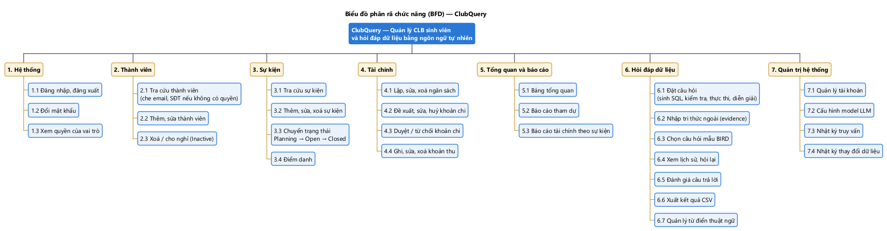

### 4.2. Biểu đồ use case tổng quát

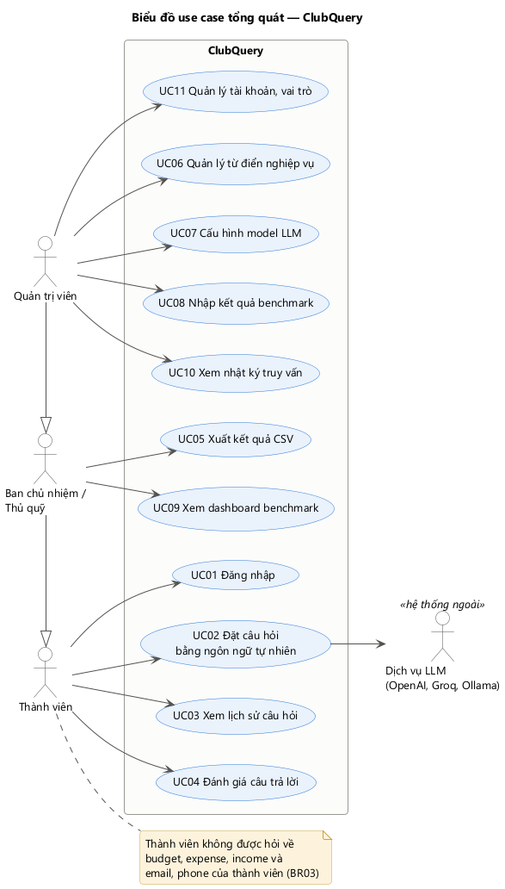

Bốn tác nhân nghiệp vụ đều tổng quát hoá thành *Người dùng*, nên đều thực hiện được UC01–UC05, UC14, UC15. Các use case khác gắn với quyền cụ thể trong ma trận. Dữ liệu một use case hiển thị cũng tuỳ quyền: tổng quan chỉ có khối tài chính khi vai trò có `finance.read`; danh sách thành viên chỉ hiện email, số điện thoại với Chủ nhiệm.

### 4.3. Phân rã UC02 — Hỏi đáp

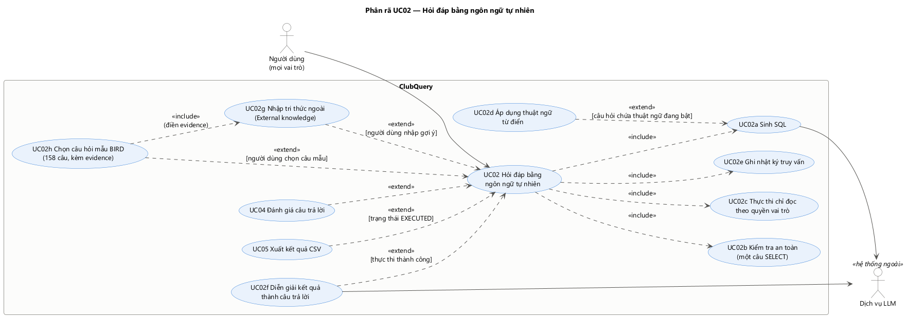

- *include*: mọi câu hỏi đều qua **sinh SQL**, **kiểm tra an toàn**, **thực thi chỉ đọc theo quyền** và **ghi nhật ký**.
- *extend*:
  - **Nhập tri thức ngoài** (UC02g) — người dùng tự gõ gợi ý vào ô *External knowledge (optional)*;
  - **Chọn câu hỏi mẫu BIRD** (UC02h) — chọn một trong 158 câu dev của `student_club`, hệ thống điền cả câu hỏi lẫn evidence của câu đó;
  - **Áp dụng thuật ngữ từ điển** (UC02d) khi câu hỏi chứa thuật ngữ đang bật;
  - **Diễn giải kết quả** khi thực thi thành công; **đánh giá** (UC04) và **xuất CSV** (UC05) do người dùng chọn sau khi có kết quả.

Tri thức ngoài chính là *evidence* của BIRD: trong bài báo, mỗi câu hỏi đi kèm một đoạn tri thức do người gán nhãn viết, và nó được đưa vào prompt ở dòng `-- External Knowledge:`. Ứng dụng giữ đúng cơ chế đó, với hai nguồn tri thức: do người hỏi cung cấp (tự gõ hoặc từ câu mẫu, giữ **nguyên văn**) và do CLB duy trì (từ điển, đã chuẩn hoá hàm giả).

### 4.4. Đặc tả use case

#### UC02 — Hỏi đáp bằng ngôn ngữ tự nhiên

| Mục | Nội dung |
|---|---|
| Tác nhân chính | Người dùng (mọi vai trò) |
| Tác nhân phụ | Dịch vụ LLM |
| Mô tả | Người dùng hỏi bằng tiếng Anh (có thể kèm tri thức ngoài, hoặc chọn câu hỏi mẫu BIRD); hệ thống ghép tri thức ngoài và thuật ngữ từ điển thành dòng External Knowledge, sinh SQL, kiểm tra, thực thi chỉ đọc theo quyền và trả lời bằng một câu tiếng Anh dễ hiểu kèm bảng dữ liệu |
| Tiền điều kiện | Đã đăng nhập; có ít nhất một model đang bật |
| Hậu điều kiện | Một bản ghi `query_log` với trạng thái kết thúc được tạo (BR04) |
| Quy tắc áp dụng | BR01, BR02, BR03, BR04 |

**Luồng chính:**
1. Người dùng mở màn **Ask AI**, chọn model (mặc định là model đánh dấu mặc định), nhập câu hỏi (3–500 ký tự); tuỳ chọn gõ gợi ý vào ô **External knowledge (optional)** (≤ 2000 ký tự) (UC02g); bấm **Ask**.
2. Hệ thống tìm các thuật ngữ **đang bật** xuất hiện trong câu hỏi (không phân biệt hoa thường) (UC02d).
3. Hệ thống dựng tri thức: tri thức ngoài người dùng nhập **giữ nguyên văn** (như evidence trong benchmark BIRD), nối `; ` với định nghĩa thuật ngữ dạng `<term> refers to <definition>` (phần này được chuẩn hoá hàm giả `DIVIDE`, `YEAR`… sang SQLite hợp lệ). Kết quả là dòng `-- External Knowledge: …` của prompt.
4. Hệ thống dựng prompt theo khuôn BIRD: các câu `CREATE TABLE` **chỉ gồm bảng/cột vai trò được xem**, rồi tri thức, rồi câu hỏi.
5. Hệ thống gửi prompt tới Dịch vụ LLM (`temperature = 0`) và tách SQL khỏi văn bản trả về (UC02a).
6. Hệ thống kiểm tra SQL là đúng một câu `SELECT`/`WITH` (UC02b, BR01).
7. Hệ thống thực thi trên `club.sqlite` mở ở chế độ chỉ đọc, kèm authorizer theo vai trò và hạn chót 10 giây (UC02c, BR02, BR03).
8. Hệ thống gửi câu hỏi và tối đa 30 dòng đầu kết quả cho Dịch vụ LLM để diễn giải thành 1–3 câu trả lời **tiếng Anh** (UC02f).
9. Hệ thống ghi `query_log` (câu hỏi, model, câu mẫu, tri thức ngoài, thuật ngữ đã dùng, SQL, câu trả lời, trạng thái, độ trễ, số dòng) (UC02e).
10. Hệ thống hiển thị thẻ kết quả: dòng *Knowledge added to the prompt* (nhãn `external knowledge` và các thuật ngữ), câu trả lời, biểu đồ (nếu kết quả có dạng nhãn–số), *Data table*, mục thu gọn *External knowledge sent to the model* và SQL (thu gọn).

**Luồng thay thế:**
- **A1 — Không có tri thức** (bước 2–3): ô tri thức ngoài trống và không thuật ngữ nào khớp → prompt **không có** dòng External Knowledge, đúng như prompt "không evidence" của BIRD.
- **A5 — Chọn câu hỏi mẫu BIRD** (UC02h, thay bước 1): người dùng bấm **BIRD sample questions (158)**, tìm theo nội dung câu hỏi/evidence, lọc theo độ khó (*All / Simple / Moderate / Challenging*), chọn một câu. Hệ thống điền câu hỏi và evidence của câu đó vào ô tri thức ngoài, hiện nhãn *BIRD sample #id · difficulty* (bấm *Clear* để bỏ); kèm nhãn *evidence attached*, hoặc *no evidence in BIRD* với 12 câu mà BIRD để trống evidence — khi đó ô tri thức ngoài để trống và prompt không có dòng `-- External Knowledge:`. Người dùng có thể sửa tự do trước khi hỏi; mã câu mẫu được ghi vào `query_log.sample_id`. 146/158 câu có evidence.
- **A6 — Hỏi lại**: nút **Ask again** trên thẻ kết quả, hoặc hỏi lại từ **Question history**, gửi lại cả tri thức ngoài đã dùng.
- **A2 — Kết quả quá 1000 dòng** (bước 10): chỉ trả 1000 dòng đầu, có cờ `truncated`.
- **A3 — Diễn giải không dùng được model** (bước 8): model lỗi hoặc trả rỗng → câu trả lời dựng theo mẫu từ kết quả, ví dụ "Result: 9.", "2 results: Law, Business.", "No matching data was found.".
- **A4 — Đánh giá, xuất CSV**: sau bước 10 người dùng có thể bấm **Correct** / **Wrong** (UC04) hoặc **CSV** (UC05).

**Luồng ngoại lệ:**

| Mã | Điều kiện | Xử lý | Trạng thái log |
|---|---|---|---|
| E0 | Model không tồn tại hoặc đang tắt; câu hỏi rỗng/quá ngắn; tri thức ngoài quá 2000 ký tự | Báo lỗi 422 (vd. "The model does not exist or is disabled"), **không** tạo log | — |
| E1 | Gọi model lỗi (Ollama chưa chạy/model chưa pull, mạng, thiếu khoá Groq) | Báo không sinh được SQL, kèm lý do | `FAILED_GENERATION` |
| E2 | Model trả văn bản không phải SQL | Báo không sinh được truy vấn | `FAILED_GENERATION` |
| E3 | SQL có nhiều câu lệnh, hoặc là lệnh ghi/DDL | Từ chối, không thực thi | `REJECTED_UNSAFE` |
| E4 | SQL đọc bảng/cột vai trò không được xem | Từ chối, nêu dữ liệu bị cấm | `REJECTED_PERMISSION` |
| E5 | Quá 10 giây | Ngắt truy vấn | `TIMEOUT` |
| E6 | Lỗi cú pháp, sai tên cột | Hiện thông báo lỗi của SQLite | `EXEC_ERROR` |

#### UC11 — Đề xuất khoản chi

| Mục | Nội dung |
|---|---|
| Tác nhân | Thủ quỹ |
| Mô tả | Lập đề xuất chi gắn với một ngân sách (sự kiện + hạng mục); đề xuất chờ Chủ nhiệm duyệt |
| Tiền điều kiện | Đã có ngân sách; sự kiện chưa `Closed` |
| Hậu điều kiện | Khoản chi mới ở trạng thái chờ duyệt (`approved = 'pending'`), lưu người đề xuất, ghi nhật ký thay đổi — trong cùng một giao dịch |
| Quy tắc | BR05, BR07 (cảnh báo), BR10, BR13 |

- **Luồng chính:** (1) Mở **Finance** → tab **Expenses**, bấm **Propose expense** → (2) chọn ngân sách, nhập mô tả, ngày, số tiền, người chi → (3) hệ thống kiểm tra ngân sách, trạng thái sự kiện, người chi → (4) lưu khoản chi chờ duyệt, ghi người đề xuất và nhật ký → (5) khoản chi hiện với nhãn "Chờ duyệt".
- **Luồng thay thế:** số tiền vượt ngân sách còn lại → vẫn lưu nhưng kèm cảnh báo Chủ nhiệm sẽ không duyệt được (BR07); khi còn chờ duyệt, chỉ người đã đề xuất được sửa hoặc huỷ (BR13).
- **Ngoại lệ:** thiếu quyền, hoặc sửa/huỷ đề xuất của người khác → 403; ngân sách/thành viên không tồn tại → 422; sự kiện đã đóng → 409; sửa/huỷ khoản đã xử lý → 409.

#### UC12 — Duyệt khoản chi

| Mục | Nội dung |
|---|---|
| Tác nhân | Chủ nhiệm |
| Mô tả | Duyệt hoặc từ chối khoản chi đang chờ duyệt |
| Tiền điều kiện | Có khoản chi ở trạng thái chờ duyệt |
| Hậu điều kiện | Duyệt: khoản chi "đã duyệt", ngân sách được tính lại. Từ chối: khoản chi "bị từ chối", lưu lý do. Cả hai: lưu người duyệt, thời điểm, ghi nhật ký — trong **một giao dịch** trên hai CSDL |
| Quy tắc | BR05, BR06, BR07, BR08, BR10 |

- **Luồng chính:** (1) Mở **Finance** → tab **Expenses**; khoản chờ duyệt xếp đầu, kèm ngân sách còn lại → (2) bấm **Approve** → (3) hệ thống kiểm tra khoản chi đang chờ, người duyệt khác người đề xuất (BR08), số tiền không vượt ngân sách còn lại (BR07) → (4) đánh dấu đã duyệt, tính lại `spent` và `remaining` (BR06), ghi nhật ký, commit → (5) ngân sách còn lại giảm tương ứng.
- **Luồng thay thế:** bấm **Reject**, nhập lý do (*Reason for rejection*) → khoản chi bị từ chối, ngân sách không đổi.
- **Ngoại lệ:** thiếu quyền (vd. Thủ quỹ) → 403; khoản đã xử lý, tự duyệt, vượt ngân sách → 409; từ chối không lý do → 422; lỗi giữa chừng → mọi thay đổi trên cả hai CSDL bị huỷ.

#### UC09 — Điểm danh

| Mục | Nội dung |
|---|---|
| Tác nhân | Chủ nhiệm, Ban sự kiện |
| Tiền điều kiện | Sự kiện đang `Open` (BR12) |
| Hậu điều kiện | Danh sách điểm danh của sự kiện được thay bằng danh sách mới; nhật ký ghi số người, số thêm, số bớt |

- **Luồng chính:** (1) Trong **Events & attendance**, mở một sự kiện đang `Open` → (2) hệ thống hiển thị thành viên, đánh dấu sẵn người đã điểm danh → (3) đánh dấu/bỏ đánh dấu, bấm **Save attendance** → (4) hệ thống kiểm tra trạng thái sự kiện và từng thành viên → (5) ghi danh sách mới và nhật ký trong một giao dịch, báo số người tham dự.
- **Ngoại lệ:** sự kiện `Planning`/`Closed` → 409; thành viên không tồn tại → 422; thiếu quyền → 403.

#### UC07 — Quản lý thành viên

| Mục | Nội dung |
|---|---|
| Tác nhân | Xem: mọi vai trò. Thêm, sửa, xoá: Chủ nhiệm |
| Hậu điều kiện | Bảng `member` được cập nhật; nhật ký ghi giá trị trước/sau |
| Quy tắc | BR05, BR09, BR10; che email, số điện thoại khi thiếu `pii.read` |

- **Luồng chính (thêm):** (1) trong **Members**, bấm **Add member** → (2) nhập họ, tên, email, số điện thoại, chức vụ, size áo, mã bưu chính, ngành → (3) hệ thống kiểm tra danh mục, định dạng email, mã bưu chính và ngành tồn tại → (4) sinh mã theo dạng của dữ liệu gốc, lưu, ghi nhật ký.
- **Luồng thay thế:** tra cứu danh sách và chi tiết (số sự kiện đã tham dự); sửa; xoá thành viên chưa có dữ liệu liên quan.
- **Ngoại lệ:** dữ liệu không hợp lệ → 422; xoá thành viên đã có điểm danh/thu chi → 409, gợi ý chuyển `Inactive` (BR09); thiếu quyền → 403.

#### UC06 — Quản lý từ điển thuật ngữ

| Mục | Nội dung |
|---|---|
| Tác nhân | Xem: mọi vai trò. Ghi: Chủ nhiệm, Quản trị |
| Mô tả | Duy trì thuật ngữ nghiệp vụ và định nghĩa SQL; thuật ngữ đang bật được ghép vào prompt như evidence |
| Hậu điều kiện | `glossary_term` được cập nhật (người, thời điểm sửa); nhật ký ghi thay đổi; câu hỏi sau dùng từ điển mới |
| Quy tắc | BR05, BR10; thuật ngữ không trùng, không phân biệt hoa thường (kể cả chữ có dấu) |

- **Luồng chính:** (1) Mở màn **Glossary** → (2) bấm **Add term**, nhập thuật ngữ và định nghĩa → (3) hệ thống kiểm tra quyền và tính duy nhất → (4) lưu, ghi nhật ký, làm mới danh sách.
- **Luồng thay thế:** sửa; tắt thuật ngữ (giữ lại nhưng không ghép vào prompt); xoá.
- **Ngoại lệ:** thuật ngữ đã tồn tại → 409; thiếu quyền → 403.

#### UC18 — Quản lý tài khoản

| Mục | Nội dung |
|---|---|
| Tác nhân | Quản trị hệ thống |
| Mô tả | Thêm tài khoản, đổi họ tên, vai trò, khoá/mở, đặt lại mật khẩu |
| Quy tắc | Tên đăng nhập duy nhất; vai trò thuộc 4 vai trò; mật khẩu tối thiểu 6 ký tự, lưu dạng băm; quản trị không tự hạ quyền hoặc tự khoá mình |

- **Luồng chính:** (1) Trong **Administration → Accounts**, nhập tên đăng nhập, họ tên, vai trò, mật khẩu → (2) lưu → (3) hệ thống kiểm tra, băm mật khẩu, lưu.
- **Luồng thay thế:** sửa tài khoản có sẵn. Tài khoản bị khoá không đăng nhập được, phiên đang mở bị từ chối ngay ở yêu cầu kế tiếp; đổi vai trò có hiệu lực ngay.
- **Ngoại lệ:** trùng tên đăng nhập → 409; vai trò không hợp lệ, mật khẩu ngắn, tự hạ quyền → 422.

Các use case còn lại (UC01, UC03–UC05, UC08, UC10, UC13–UC17, UC19) có luồng đơn giản, tóm tắt trong tài liệu `02_use_case.md`.

---

## 5. Phân tích hệ thống

### 5.1. Biểu đồ hoạt động

**UC02 — Hỏi đáp.** Tri thức ngoài (nguyên văn) và thuật ngữ từ điển (đã chuẩn hoá) được nối thành dòng `-- External Knowledge`; cả hai rỗng thì prompt không có dòng này, đúng như prompt "không evidence" của BIRD. Mọi nhánh, kể cả nhánh bị từ chối, đều hội tụ về bước ghi nhật ký (BR04).


**UC11 → UC12 — Đề xuất và duyệt khoản chi.** Ba làn: Thủ quỹ đề xuất, Hệ thống kiểm tra và ghi, Chủ nhiệm quyết định.

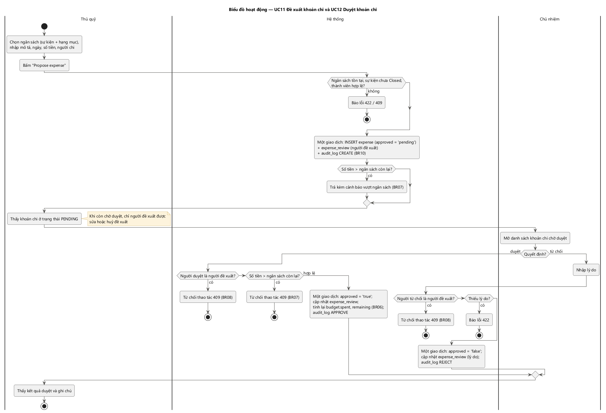

### 5.2. Biểu đồ tuần tự

**Hỏi đáp (UC02).** Đoạn `opt` đầu biểu đồ là việc chọn câu hỏi mẫu BIRD; tri thức ngoài và `sample_id` đi cùng câu hỏi tới `service.ask()`. Phân quyền được kiểm hai lần: schema trong prompt đã được lọc, và bộ kiểm tra quyền ở tầng engine SQLite chặn tiếp.

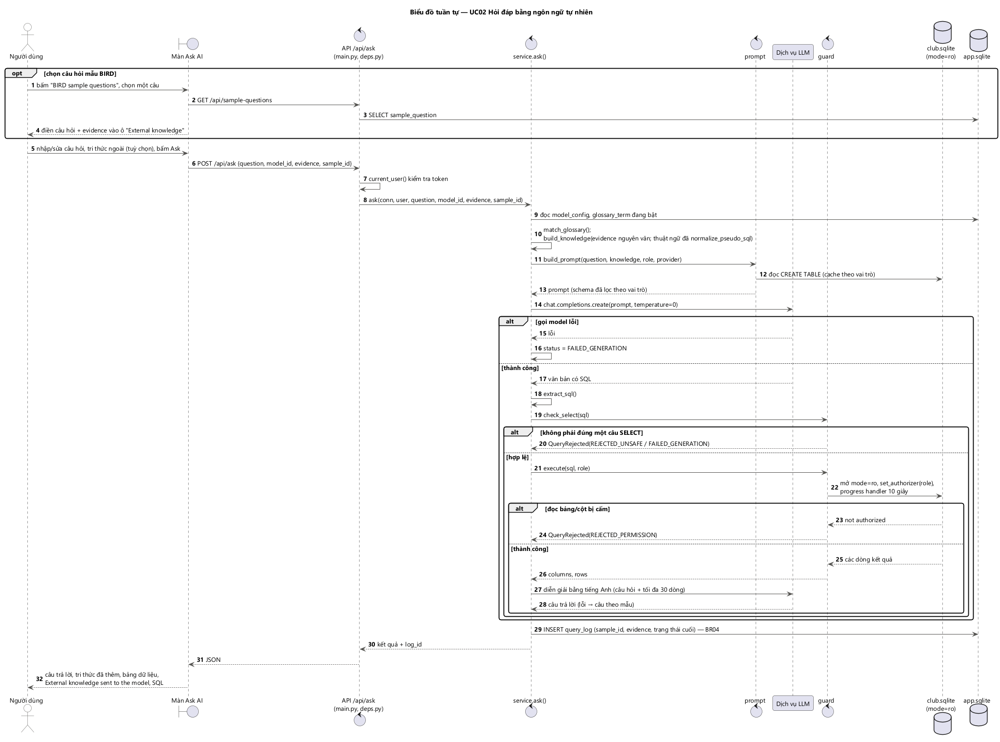

**Duyệt khoản chi (UC12).** Cập nhật khoản chi và ngân sách (ở `club.sqlite`), ghi người duyệt và nhật ký (ở `app.sqlite`) nằm trong một giao dịch.

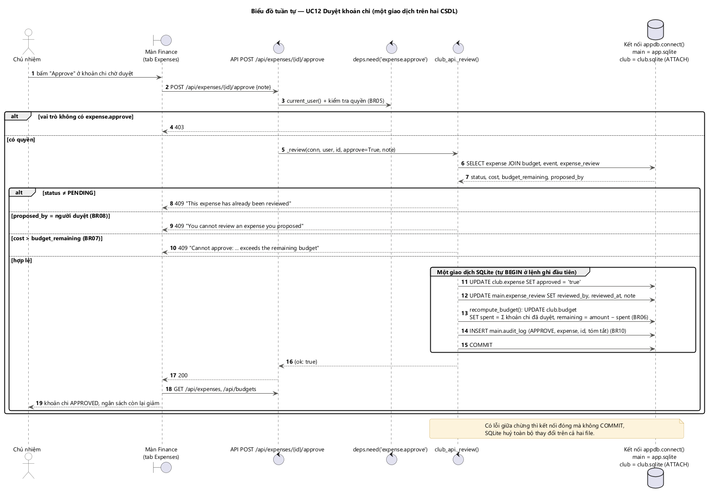

**Quản lý từ điển (UC06)**

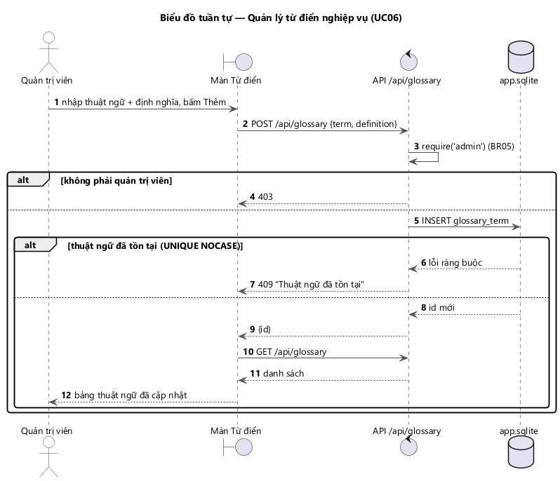

### 5.3. Biểu đồ lớp phân tích

Các lớp được chia theo mẫu boundary – control – entity. Lớp `MaTranQuyen` được cả `XacThucControl` (API quản lý) lẫn `PromptBuilder`, `QueryGuard` (hỏi đáp) dùng; `AuditLogger` được mọi control ghi dữ liệu gọi.

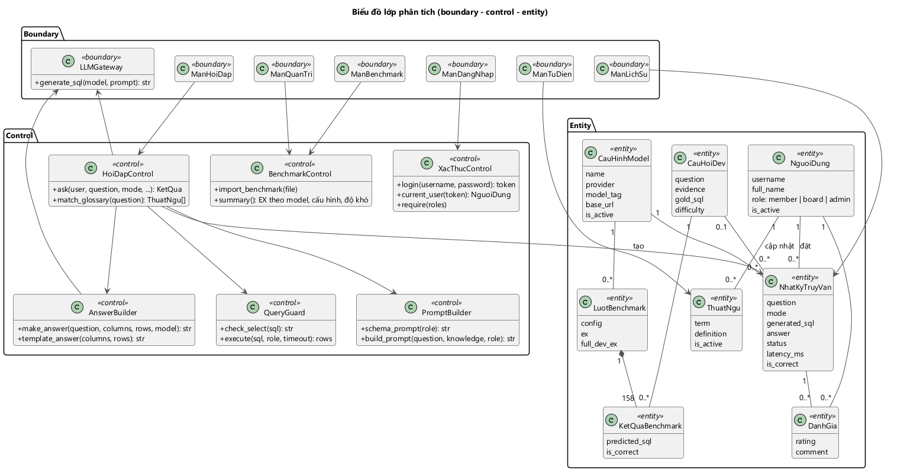

### 5.4. Biểu đồ trạng thái

**Một truy vấn.** `Received`, `Generated`, `Validated` là các trạng thái trung gian trong bộ nhớ. Cột `query_log.status` lưu một trong sáu trạng thái kết thúc: `EXECUTED`, `FAILED_GENERATION`, `REJECTED_UNSAFE`, `REJECTED_PERMISSION`, `TIMEOUT`, `EXEC_ERROR`.

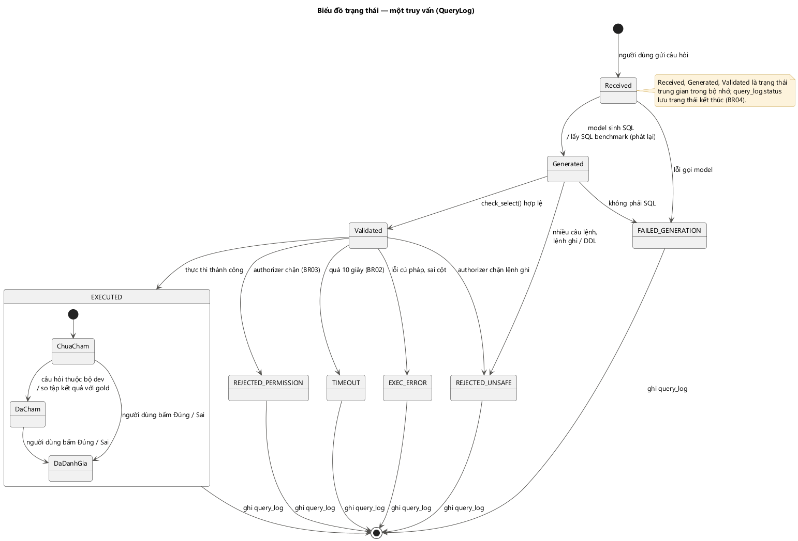

**Khoản chi.** Trạng thái suy ra từ cột `expense.approved`: `'pending'` → chờ duyệt, `'true'` (hoặc NULL ở dữ liệu cũ) → đã duyệt, `'false'` → bị từ chối.

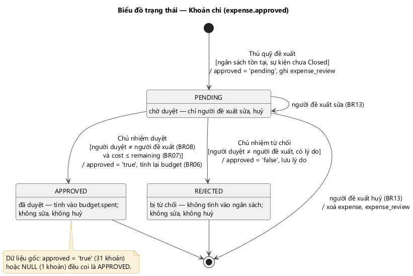

**Sự kiện.** Vòng đời một chiều (BR11); trạng thái quyết định có được điểm danh (BR12) và đề xuất chi hay không.

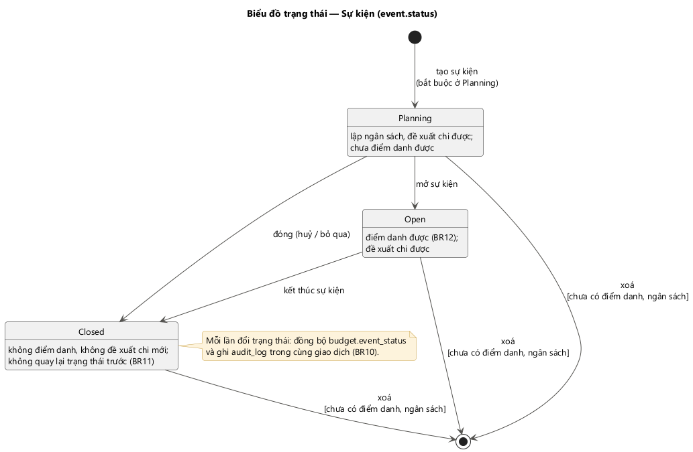

---

## 6. Thiết kế hệ thống

### 6.1. Kiến trúc


- **Phân tầng:** giao diện (HTML/JS) → API (FastAPI: `main.py`, `club_api.py`; xác thực, phân quyền trong `deps.py`) → nghiệp vụ (`service.py` cho hỏi đáp, các hàm trong `club_api.py` cho quản lý) → dịch vụ (`prompt`, `guard`, `llm`, `answer`) → dữ liệu (`appdb.py`).
- **Một ma trận quyền cho hai đường truy cập dữ liệu:** API quản lý kiểm tra `need(quyền)`; hỏi đáp gọi `restrictions(role)` để lọc schema và cấu hình authorizer. Sửa ma trận ở một chỗ thì cả hai cùng đổi.
- **Tái sử dụng mã nghiên cứu:** `ollama_request.extract_sql()` tách SQL khỏi khối mã `sql` trong câu trả lời của model; `normalize_pseudo_sql()` chuẩn hoá evidence (mục 2.6). Prompt giữ khuôn của BIRD (schema, `-- External Knowledge`, câu hỏi) và kết thúc bằng câu yêu cầu tường minh "chỉ trả về SQL trong khối mã" — đúng phát hiện ở mục 2.6 rằng kỹ thuật mồi `SELECT ` không hợp với model chat. Một câu kết thúc này dùng chung cho mọi nhà cung cấp.
- **Một giao diện cho mọi nhà cung cấp:** Ollama (chạy nội bộ, mặc định), Groq và OpenRouter đều có API chuẩn Chat Completions, gọi qua cùng một thư viện client (gói Python `openai`, chỉ dùng làm client). Thêm model chỉ cần thêm một dòng cấu hình. Ứng dụng không dùng dịch vụ OpenAI, nên với model mặc định, dữ liệu CLB không rời máy chủ.
- **Câu trả lời trước, SQL sau:** `answer.py` biến bảng kết quả thành một câu trả lời; bảng dữ liệu và SQL (thu gọn) vẫn được hiển thị để ai cần thì kiểm tra lại.

### 6.2. Thiết kế dữ liệu

Hệ thống dùng ba file SQLite với vai trò tách biệt:

| CSDL | Nội dung | Cách mở |
|---|---|---|
| `student_club.sqlite` (BIRD) | Dữ liệu gốc | Chỉ để chép một lần sang `club.sqlite`, không bao giờ bị sửa |
| `club.sqlite` | Dữ liệu nghiệp vụ CLB, giữ nguyên lược đồ 8 bảng của BIRD | Quản lý: đọc ghi qua kết nối chung (ATTACH as `club`). Hỏi đáp: kết nối riêng chỉ đọc (`mode=ro`) + authorizer |
| `app.sqlite` | Dữ liệu ứng dụng: 8 bảng | Kết nối chính (`main`) |

Lý do thiết kế:
- SQL do model sinh chạy trên một kết nối **chỉ đọc chỉ thấy `club.sqlite`**, nên không bao giờ chạm được vào tài khoản, nhật ký hay quy trình duyệt.
- Giữ nguyên lược đồ BIRD cho dữ liệu nghiệp vụ, nên prompt vẫn đúng khuôn BIRD và kết quả nghiên cứu áp dụng trực tiếp được. Thông tin chỉ ứng dụng cần (ai đề xuất, ai duyệt, lý do) để ở bảng `expense_review` bên `app.sqlite`.
- `appdb.connect()` **ATTACH** `club.sqlite` vào kết nối của `app.sqlite`, nên một thao tác nghiệp vụ chạm cả hai file vẫn là **một giao dịch** (SQLite đảm bảo commit nguyên tử trên các CSDL đã ATTACH).


Phần `club.sqlite` được **đảo ngược** từ các khoá ngoại thật trong file SQLite. Hệ thống dùng thêm giá trị `'pending'`, `'false'` cho cột `expense.approved` (dữ liệu gốc chỉ có `'true'` và một giá trị NULL) và giữ `budget.event_status` đồng bộ với `event.status`.

**Từ điển dữ liệu của `app.sqlite`:**

| Bảng | Cột chính | Ràng buộc |
|---|---|---|
| `user_account` | `username`, `full_name`, `password_hash`, `role`, `is_active` | `username` duy nhất; `role` ∈ {president, treasurer, event, admin}; mật khẩu băm PBKDF2-SHA256 có salt |
| `model_config` | `name`, `provider`, `model_tag`, `base_url`, `api_key_env`, `is_active`, `is_default` | `name` duy nhất; `provider` ∈ {groq, openrouter, ollama}. Chỉ lưu **tên biến môi trường** chứa khoá API, không lưu khoá |
| `glossary_term` | `term`, `definition`, `is_active`, `updated_by`, `updated_at` | `term` duy nhất, không phân biệt hoa thường |
| `sample_question` | `id` (= `question_id` trong `dev.json`), `question`, `evidence`, `difficulty` | 158 câu dev BIRD của `student_club`, nạp khi khởi tạo; `difficulty` ∈ {simple, moderate, challenging} |
| `query_log` | `user_id`, `question`, `model_id`, `sample_id`, `evidence`, `glossary_used`, `generated_sql`, `answer`, `status`, `error`, `latency_ms`, `row_count`, `created_at` | `status` là trạng thái kết thúc |
| `feedback` | `query_log_id`, `user_id`, `rating`, `comment`, `created_at` | Mỗi người đánh giá một câu một lần (ghi đè khi đánh giá lại); `rating` ∈ {-1, 1} |
| `expense_review` | `expense_id`, `proposed_by`, `proposed_at`, `reviewed_by`, `reviewed_at`, `note` | `expense_id` = mã khoản chi bên `club.sqlite` (liên kết logic, khác CSDL) |
| `audit_log` | `user_id`, `action`, `entity`, `entity_id`, `summary`, `detail`, `created_at` | `action` ∈ {CREATE, UPDATE, DELETE, APPROVE, REJECT}; `detail` là JSON giá trị trước/sau |

### 6.3. Thiết kế an toàn truy vấn

SQL do LLM sinh là **dữ liệu không tin cậy**. Hệ thống áp dụng phòng thủ nhiều lớp:

| Lớp | Cơ chế | Chặn được |
|---|---|---|
| 1 | Prompt chỉ chứa schema mà vai trò được xem | Model không biết bảng bị cấm nên ít khi sinh truy vấn vào đó |
| 2 | `check_select()`: tách câu lệnh bằng `sqlparse`, chỉ nhận đúng một `SELECT`/`WITH` | Nhiều câu lệnh, `DELETE`, `DROP`, `PRAGMA`, `ATTACH`… |
| 3 | Kết nối riêng tới `club.sqlite` với `mode=ro` | Mọi thao tác ghi |
| 4 | `sqlite3.set_authorizer` theo vai trò | Đọc bảng/cột bị cấm, kể cả `COUNT(*)` và `SELECT *`; lệnh ghi giấu trong CTE |
| 5 | `set_progress_handler` với hạn chót 10 giây | Truy vấn chạy quá lâu |

Bước diễn giải chỉ nhận các dòng **đã qua kiểm tra quyền**, nên model không thể "kể" cho một vai trò những dữ liệu mà vai trò đó không được xem.

Tri thức ngoài do người dùng nhập chỉ đi vào prompt, không đi vào SQL; SQL sinh ra vẫn phải qua lớp 2–5, nên tri thức ngoài không mở rộng được quyền đọc dữ liệu.

Lớp 4 là điểm then chốt. Nếu chỉ ẩn bảng khỏi prompt, model vẫn có thể đoán tên bảng `expense`. Authorizer chặn ở tầng engine SQLite, nên mọi đường đọc dữ liệu đều bị kiểm tra, bất kể câu SQL viết thế nào.

### 6.4. Thiết kế API

| Phương thức | Đường dẫn | Use case | Quyền |
|---|---|---|---|
| POST, GET | `/api/login`, `/api/logout`, `/api/me`, `/api/me/password`, `/api/roles` | UC01 | — / đã đăng nhập |
| POST | `/api/ask` (`question`, `model_id?`, `evidence?` ≤ 2000 ký tự, `sample_id?`) | UC02 | Đã đăng nhập |
| GET | `/api/sample-questions` | UC02 | Đã đăng nhập |
| GET | `/api/models` | UC02, UC17 | Đã đăng nhập |
| GET | `/api/history` | UC03 | Đã đăng nhập |
| POST | `/api/feedback` | UC04 | Người đặt câu hỏi |
| GET | `/api/export/{log_id}` | UC05 | Người đặt câu hỏi |
| GET; POST, PUT, DELETE | `/api/glossary[/{id}]` | UC06 | Đọc: đã đăng nhập; ghi: `glossary.write` |
| GET; POST, PUT, DELETE | `/api/members[/{id}]` | UC07 | Đọc: đã đăng nhập; ghi: `member.write` |
| GET; POST, PUT, DELETE | `/api/events[/{id}]` | UC08 | Đọc: đã đăng nhập; ghi: `event.write` |
| PUT | `/api/events/{id}/attendance` | UC09 | `attendance.write` |
| GET; POST, PUT, DELETE | `/api/budgets[/{id}]` | UC10 | Đọc: `finance.read`; ghi: `finance.write` |
| GET; POST, PUT, DELETE | `/api/expenses[/{id}]` | UC11 | Đọc: `finance.read`; ghi: `finance.write` |
| POST | `/api/expenses/{id}/approve`, `/api/expenses/{id}/reject` | UC12 | `expense.approve` |
| GET; POST, PUT, DELETE | `/api/incomes[/{id}]` | UC13 | Đọc: `finance.read`; ghi: `finance.write` |
| GET | `/api/dashboard` | UC14 | Đã đăng nhập (tài chính nếu có `finance.read`) |
| GET | `/api/reports/attendance`, `/api/reports/finance` | UC15 | Đã đăng nhập; báo cáo tài chính cần `finance.read` |
| GET | `/api/audit` | UC16 | `audit.read` |
| PUT | `/api/models/{id}` | UC17 | `system.admin` |
| GET, POST, PUT | `/api/users[/{id}]` | UC18 | `system.admin` |
| GET | `/api/logs` | UC19 | `system.admin` |

Mã lỗi thống nhất: 401 chưa đăng nhập; 403 thiếu quyền; 404 không tìm thấy; 409 vi phạm quy tắc nghiệp vụ; 422 dữ liệu nhập không hợp lệ.

### 6.5. Thiết kế giao diện

Giao diện một trang, **toàn bộ bằng tiếng Anh**: nhãn, thông báo lỗi của API (vd. "You cannot review an expense you proposed"), ngày dạng "07 Apr 2020", câu trả lời theo mẫu ("Result: 9.", "No matching data was found."), tên vai trò President / Treasurer / Event team / System admin. Lý do: câu hỏi, schema và evidence của BIRD đều bằng tiếng Anh; một ngôn ngữ thống nhất giúp model hiểu đúng và người dùng đối chiếu được câu trả lời với SQL. Báo cáo này trích nguyên văn các nhãn tiếng Anh khi cần.

Menu chia ba nhóm: **General** (Dashboard, Ask AI, Question history), **Management** (Members, Events & attendance, Finance, Reports), **System** (Glossary, Change log, Administration). Menu chỉ hiện các mục vai trò có quyền; các nút thêm/sửa/duyệt hiện theo danh sách quyền của người dùng (nút sửa/huỷ khoản chi chỉ hiện với người đề xuất).

| Màn hình | Vai trò thấy |
|---|---|
| Sign in (Đăng nhập) | — |
| Dashboard (Tổng quan) | Tất cả (khối tài chính: Chủ nhiệm, Thủ quỹ, Quản trị) |
| Ask AI (Hỏi đáp), BIRD sample questions, Question history | Tất cả |
| Members (Thành viên) | Tất cả (ghi: Chủ nhiệm) |
| Events & attendance (Sự kiện, điểm danh) | Tất cả (ghi: Chủ nhiệm, Ban sự kiện) |
| Finance: Expenses / Budgets / Income | Chủ nhiệm, Thủ quỹ, Quản trị |
| Reports (Báo cáo) | Tất cả (tài chính theo quyền) |
| Glossary (Từ điển) | Tất cả (ghi: Chủ nhiệm, Quản trị) |
| Change log (Nhật ký thay đổi) | Chủ nhiệm, Quản trị |
| Administration: Accounts / AI models / Query log / Permissions | Quản trị |

**Đăng nhập**

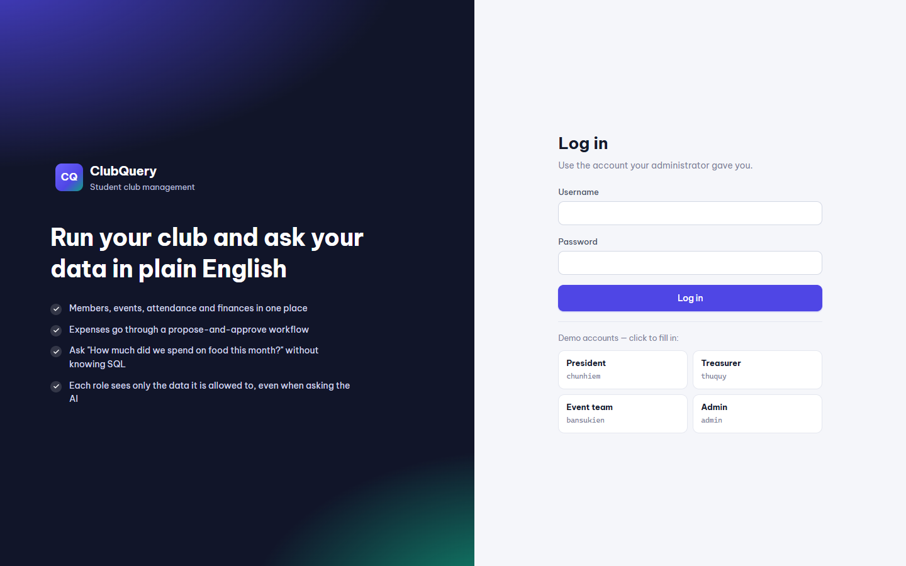

**Dashboard (tài khoản Chủ nhiệm):** thẻ chỉ số (thành viên đang hoạt động, sự kiện sắp tới, tham dự trung bình, ngân sách còn lại, khoản chi chờ duyệt), ô hỏi nhanh, biểu đồ thu chi theo tháng, danh sách sự kiện sắp tới, chi theo hạng mục và nguồn thu. Khối tài chính chỉ hiện với vai trò có `finance.read`.

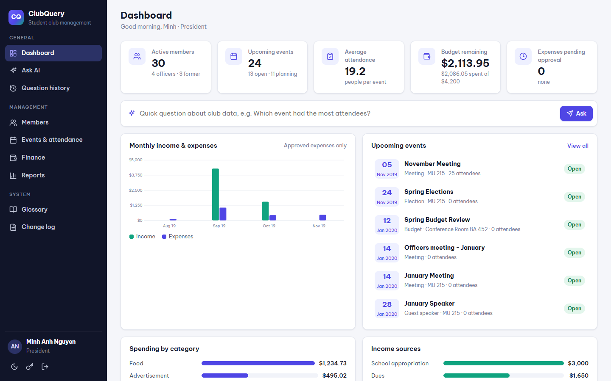

**Ask AI:** ô câu hỏi; ô **External knowledge (optional)** kèm chú thích "Added to the prompt as `-- External Knowledge:`, the same way BIRD passes evidence"; chọn model; nút **BIRD sample questions (158)**; nút **Ask**. Bên dưới là các câu hỏi gợi ý theo nhóm (Members, Events, Finance, Contacts); bên phải là khung *Your data access* (vai trò được đọc gì) và *Recent questions*. Sau khi hỏi, mỗi thẻ kết quả có trạng thái, model, độ trễ, số dòng, nhãn *BIRD sample #id* (nếu dùng câu mẫu), dòng *Knowledge added to the prompt* (nhãn `external knowledge` và các thuật ngữ từ điển), câu trả lời tiếng Anh, biểu đồ cột khi kết quả có dạng nhãn–số, *Data table*, mục thu gọn *External knowledge sent to the model*, SQL, và các nút **Correct / Wrong**, **CSV**, **Ask again**. Ảnh dưới là thẻ kết quả của câu mẫu BIRD #1379 chạy bằng Qwen2.5-Coder (đã cuộn xuống phần kết quả).

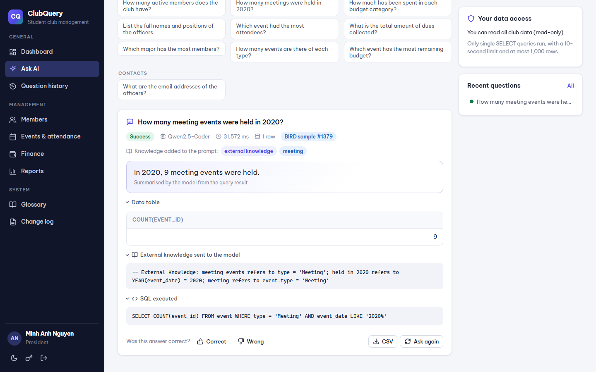

**BIRD sample questions:** hộp chọn 158 câu hỏi dev của BIRD trên `student_club`; tìm theo câu hỏi hoặc evidence, lọc *All / Simple / Moderate / Challenging*; mỗi câu hiện mã (vd. #1312), độ khó và evidence (hoặc nhãn *no evidence*). Chọn một câu thì câu hỏi và evidence được điền vào màn Ask AI, kèm nhãn *BIRD sample #id · difficulty*.

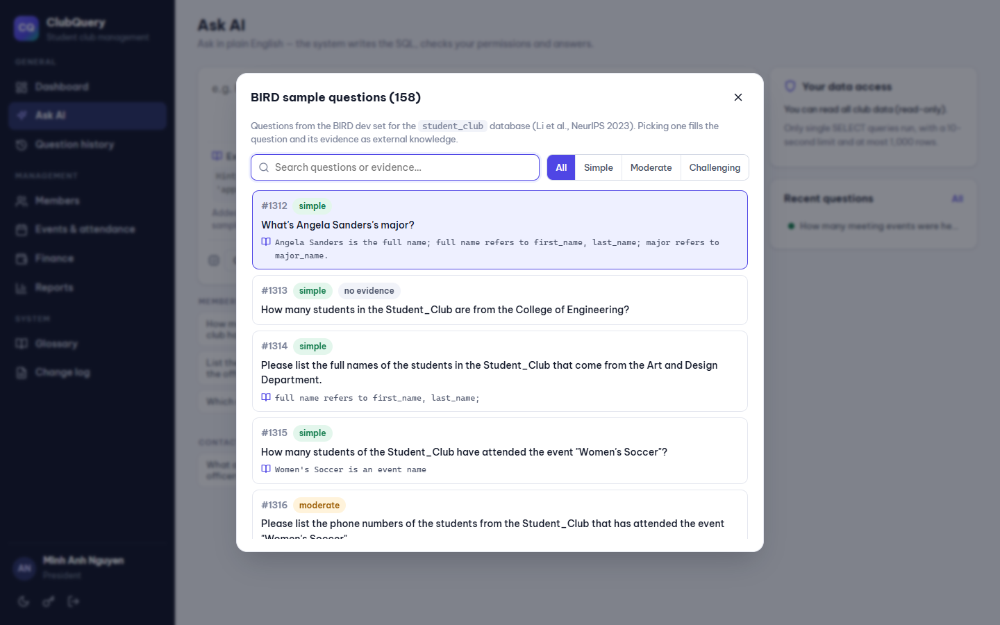

**Members**

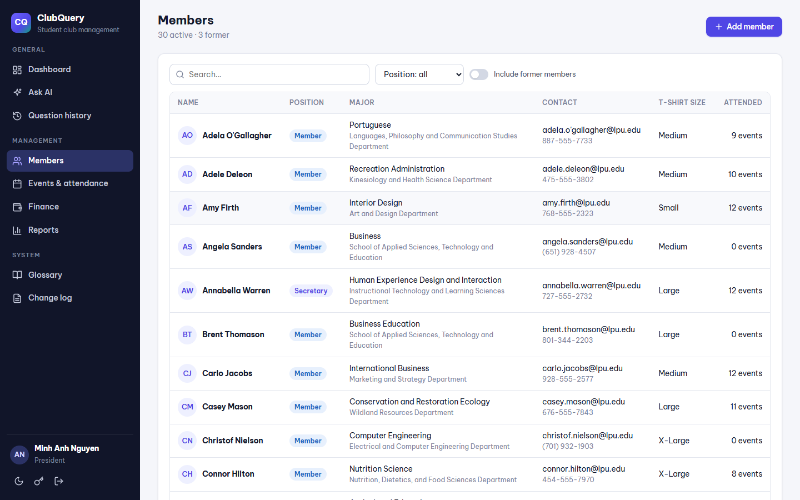

**Events & attendance:** hộp chi tiết của một sự kiện đang mở (*Open*, "07 Apr 2020 12:00"), gồm *Budget* theo hạng mục (Budget / Spent) và *Attendance* với ô chọn từng thành viên, *Search members…*, *Select all*, *Clear*; các nút **Edit**, **Close event**, **Save attendance**. Khi sự kiện còn `Planning`, hộp này nhắc "click **Open event** below, tick the members who came, then **Save attendance**". Trong khung *Budget*, Thủ quỹ có nút **Add budget** (mở form *Create budget* chọn sẵn sự kiện); Chủ nhiệm thấy dòng "Budgets are created by the Treasurer (Finance → Budgets)".

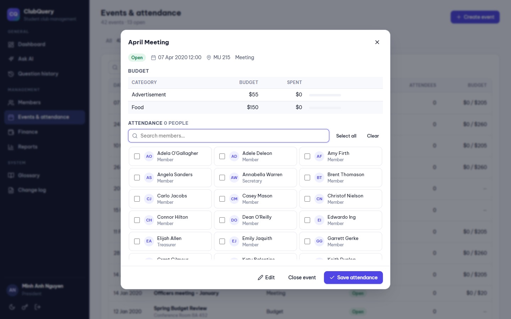

**Finance:** thẻ *Total budget, Spent, Remaining, Total income, Pending approval*; ba tab **Expenses** (Propose expense, Approve, Reject) / **Budgets** (ảnh: theo sự kiện, hạng mục, trạng thái sự kiện, cột *Usage*) / **Income**.

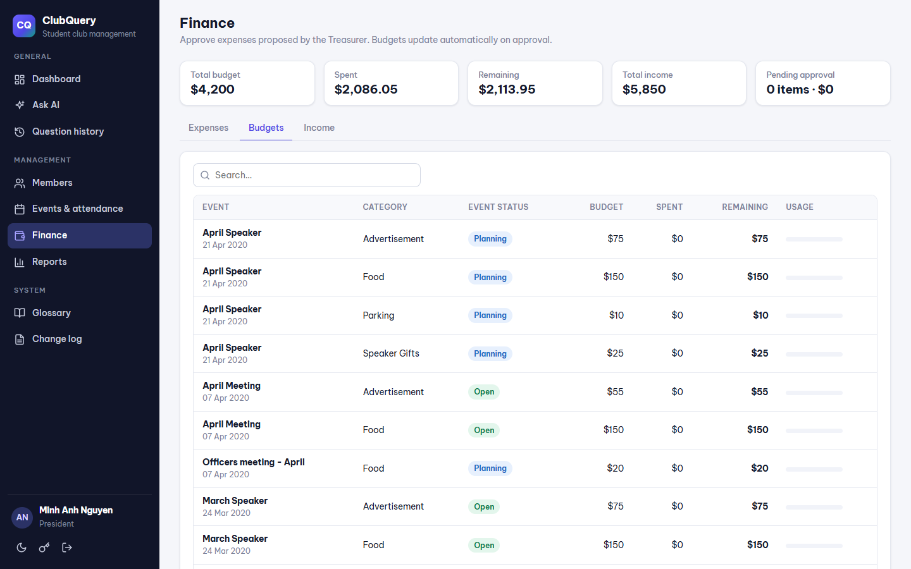

**Reports**

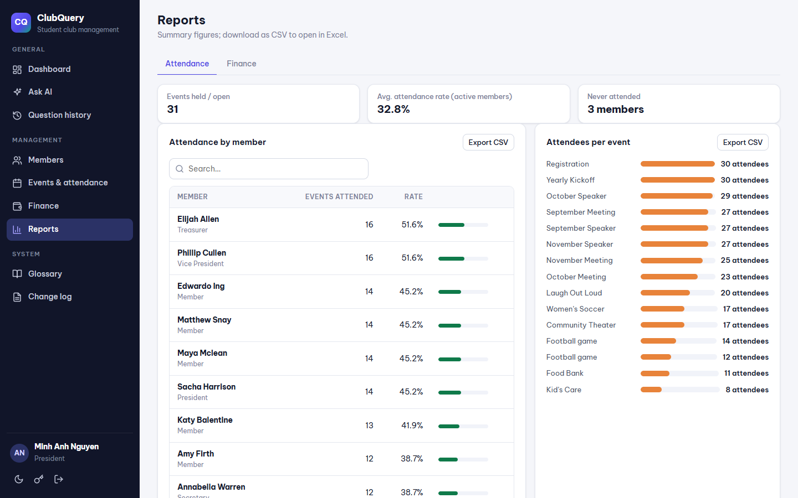

**Glossary:** 11 thuật ngữ mẫu tiếng Anh (active member, meeting, pending expense…) với định nghĩa dạng SQL; khung giải thích liên hệ với bài báo BIRD (evidence tăng EX của GPT-3.5-Turbo từ 31,2% lên 47,8%); nút **Add term**.

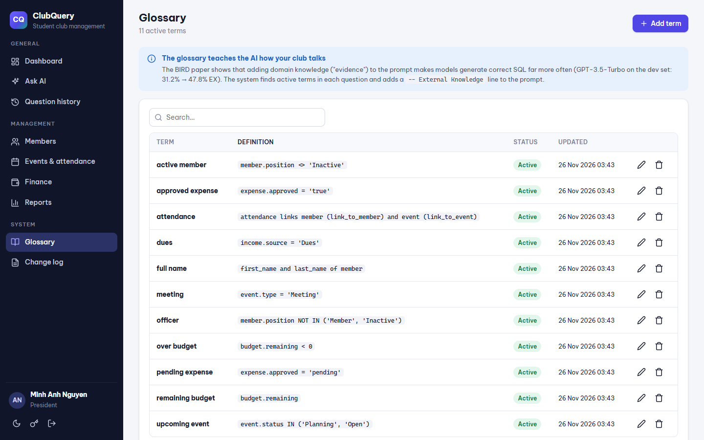

**Administration:** bốn tab **Accounts**, **AI models**, **Query log**, **Permissions**. Ảnh chụp tab Permissions: ma trận quyền × vai trò lấy trực tiếp từ `config.PERMISSIONS`, cũng là ma trận dùng cho hỏi đáp.

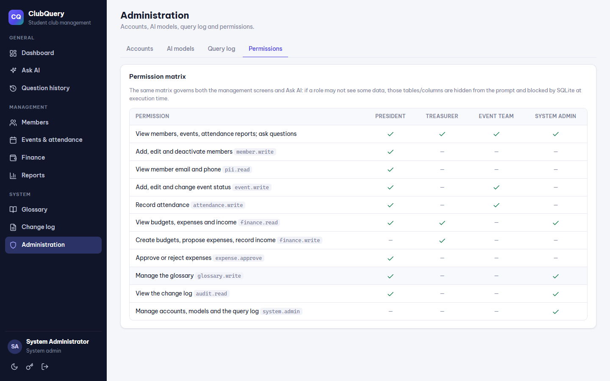

**Trên điện thoại**

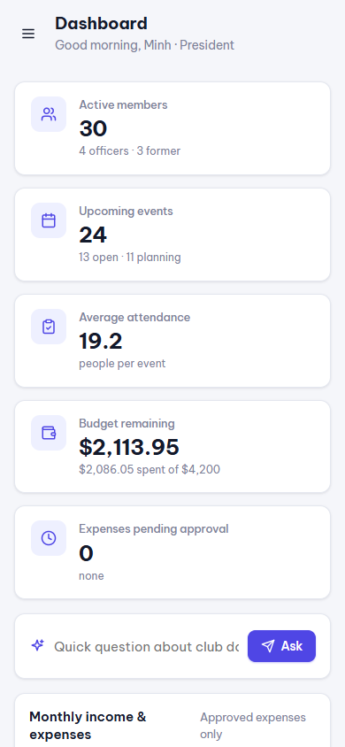

---

## 7. Cài đặt

### 7.1. Công nghệ

| Thành phần | Công nghệ |
|---|---|
| Backend | Python 3, FastAPI, uvicorn, Pydantic |
| CSDL | SQLite: `club.sqlite` (nghiệp vụ), `app.sqlite` (ứng dụng), ATTACH để giao dịch chung |
| Gọi model | Ollama (model mặc định Qwen2.5-Coder 7B, chạy nội bộ) hoặc Groq, qua API chuẩn Chat Completions; gói Python `openai` chỉ dùng làm thư viện client |
| Kiểm tra SQL | `sqlparse`, `sqlite3.set_authorizer`, `set_progress_handler` |
| Frontend | HTML, CSS, JavaScript thuần (không cần build) |
| Kiểm thử | pytest, FastAPI TestClient |
| Diagram | PlantUML |

### 7.2. Cấu trúc mã nguồn

```
app/
  backend/
    config.py     đường dẫn, giới hạn truy vấn, vai trò, ma trận quyền, restrictions() (BR03, BR05)
    deps.py       kết nối CSDL theo yêu cầu, phiên đăng nhập, need(quyền) (BR05)
    appdb.py      lược đồ app.sqlite, chép club.sqlite, ATTACH, dữ liệu khởi tạo, audit() (BR10)
    main.py       đăng nhập, hỏi đáp, lịch sử, đánh giá, xuất CSV, model, tài khoản, nhật ký truy vấn
    club_api.py   thành viên, sự kiện, điểm danh, ngân sách, khoản chi + duyệt, khoản thu,
                  tổng quan, báo cáo, từ điển, nhật ký thay đổi (BR06–BR12)
    service.py    điều phối hỏi đáp, ghép từ điển, ghi nhật ký (BR04)
    prompt.py     dựng prompt theo khuôn BIRD, lọc schema theo vai trò
    guard.py      kiểm tra SELECT, authorizer theo vai trò, timeout (BR01–BR03)
    llm.py        gọi dịch vụ LLM, tách SQL
    answer.py     diễn giải kết quả thành câu trả lời
    trace.py      log từng bước của luồng hỏi đáp (phục vụ trình bày)
  frontend/       giao diện một trang
  data/           club.sqlite, app.sqlite (tự tạo)
  tests/          test_guard.py, test_answer.py, test_api.py
docs/pttk/        tài liệu, diagram (.puml và .png), ảnh màn hình
```

### 7.3. Trích đoạn cài đặt chính

**Ma trận quyền và dữ liệu bị ẩn khi hỏi đáp (BR03, BR05).** Bảng/cột bị cấm được suy ra từ ma trận, không khai báo riêng:

```python
PERMISSIONS = {
    'president': {'member.write', 'pii.read', 'event.write', 'attendance.write', 'finance.read',
                  'expense.approve', 'glossary.write', 'audit.read'},
    'treasurer': {'finance.read', 'finance.write'},
    'event': {'event.write', 'attendance.write'},
    'admin': {'finance.read', 'glossary.write', 'audit.read', 'system.admin'},
}

def restrictions(role):
    return {'tables': set() if can(role, 'finance.read') else {'budget', 'expense', 'income'},
            'columns': set() if can(role, 'pii.read') else {('member', 'email'), ('member', 'phone')}}
```

**Kiểm tra quyền trên mọi API (BR05):**

```python
def need(*perms):
    def dep(user=Depends(current_user)):
        if not any(config.can(user['role'], p) for p in perms):
            raise HTTPException(403, 'Bạn không có quyền thực hiện chức năng này')
        return user
    return dep

@router.post('/expenses/{expense_id}/approve')
def approve_expense(expense_id, body: ReviewIn = ReviewIn(), user=Depends(need('expense.approve')), conn=Depends(db)):
    return _review(conn, user, expense_id, True, body.note)
```

**Duyệt chi trong một giao dịch (BR06, BR07, BR08, BR10).** `club.sqlite` được ATTACH vào kết nối của `app.sqlite`; mọi lệnh ghi ở hai file chạy trước một `commit()` duy nhất:

```python
def _review(conn, user, expense_id, approve, note):
    x = _expense(conn, expense_id)
    if x['status'] != 'PENDING':
        raise HTTPException(409, 'Khoản chi này đã được xử lý')
    if x['proposed_by'] == user['id']:                                   # BR08
        raise HTTPException(409, 'Người đề xuất không được tự duyệt khoản chi của mình')
    if approve and x['cost'] > (x['budget_remaining'] or 0):              # BR07
        raise HTTPException(409, 'Không thể duyệt: khoản chi vượt ngân sách còn lại ...')
    if not approve and not (note or '').strip():
        raise HTTPException(422, 'Hãy nhập lý do từ chối')
    conn.execute('UPDATE expense SET approved = ? WHERE expense_id = ?', ('true' if approve else 'false', expense_id))
    conn.execute('UPDATE expense_review SET reviewed_by = ?, reviewed_at = ?, note = ? WHERE expense_id = ?', ...)
    recompute_budget(conn, x['link_to_budget'])                           # BR06
    audit(conn, user, 'APPROVE' if approve else 'REJECT', 'expense', expense_id, ...)   # BR10
    conn.commit()
```

**Phân quyền ở tầng engine (BR03).** Authorizer được SQLite gọi cho mỗi bảng và cột mà truy vấn đọc. Với `COUNT(*)`, SQLite vẫn gọi `SQLITE_READ` với tên bảng và cột rỗng, nên kiểu truy vấn này cũng bị chặn.

```python
def _authorizer(role, denied):
    r = config.restrictions(role)
    def auth(action, arg1, arg2, _db, _src):
        if action not in ALLOWED_ACTIONS:            # chỉ SELECT, READ, FUNCTION, RECURSIVE
            denied.append(('unsafe', action)); return sqlite3.SQLITE_DENY
        if action == sqlite3.SQLITE_READ:
            if arg1 in r['tables']:                  # bảng bị cấm
                denied.append(('permission', arg1)); return sqlite3.SQLITE_DENY
            if (arg1, arg2) in r['columns']:         # cột bị cấm
                denied.append(('permission', f'{arg1}.{arg2}')); return sqlite3.SQLITE_DENY
        return sqlite3.SQLITE_OK
    return auth
```

**Lọc schema trong prompt theo vai trò** (lớp phòng thủ thứ nhất):

```python
for name, sql in tables:
    if name == 'sqlite_sequence' or name in r['tables']:
        continue                                     # bỏ hẳn bảng bị cấm
    for table, column in r['columns']:
        if table == name:                            # bỏ dòng khai báo cột bị cấm
            sql = re.sub(rf'^\s*{re.escape(column)}\s+\w+,?\s*\n', '', sql, flags=re.MULTILINE)
    parts.append(sql)
```

**Tri thức ngoài và từ điển thuật ngữ trở thành evidence:**

```python
def match_glossary(conn, question):
    q = question.lower()
    terms = conn.execute('SELECT term, definition FROM glossary_term WHERE is_active = 1 ORDER BY term').fetchall()
    return [dict(t) for t in terms if t['term'].lower() in q]

def build_knowledge(evidence, terms):
    # tri thức ngoài (người dùng nhập / evidence của câu mẫu BIRD) giữ nguyên văn như lúc benchmark,
    # rồi tới định nghĩa thuật ngữ từ điển (đã chuẩn hoá hàm giả, Gap 3); rỗng cả hai → không có dòng External Knowledge
    parts = [evidence.strip()] if evidence and evidence.strip() else []
    if terms:
        parts.append(normalize_pseudo_sql('; '.join(f"{t['term']} refers to {t['definition']}" for t in terms)))
    return '; '.join(parts) or None
```

**Ghi nhật ký cho mọi kết cục (BR04).** Lệnh ghi `query_log` đặt trong khối `finally` của `service.ask()`, nên câu hỏi bị từ chối hay lỗi cũng được ghi.

### 7.4. Hướng dẫn chạy

```bash
venv/Scripts/python -m pip install fastapi "uvicorn[standard]" openai python-dotenv sqlparse pytest httpx
venv/Scripts/python -m app.backend.appdb                        # (tuỳ chọn) tạo lại app.sqlite và club.sqlite
venv/Scripts/python -m uvicorn app.backend.main:app --port 8000
```

Mở http://127.0.0.1:8000. Tài khoản demo: `chunhiem/chunhiem123` (Chủ nhiệm), `thuquy/thuquy123` (Thủ quỹ), `bansukien/bansukien123` (Ban sự kiện), `admin/admin123` (Quản trị).

- Các chức năng quản lý không cần model.
- Hỏi đáp cần Ollama chạy tại `localhost:11434` (model mặc định `qwen2.5-coder:7b`), hoặc `GROQ_API_KEY` trong `.env` để dùng GPT-OSS-20B qua Groq.

Dữ liệu BIRD (CSDL, `dev.json`, SQL đáp án) phát hành theo giấy phép CC BY-SA 4.0, nên không đưa vào repo. Người dùng tự tải từ https://bird-bench.github.io/; hệ thống cần `student_club.sqlite` để tạo dữ liệu mồi.

---

## 8. Kiểm thử và đánh giá

### 8.1. Kế hoạch kiểm thử

| Mức | Nội dung | Số ca |
|---|---|---|
| Đơn vị (`test_guard.py`) | BR01 (chỉ SELECT), BR02 (timeout, chỉ đọc), BR03 (phân quyền ở tầng engine theo 4 vai trò), lọc schema theo ma trận quyền | 35 |
| Đơn vị (`test_answer.py`) | Câu trả lời theo mẫu: rỗng, một giá trị, một dòng, danh sách, bảng | 5 |
| Chức năng (`test_api.py`) | Từng use case qua API theo từng vai trò; tri thức ngoài và câu hỏi mẫu BIRD; quy tắc BR04–BR13; model được giả lập | 28 |
| Phân quyền trên câu hỏi thật | 158 câu SQL do GPT-3.5 sinh, chạy với từng vai trò | 158 × 4 |
| Giao diện | Đăng nhập từng vai trò, các màn hình, khổ điện thoại | thủ công |
| Tích hợp model thật | Qwen2.5-Coder 7B qua Ollama: câu mẫu BIRD #1379 kèm evidence; bật/tắt thuật ngữ (mục 8.3) | 5 câu |

Test tự tạo `app.sqlite` và `club.sqlite` tạm, không đụng dữ liệu làm việc và không gọi model thật.

**Kết quả:** `pytest app/tests` → **68/68 ca đạt** (5,2 giây).

**Một số ca kiểm thử tiêu biểu:**

| Ca | Đầu vào | Mong đợi | Kết quả |
|---|---|---|---|
| Lệnh ghi | `DELETE FROM member` | `REJECTED_UNSAFE` | Đạt |
| Nhiều câu lệnh | `SELECT 1; DROP TABLE member` | `REJECTED_UNSAFE` | Đạt |
| Lệnh ghi giấu trong CTE | `WITH x AS (SELECT 1) DELETE FROM member` | Authorizer chặn, `REJECTED_UNSAFE` | Đạt |
| Ban sự kiện đếm khoản chi | `SELECT COUNT(*) FROM expense` | `REJECTED_PERMISSION` | Đạt |
| Ban sự kiện `SELECT *` | `SELECT * FROM member` (gồm email, phone) | `REJECTED_PERMISSION` | Đạt |
| Thủ quỹ, Quản trị đọc liên lạc | `SELECT email FROM member` | `REJECTED_PERMISSION`; Chủ nhiệm chạy được | Đạt |
| Truy vấn vô hạn | CTE đệ quy không điểm dừng, timeout 0,5 giây | `TIMEOUT` | Đạt |
| Ghi qua kết nối hỏi đáp | `UPDATE member …` | Lỗi readonly | Đạt |
| Thuật ngữ thành evidence | Ban sự kiện hỏi "How many meetings were held?" | Prompt có `-- External Knowledge: meeting refers to event.type = 'Meeting'`; không có `expense`, `email`; trả lời theo mẫu "Result: n." | Đạt |
| Tri thức ngoài, câu mẫu BIRD | Hỏi bằng một câu mẫu có evidence; tự nhập tri thức kèm câu chứa `meeting`; tri thức chỉ có khoảng trắng | Evidence nằm nguyên văn sau `-- External Knowledge:`, `query_log` lưu `evidence` và `sample_id`; hai nguồn nối bằng `; `; không có dòng External Knowledge | Đạt |
| Model lỗi | Giả lập mất kết nối | `FAILED_GENERATION`, vẫn ghi log | Đạt |
| Duyệt chi | Thủ quỹ đề xuất 7,5; Chủ nhiệm duyệt | `spent` +7,5, `remaining` −7,5; duyệt lại → 409 | Đạt |
| Tách nhiệm vụ | Chủ nhiệm lập chi; Thủ quỹ duyệt | 403; 403 | Đạt |
| Vượt ngân sách (BR07) | Đề xuất lớn hơn số còn lại | Có cảnh báo; duyệt → 409; từ chối không lý do → 422 | Đạt |
| Chỉ người đề xuất sửa, huỷ (BR13) | Thủ quỹ khác sửa/huỷ đề xuất | 403 | Đạt |
| Tự duyệt (BR08) | Người đề xuất được đổi sang Chủ nhiệm rồi duyệt | 409 | Đạt |
| Xoá thành viên (BR09) | Xoá người đã điểm danh | 409 | Đạt |
| Nhật ký thay đổi (BR10) | Thêm, sửa, xoá một thành viên | `audit_log`: CREATE, UPDATE, DELETE | Đạt |
| Vòng đời sự kiện (BR11, BR12) | Điểm danh khi Planning; mở lại sự kiện Closed | 409; 422 | Đạt |
| Ngân sách | Sửa nhỏ hơn số đã chi; trùng hạng mục; xoá khi có khoản chi | 422; 409; 409 | Đạt |
| Trùng thuật ngữ | "TIỆC CUỐI NĂM" khi đã có "tiệc cuối năm" | 409 | Đạt |
| Quản trị tự hạ quyền | PUT `/api/users/{id của mình}` với vai trò khác | 422 | Đạt |

### 8.2. Đánh giá phân quyền trên câu hỏi thật

Lấy 158 câu SQL mà GPT-3.5-Turbo (có evidence) đã sinh cho các câu hỏi dev của `student_club` trong phần khảo nghiệm, chạy qua lớp an toàn hiện tại với từng vai trò:

| Vai trò | Chạy được | Bị chặn quyền | Lỗi thực thi |
|---|---|---|---|
| Chủ nhiệm | 131 | 0 | 27 |
| Thủ quỹ | 123 | 9 | 26 |
| Quản trị | 123 | 9 | 26 |
| Ban sự kiện | 65 | **76** | 17 |

Gần một nửa số câu hỏi thực tế chạm tới dữ liệu tài chính hoặc thông tin liên lạc, nên phân quyền khi hỏi đáp là yêu cầu thật của bài toán, không phải chi tiết trang trí.

### 8.3. Thử nghiệm với model thật: tác dụng của tri thức (evidence)

Các lần chạy dưới đây dùng **Qwen2.5-Coder 7B qua Ollama** (model mặc định), tài khoản Chủ nhiệm.

#### 8.3.1. Câu hỏi mẫu BIRD kèm evidence (giao diện hiện tại)

Chọn câu mẫu **#1379** (simple) trong hộp *BIRD sample questions*: *"How many meeting events were held in 2020?"*. Hệ thống điền evidence của BIRD vào ô *External knowledge*: `meeting events refers to type = 'Meeting'; held in 2020 refers to YEAR(event_date) = 2020`. Câu hỏi còn chứa thuật ngữ `meeting` của từ điển, nên dòng tri thức gửi cho model là:

```
-- External Knowledge: meeting events refers to type = 'Meeting'; held in 2020 refers to YEAR(event_date) = 2020; meeting refers to event.type = 'Meeting'
```

| SQL model sinh | Trạng thái | Câu trả lời | Độ trễ |
|---|---|---|---|
| `SELECT COUNT(event_id) FROM event WHERE type = 'Meeting' AND event_date LIKE '2020%'` | `EXECUTED` | "In 2020, 9 meeting events were held." | ≈ 31,8 giây |

- Evidence của câu mẫu được truyền **nguyên văn**, giống hệt cách benchmark BIRD đưa evidence vào prompt; vì vậy nó vẫn chứa hàm giả `YEAR()` mà SQLite không có (vấn đề "Gap 3", mục 2.6). Ở lần chạy này model không chép `YEAR()` mà tự dùng `LIKE '2020%'`; với model khác hoặc câu khác, chép nguyên hàm giả sẽ gây `EXEC_ERROR`. Phần thuật ngữ từ điển thì đã được chuẩn hoá bằng `normalize_pseudo_sql`.
- Thẻ kết quả hiện nhãn *BIRD sample #1379*, dòng *Knowledge added to the prompt* (nhãn `external knowledge` và `meeting`) và mục *External knowledge sent to the model* với đúng dòng ở trên, nên người dùng thấy model đã nhận tri thức gì.

#### 8.3.2. Bật/tắt một thuật ngữ từ điển (đo trước khi chuyển giao diện sang tiếng Anh)

Lần đo này thực hiện ở phiên bản trước, khi giao diện, câu hỏi và từ điển còn bằng tiếng Việt: câu hỏi *"Có bao nhiêu thành viên đang hoạt động?"*, thuật ngữ `thành viên đang hoạt động` = `member.position <> 'Inactive'` (nay thuật ngữ này có tên tiếng Anh là `active member`, định nghĩa không đổi). Giữ lại như một phép đo lịch sử vì nó tách riêng đúng một biến: có hay không có tri thức.

| Thuật ngữ | Dòng tri thức trong prompt | SQL model sinh | Trạng thái | Câu trả lời |
|---|---|---|---|---|
| **Bật** | `-- External Knowledge: thành viên đang hoạt động refers to member.position <> 'Inactive'` | `SELECT COUNT(*) FROM member WHERE position != 'Inactive'` | `EXECUTED` | "Có 30 thành viên đang hoạt động." (đúng: 33 − 3 Inactive) |
| **Tắt** | (không có) | `SELECT COUNT(*) FROM member WHERE status = 'active'` | `EXEC_ERROR` (no such column: status) | Không có |

Khi không có tri thức, model **đoán** một cột `status` không tồn tại trong bảng `member` — đúng nhóm lỗi "hiểu sai nội dung CSDL" mà BIRD mô tả (mục 2.3). Một dòng định nghĩa do CLB tự viết là đủ để biến câu hỏi từ lỗi thành đúng. Đây là minh hoạ trực tiếp nhất cho phát hiện của bài báo (evidence tăng mạnh độ chính xác) khi đưa vào hệ thống thật.

Các quan sát khác trong cùng đợt (phiên bản tiếng Việt, khi đó prompt diễn giải yêu cầu trả lời cùng ngôn ngữ với câu hỏi; nay luôn trả lời tiếng Anh):

| Câu hỏi | Kết quả | Độ trễ |
|---|---|---|
| Có bao nhiêu thành viên đang hoạt động? (thuật ngữ bật) | 1 dòng | ≈ 11 giây |
| Mỗi loại sự kiện có bao nhiêu sự kiện? | 8 dòng, giao diện tự vẽ biểu đồ cột | ≈ 21 giây |
| Tổng đã chi theo từng hạng mục là bao nhiêu? | 5 dòng, kèm biểu đồ cột | ≈ 55 giây |

Độ trễ cao do model 7B chạy cục bộ trên máy thử nghiệm và mỗi câu gọi model hai lần (sinh SQL, diễn giải). Đây là hạn chế về hạ tầng, không phải của thiết kế; có thể giảm bằng GPU mạnh hơn hoặc chọn model qua Groq.

### 8.4. Kết quả khảo nghiệm trên `student_club`

Phần này là kết quả **nghiên cứu** (chạy bằng script, ngoài ứng dụng), dùng để biện minh cho thiết kế từ điển thuật ngữ. 158 câu, gồm 101 simple, 48 moderate, 9 challenging. Đơn vị: % EX.

| Model | Không evidence | Có evidence | Evidence chuẩn hoá | Toàn dev, có evidence |
|---|---|---|---|---|
| GPT-3.5-Turbo | 37,97 | 50,00 | 51,90 | 47,78 |
| DeepSeek-Coder-V2* | 36,08 | 51,90 | 53,80 | 41,98 |
| Gemma3* | 49,37 | 71,52 | 70,89 | 48,31 |
| Qwen2.5-Coder* | 46,84 | 72,15 | 73,42 | 53,85 |

\* Số tạm thời (mục 2.5).

**Theo độ khó (cấu hình có evidence):**

| Model | Simple (101) | Moderate (48) | Challenging (9) |
|---|---|---|---|
| GPT-3.5-Turbo | 60,40 | 35,42 | 11,11 |
| DeepSeek-Coder-V2 | 57,43 | 45,83 | 22,22 |
| Gemma3 | 78,22 | 62,50 | 44,44 |
| Qwen2.5-Coder | 82,18 | 58,33 | 33,33 |

**Nhận xét:**
1. **Evidence tăng EX ở mọi model, từ 12 đến 25 điểm**, cùng chiều với kết luận của bài báo (trên toàn dev, GPT-3.5-Turbo tăng từ 31,23% lên 47,78%). Đây là căn cứ cho chức năng từ điển thuật ngữ: từ điển là evidence do chính tổ chức duy trì, được ghép tự động vào prompt.
2. **`student_club` dễ hơn mức trung bình của bộ dev.** Qwen2.5-Coder đạt 72,15% ở đây nhưng 53,85% trên toàn dev. Không lấy số của một CSDL để kết luận cho cả benchmark.
3. **Sai số khoảng ±8 điểm với 158 câu**, nên chênh lệch giữa Gemma3 và Qwen2.5 (dưới 1 điểm) hay giữa hai cấu hình evidence (dưới 2 điểm) không có ý nghĩa. Riêng nhóm challenging chỉ có 9 câu, không nên diễn giải.
4. **Phân tích lượt GPT-3.5 có evidence:** 79 câu đúng, 52 câu chạy được nhưng sai kết quả, 27 câu lỗi thực thi. Trong 158 câu, có 51 câu cả 4 model đều đúng và 30 câu cả 4 model đều sai.

### 8.5. Phân tích hai ca sai tiêu biểu

**Câu #1324 — "What is the average attendance of meetings in 2020?"** Cả 4 model đều sai.
- Evidence gợi ý `DIVIDE(COUNT(event_id), COUNT(DISTINCT event_name))`, tức đếm sự kiện chứ không đếm lượt điểm danh.
- GPT-3.5 làm theo nguyên văn và bỏ qua bảng `attendance`:
  ```sql
  SELECT AVG(COUNT(event_id) * 1.0 / COUNT(DISTINCT event_name))
  FROM event WHERE type = 'Meeting' AND strftime('%Y', event_date) = '2020'
  ```
- Đáp án đúng phải JOIN `attendance` và chia số lượt điểm danh cho số buổi họp.
- Đây đúng là nhóm lỗi **"hiểu sai evidence"** của BIRD, ở lớp ngữ nghĩa: chuẩn hoá cú pháp không cứu được câu này. Bài học cho hệ thống: định nghĩa trong từ điển phải do người hiểu nghiệp vụ viết và kiểm tra.

**Câu #1318 — "What is the event that has the highest attendance…?"**
- GPT-3.5 tìm đúng sự kiện nhưng trả thêm cột `event_id` và `attendance_count`. EX so khớp tập kết quả nên câu bị tính sai.
- Các model còn lại hiểu "students from the Student_Club" là một điều kiện lọc (`position = 'Student_Club'`), một lỗi **liên kết schema/giá trị**.
- Ca này cho thấy EX là thước đo chặt, có thể đánh giá thấp model so với cảm nhận của người dùng. Vì vậy hệ thống có thêm chức năng **đánh giá của người dùng** (UC04).

### 8.6. Đánh giá yêu cầu phi chức năng

| Mã | Chỉ tiêu | Kết quả |
|---|---|---|
| NFR1 | Toàn vẹn dữ liệu | Mọi thao tác ghi và nhật ký chạy trước một `commit()`; hai CSDL được ATTACH vào cùng kết nối nên commit nguyên tử |
| NFR2 | An toàn khi hỏi đáp | `mode=ro` cộng authorizer; có test (lệnh ghi, CTE, bảng/cột bị cấm) |
| NFR3 | Bảo vệ dữ liệu gốc | `student_club.sqlite` chỉ được chép, không mở để ghi |
| NFR4 | Bảo mật tài khoản | PBKDF2-SHA256, 100.000 vòng, có salt; `model_config` chỉ lưu tên biến môi trường của khoá |
| NFR5 | Truy vết | `audit_log` có người, thời điểm, giá trị trước/sau; `query_log` có câu hỏi, SQL, trạng thái |
| NFR6 | Độ trễ hỏi đáp | Ghi `latency_ms` từng câu; hỏi đáp gọi model 2 lần (sinh SQL, diễn giải). Với Qwen2.5-Coder 7B chạy cục bộ đo được khoảng 11–55 giây/câu (mục 8.3) — chấp nhận được cho demo, còn chậm cho sử dụng thường xuyên |
| NFR7 | Tối thiểu dữ liệu gửi ra ngoài | Tối đa 30 dòng đã qua kiểm tra quyền; model mặc định chạy nội bộ qua Ollama nên dữ liệu không rời máy chủ |
| NFR8 | Dùng được trên điện thoại | Kiểm tra ở khổ 390px khi chụp màn hình |

---

## 9. Kết luận và hướng phát triển

### 9.1. Kết quả đạt được

1. **Về nghiên cứu:**
   - Phân tích đóng góp, phương pháp đánh giá và kết quả của bài báo BIRD.
   - Phát hiện một số điểm lệch giữa bài báo và mã nguồn.
   - Khảo nghiệm lại với các model hiện có: GPT-3.5-Turbo hiện tại đạt 31,23% EX không evidence và 47,78% có evidence trên toàn dev.
   - Đề xuất chuẩn hoá evidence, với mức cải thiện có ý nghĩa thống kê ở hai model.
2. **Về phân tích thiết kế:**
   - Xác định 4 vai trò nghiệp vụ và 1 hệ thống ngoài, ma trận 10 quyền, 19 use case trong 7 nhóm chức năng, 13 quy tắc nghiệp vụ, 8 yêu cầu phi chức năng.
   - Xây dựng đủ bộ mô hình: phân rã chức năng, use case, đặc tả, hoạt động, tuần tự, lớp, ba biểu đồ trạng thái (truy vấn, khoản chi, sự kiện), ERD hai CSDL, kiến trúc.
3. **Về hệ thống:**
   - ClubQuery quản lý được thành viên, sự kiện, điểm danh, ngân sách, khoản thu và khoản chi có quy trình đề xuất – duyệt với tách nhiệm vụ; có tổng quan, báo cáo và nhật ký thay đổi cho mọi dữ liệu nghiệp vụ.
   - Một ma trận quyền dùng chung cho chức năng quản lý và hỏi đáp; phân quyền khi hỏi đáp được thực thi ở tầng engine SQLite.
   - Phát hiện chính của BIRD (evidence tăng độ chính xác) được đưa vào hệ thống theo đúng cơ chế của bài báo — dòng `-- External Knowledge` trong prompt — với hai nguồn: tri thức ngoài do người hỏi cung cấp (hoặc evidence của 158 câu hỏi mẫu BIRD, giữ nguyên văn) và từ điển thuật ngữ do CLB tự duy trì.
   - 68 ca kiểm thử tự động đều đạt.

### 9.2. Trả lời câu hỏi của bài báo

*"LLM đã đủ sức làm giao diện CSDL chưa?"* Với dữ liệu CLB, model tốt nhất đạt khoảng 72% có evidence. Con số này đủ để *hỗ trợ* người dùng, nhưng chưa đủ để *thay thế* người hiểu dữ liệu. Vì vậy một hệ thống thực tế cần:
- **hiển thị SQL** để người dùng kiểm tra;
- **tri thức nghiệp vụ** do tổ chức tự duy trì;
- **phân quyền và nhật ký**, vì SQL do model sinh là đầu vào không tin cậy.

ClubQuery được thiết kế theo đúng ba yêu cầu đó. Đồng thời, hỏi đáp chỉ là **một phần** của hệ thống: các nghiệp vụ cần chính xác tuyệt đối (duyệt chi, ngân sách, điểm danh) được làm bằng chức năng quản lý có quy tắc nghiệp vụ rõ ràng, còn hỏi đáp phục vụ tra cứu và thống kê linh hoạt.

### 9.3. Hạn chế

- Số liệu của 3 model Ollama là tạm thời, cần chạy lại sau khi sửa prompt.
- Giao diện, từ điển và câu trả lời bằng tiếng Anh (thống nhất với BIRD); hỏi bằng tiếng Việt vẫn chạy được nhưng độ chính xác chưa được đo.
- Evidence của câu mẫu BIRD được gửi nguyên văn, kể cả hàm giả như `YEAR()`, `DIVIDE()` (chỉ thuật ngữ từ điển được chuẩn hoá); model có thể chép hàm giả và gây lỗi thực thi.
- Phiên đăng nhập lưu trong bộ nhớ tiến trình, nên khởi động lại máy chủ thì phải đăng nhập lại. Đủ cho demo, chưa đủ cho triển khai thật.
- Từ điển khớp thuật ngữ theo chuỗi con, chưa xử lý từ đồng nghĩa hay biến thể.
- Model mặc định 7B chạy cục bộ nên chậm (11–55 giây/câu đo được). Chọn Groq thì nhanh hơn nhưng khi đó tối đa 30 dòng kết quả được gửi ra dịch vụ bên ngoài ở bước diễn giải.
- Thay đổi tài khoản, cấu hình model chưa được ghi vào nhật ký thay đổi.
- Kiểm thử giao diện còn thủ công; mới đánh giá trên một CSDL.

### 9.4. Hướng phát triển

- Chạy lại và chốt số liệu các model mã nguồn mở; đánh giá thêm model mới.
- Thêm tuỳ chọn chuẩn hoá evidence của câu mẫu (Gap 3) và đo EX trực tiếp trên ứng dụng bằng 158 câu mẫu (so với SQL đáp án).
- Xây bộ câu hỏi tiếng Việt cho `student_club` để đo độ chính xác khi hỏi tiếng Việt.
- Dùng đánh giá đúng/sai của người dùng (UC04) để bổ sung thuật ngữ vào từ điển, tạo vòng cải tiến liên tục.
- Khớp thuật ngữ theo ngữ nghĩa (embedding) thay vì chuỗi con.
- Lưu phiên vào CSDL hoặc dùng JWT; triển khai qua HTTPS; ghi nhật ký cả thay đổi tài khoản và cấu hình.
- Thêm thông báo (email) khi có khoản chi chờ duyệt; nhập/xuất danh sách thành viên.

---

## 10. Tài liệu tham khảo

1. J. Li, B. Hui, G. Qu, et al. *Can LLM Already Serve as A Database Interface? A BIg Bench for Large-Scale Database Grounded Text-to-SQLs.* NeurIPS 2023 Datasets and Benchmarks Track. https://arxiv.org/abs/2305.03111
2. BIRD-SQL benchmark, trang chủ và dữ liệu. https://bird-bench.github.io/
3. AlibabaResearch/DAMO-ConvAI, mã nguồn gốc của BIRD (thư mục `bird/`). https://github.com/AlibabaResearch/DAMO-ConvAI
4. T. Yu et al. *Spider: A Large-Scale Human-Labeled Dataset for Complex and Cross-Domain Semantic Parsing and Text-to-SQL Task.* EMNLP 2018.
5. SQLite Documentation — *Compile-Time Authorization Callbacks* (`sqlite3_set_authorizer`). https://www.sqlite.org/c3ref/set_authorizer.html
6. SQLite Documentation — *ATTACH DATABASE* và *Atomic Commit In SQLite*. https://www.sqlite.org/lang_attach.html, https://www.sqlite.org/atomiccommit.html
7. FastAPI Documentation. https://fastapi.tiangolo.com/
8. PlantUML Language Reference Guide. https://plantuml.com/

---

## 11. Phụ lục

### Phụ lục A — Dữ liệu khởi tạo

**Tài khoản demo:**

| Tên đăng nhập | Mật khẩu | Họ tên | Vai trò |
|---|---|---|---|
| chunhiem | chunhiem123 | Minh Anh Nguyen | Chủ nhiệm (President) |
| thuquy | thuquy123 | Thu Ha Tran | Thủ quỹ (Treasurer) |
| bansukien | bansukien123 | Quoc Bao Le | Ban sự kiện (Event team) |
| admin | admin123 | System Administrator | Quản trị hệ thống (System admin) |

**Từ điển thuật ngữ mẫu (11 thuật ngữ):**

| Thuật ngữ | Định nghĩa |
|---|---|
| full name | `first_name and last_name of member` |
| active member | `member.position <> 'Inactive'` |
| officer | `member.position NOT IN ('Member', 'Inactive')` |
| meeting | `event.type = 'Meeting'` |
| upcoming event | `event.status IN ('Planning', 'Open')` |
| dues | `income.source = 'Dues'` |
| approved expense | `expense.approved = 'true'` |
| pending expense | `expense.approved = 'pending'` |
| remaining budget | `budget.remaining` |
| over budget | `budget.remaining < 0` |
| attendance | `attendance links member (link_to_member) and event (link_to_event)` |

**Câu hỏi mẫu BIRD:** 158 câu dev của `student_club` (101 simple, 48 moderate, 9 challenging; 146 câu có evidence), nạp từ `dev.json` vào bảng `sample_question`.

**Model được cấu hình:**

| Tên | Nhà cung cấp | Model tag | Mặc định |
|---|---|---|---|
| Qwen2.5-Coder | ollama | qwen2.5-coder:7b | ✓ |
| DeepSeek-Coder-V2 | ollama | deepseek-coder-v2:16b | |
| Gemma3 | ollama | gemma3:12b | |
| GPT-OSS-20B (Groq) | groq | openai/gpt-oss-20b | |

### Phụ lục B — Kịch bản demo (8–10 phút)

| # | Tài khoản | Thao tác | Điều cần chứng minh |
|---|---|---|---|
| 1 | `bansukien / bansukien123` | Mở **Dashboard** | Không có khối tài chính; menu không có **Finance** |
| 2 | bansukien | **Events & attendance** → **Create event** "Git Workshop" → mở sự kiện | Sự kiện mới ở `Planning`; điểm danh bị chặn (BR12) |
| 3 | bansukien | Chuyển sự kiện sang `Open`, điểm danh 3 người (**Save attendance**); thử chuyển về `Planning` | Điểm danh được; không đi lùi trạng thái (BR11) |
| 4 | bansukien | **Ask AI**: "How many meetings were held in 2020?" | Thuật ngữ `meeting` tự ghép vào prompt (nhãn trong *Knowledge added to the prompt*); trả lời một câu tiếng Anh, kèm SQL |
| 5 | bansukien | Hỏi "How much has been spent in each budget category?" | `REJECTED_PERMISSION` ở tầng engine (BR03), vẫn ghi log (BR04) |
| 6 | `thuquy / thuquy123` | **Finance** → **Expenses** → **Propose expense** một khoản nhỏ và một khoản vượt ngân sách còn lại | Cả hai chờ duyệt; khoản thứ hai có cảnh báo (BR07); Thủ quỹ không có nút **Approve** |
| 7 | `chunhiem / chunhiem123` | **Dashboard** → thẻ *Pending approval* → **Approve** khoản nhỏ | Ngân sách còn lại giảm đúng số tiền (BR06) |
| 8 | chunhiem | **Approve** khoản vượt ngân sách → bị chặn → **Reject** kèm lý do | BR07; từ chối bắt buộc có lý do |
| 9 | chunhiem | **Members** → xoá một thành viên đã từng điểm danh → chuyển sang `Inactive` | BR09; Chủ nhiệm thấy email, số điện thoại |
| 10 | chunhiem | **Ask AI** → **BIRD sample questions** → lọc *Simple* → chọn #1379 → **Ask** | Evidence của BIRD được điền vào *External knowledge* và gửi nguyên văn; xem *External knowledge sent to the model* |
| 11 | chunhiem | **Glossary** → **Add term** `year-end party` = `event.type = 'Social'` → hỏi "How many year-end party events are there?" | Tri thức nghiệp vụ do CLB tự duy trì đi thẳng vào prompt |
| 12 | chunhiem | **Change log** | Mọi thao tác ở bước 2–11 có người, thời điểm, giá trị trước/sau (BR10) |
| 13 | `admin / admin123` | **Administration** → **Query log**, **AI models**, **Accounts**, **Permissions** | Thống kê theo trạng thái có cả lần bị chặn; đổi model mặc định; khoá/mở tài khoản; ma trận quyền |

Khi nói về độ chính xác của hỏi đáp, cần nêu số tổng thể của khảo nghiệm (Qwen2.5-Coder có evidence: 72,15% trên 158 câu `student_club`, số tạm thời), để các câu demo không bị hiểu là chỉ chọn câu đẹp. Model 7B chạy cục bộ mất 10–60 giây mỗi câu, nên hỏi trước vài câu để có sẵn trong Lịch sử.

### Phụ lục C — Mã nguồn diagram

Toàn bộ diagram viết bằng PlantUML trong `docs/pttk/diagrams/*.puml`. Vẽ lại bằng lệnh:

```bash
cd docs/pttk/diagrams && java -jar ../../../tools/plantuml.jar -charset UTF-8 -tpng [0-9]*.puml
```
