<!--
Nguồn nội dung của báo cáo nhóm PTKTHTTT_NC_Nhom5. Dựng file Word bằng:
  venv/Scripts/python docs/pttk/build_docx.py
Cú pháp: # / ## / ### là Heading 1/2/3; dòng "Bảng x.y. …" ngay trước bảng là chú thích bảng;
{width=6} là hình kèm chú thích; <br> tách đoạn trong ô bảng;
{{CHUONG_II}} giữ nguyên Chương II của file Word gốc (có hình công thức).
-->

# CHƯƠNG I. TỔNG QUAN

## 1.1. Lý do hình thành đề tài

Một câu lạc bộ (CLB) sinh viên cần quản lý thành viên, sự kiện, điểm danh và thu chi, với quy trình rõ ràng: ai được xem dữ liệu tài chính, ai đề xuất chi, ai duyệt chi, ai đã sửa gì. Bên cạnh nghiệp vụ hằng ngày, ban chủ nhiệm thường cần trả lời những câu hỏi như "năm 2020 trung bình mỗi buổi họp có bao nhiêu người tham dự?" hay "tổng chi cho hạng mục Food là bao nhiêu?". Hầu hết họ không biết SQL, nên phải nhờ người khác hoặc xuất dữ liệu ra bảng tính rồi tính tay.

Bài toán Text-to-SQL (chuyển câu hỏi ngôn ngữ tự nhiên thành câu lệnh SQL) nhắm đúng vào khoảng trống thứ hai. Các mô hình ngôn ngữ lớn (Large Language Model – LLM) đã cải thiện bài toán rất nhiều. Bài báo BIRD [1] (NeurIPS 2023) đặt câu hỏi: LLM đã đủ sức làm giao diện cho CSDL thực tế chưa? Câu trả lời của bài báo là chưa: trên dữ liệu thực tế, mô hình mạnh nhất lúc đó (GPT-4) chỉ đạt 54,89% độ chính xác thực thi, trong khi con người đạt 92,96%.

Dựa trên những kiến thức được học từ môn Phân tích và Thiết kế Hệ thống Thông tin, đồ án lựa chọn đề tài nghiên cứu bài báo BIRD và xây dựng hệ thống ClubQuery – hệ thống quản lý CLB sinh viên có chức năng hỏi đáp dữ liệu bằng ngôn ngữ tự nhiên. Mục tiêu là đưa kết quả nghiên cứu vào một hệ thống thông tin hoàn chỉnh, có nghiệp vụ, người dùng, phân quyền, quy trình duyệt, nhật ký và quản trị, đồng thời kiểm chứng lại kết luận của bài báo với các mô hình hiện có.

## 1.2. Mục tiêu

1. Nghiên cứu bài báo BIRD: đóng góp, phương pháp đánh giá (EX, VES), vai trò của tri thức ngoài (evidence) và các nhóm lỗi.
2. Khảo nghiệm lại phương pháp của bài báo với các model hiện có, và mở rộng một hướng cải tiến (chuẩn hoá evidence).
3. Phân tích, thiết kế và xây dựng hệ thống ClubQuery quản lý CLB (thành viên, sự kiện, điểm danh, ngân sách, khoản chi có quy trình đề xuất – duyệt, khoản thu, báo cáo) với 4 vai trò nghiệp vụ và một ma trận quyền dùng chung, trên CSDL `student_club` của BIRD.
4. Đưa kết quả nghiên cứu vào hệ thống dưới dạng chức năng hỏi đáp bằng ngôn ngữ tự nhiên: tri thức ngoài đi vào prompt đúng như cách BIRD truyền evidence, có từ điển nghiệp vụ, phân quyền ở tầng engine CSDL và nhật ký.
5. Kiểm thử hệ thống theo use case và quy tắc nghiệp vụ; đánh giá phân quyền hỏi đáp trên chính bộ câu hỏi của BIRD.

## 1.3. Lợi ích

Hệ thống giúp CLB làm nghiệp vụ hằng ngày theo quy trình có kiểm soát, cho phép người không biết SQL hỏi trực tiếp dữ liệu, đồng thời giữ cho dữ liệu nhạy cảm được bảo vệ và mọi thay đổi, mọi câu hỏi đều được ghi lại. Lợi ích được nhìn từ hai phía: người dùng trong CLB và tổ chức CLB.

### 1.3.1. Lợi ích dành cho ban chủ nhiệm và các ban

- Làm việc trên phần mềm thay vì sửa CSDL: ban sự kiện tạo sự kiện và điểm danh; thủ quỹ lập ngân sách, đề xuất chi, ghi khoản thu; chủ nhiệm duyệt chi với số ngân sách còn lại hiển thị ngay.
- Hỏi bằng ngôn ngữ tự nhiên: không cần biết SQL hay cấu trúc bảng; câu trả lời được diễn giải thành một câu dễ hiểu và đặt lên đầu, kèm biểu đồ khi kết quả có dạng nhãn – số.
- Kiểm tra được câu trả lời: bảng dữ liệu, câu SQL và đoạn tri thức đã gửi cho model đều được hiển thị (thu gọn) để ai cần thì đối chiếu lại.
- Tiết kiệm thời gian: tổng quan, báo cáo tham dự và báo cáo tài chính theo sự kiện có sẵn; kết quả hỏi đáp xuất được ra CSV.

### 1.3.2. Lợi ích dành cho tổ chức (câu lạc bộ)

- Kiểm soát chi tiêu: tách nhiệm vụ giữa người đề xuất và người duyệt; không duyệt được khoản chi vượt ngân sách; ngân sách đã chi được tính tự động.
- Bảo vệ dữ liệu nhạy cảm: dữ liệu tài chính và thông tin liên lạc chỉ những vai trò được phép mới đọc được, kể cả khi hỏi đáp; phân quyền hỏi đáp được kiểm tra ở tầng engine CSDL.
- Truy vết được: nhật ký thay đổi ghi ai đã sửa gì (giá trị trước/sau); nhật ký truy vấn ghi ai đã hỏi gì, kể cả các câu bị từ chối hoặc lỗi.
- Lưu giữ tri thức nghiệp vụ: những quy ước như "meeting" nghĩa là `type = 'Meeting'` được lưu trong từ điển nghiệp vụ thay vì chỉ nằm trong đầu người cũ, và được ghép tự động vào prompt.

## 1.4. Phạm vi

- Dữ liệu: CSDL `student_club` (8 bảng) trong tập dev của BIRD làm dữ liệu mồi của hệ thống; 158 câu hỏi có đáp án chuẩn của CSDL này dùng làm câu hỏi mẫu, cho phần khảo nghiệm và đánh giá phân quyền.
- Hệ thống quản lý dữ liệu CLB (thêm, sửa, xoá theo quy tắc nghiệp vụ) trên một bản sao làm việc; CSDL gốc của BIRD không bị sửa. Chức năng hỏi đáp chỉ đọc dữ liệu.
- Model: phần khảo nghiệm dùng GPT-3.5-Turbo (OpenAI), DeepSeek-Coder-V2, Gemma3, Qwen2.5-Coder (mã nguồn mở, chạy qua Ollama). Ứng dụng chỉ dùng model mã nguồn mở: Qwen2.5-Coder (mặc định), DeepSeek-Coder-V2, Gemma3 qua Ollama chạy nội bộ, và GPT-OSS-20B qua Groq; không dùng dịch vụ OpenAI.
- Khảo nghiệm benchmark chạy bằng script riêng, không phải chức năng của ứng dụng.

## 1.5. Lý do chọn lĩnh vực câu lạc bộ sinh viên

Tập dev của BIRD có 11 CSDL. `student_club` được chọn vì ba lý do:

- Người xem tự kiểm chứng được: ai cũng hiểu thành viên, sự kiện, điểm danh, thu chi.
- Có đủ yếu tố nghiệp vụ để phân tích thiết kế: nhiều tác nhân, quy trình duyệt chi, dữ liệu nhạy cảm (tài chính, liên lạc) và quy tắc phân quyền.
- Có sẵn dữ liệu và câu hỏi thật: dữ liệu mồi đủ để vận hành các chức năng quản lý, và 158 câu hỏi kèm SQL đáp án để đánh giá phần hỏi đáp.

## 1.6. Lựa chọn công nghệ

Bảng 1.1. Công nghệ sử dụng

| Thành phần | Công nghệ |
|---|---|
| Backend | Python 3, FastAPI [7], uvicorn, Pydantic |
| CSDL | SQLite: `club.sqlite` (dữ liệu nghiệp vụ), `app.sqlite` (dữ liệu ứng dụng), ATTACH để giao dịch chung [6] |
| Gọi model | Ollama (mặc định Qwen2.5-Coder 7B, chạy nội bộ) hoặc Groq, qua API chuẩn Chat Completions; gói Python `openai` chỉ dùng làm thư viện client |
| Kiểm tra SQL | `sqlparse`, `sqlite3.set_authorizer` [5], `set_progress_handler` |
| Frontend | HTML, CSS, JavaScript thuần chia module (không cần build), biểu đồ SVG tự vẽ, giao diện sáng/tối |
| Kiểm thử | pytest, FastAPI TestClient, Playwright |
| Công cụ vẽ sơ đồ | PlantUML [8] |

{{CHUONG_II}}

# CHƯƠNG III. PHÂN TÍCH YÊU CẦU HỆ THỐNG

## 3.1. Hiện trạng và dữ liệu nguồn

CLB lưu dữ liệu trong CSDL `student_club` gồm 8 bảng:

Bảng 3.1. Các bảng của CSDL nguồn student_club

| Bảng | Số dòng | Nội dung |
|---|---|---|
| `member` | 33 | Thành viên: họ tên, email, chức vụ, size áo, số điện thoại, mã bưu chính, ngành |
| `major` | 113 | Ngành học, khoa, trường |
| `zip_code` | 41.877 | Mã bưu chính, thành phố, quận, bang |
| `event` | 42 | Sự kiện: tên, ngày, loại (Meeting, Election, Game, Guest Speaker…), địa điểm, trạng thái (18 Closed, 13 Open, 11 Planning) |
| `attendance` | 326 | Điểm danh, quan hệ nhiều – nhiều giữa `member` và `event` |
| `budget` | 52 | Ngân sách theo sự kiện và hạng mục (Food, Advertisement, Parking, Speaker Gifts, Club T-Shirts) |
| `expense` | 32 | Khoản chi, cột `approved` |
| `income` | 36 | Khoản thu (Dues, Fundraising, Sponsorship, School Appropration) |

Ngoài ra, `dev.json` của BIRD có 158 câu hỏi trên `student_club` (101 simple, 48 moderate, 9 challenging; 146 câu kèm evidence). Hệ thống nạp chúng thành câu hỏi mẫu để người dùng hỏi lại đúng các câu của benchmark, với đúng evidence của benchmark.

Những vấn đề của hiện trạng:

1. Không có phần mềm nghiệp vụ: ghi điểm danh, lập ngân sách, ghi khoản chi đều phải sửa trực tiếp CSDL.
2. Không có quy trình duyệt chi: người ghi khoản chi cũng là người "duyệt", ngân sách đã chi phải tự cộng tay.
3. Không giới hạn ai được xem dữ liệu tài chính và thông tin liên lạc; không biết ai đã sửa gì.
4. Chỉ người biết SQL mới trả lời được các câu hỏi thống kê.
5. Tri thức nghiệp vụ (ví dụ "meeting" nghĩa là `type = 'Meeting'`) chỉ nằm trong đầu người cũ.

## 3.2. Ranh giới hệ thống

- Trong phạm vi: quản lý thành viên, sự kiện, điểm danh, ngân sách, khoản chi (có quy trình đề xuất – duyệt), khoản thu; tổng quan và báo cáo; hỏi đáp bằng ngôn ngữ tự nhiên kèm tri thức ngoài và câu hỏi mẫu BIRD; từ điển nghiệp vụ; tài khoản, vai trò, ma trận quyền; nhật ký truy vấn và nhật ký thay đổi dữ liệu; cấu hình model.
- Ngoài phạm vi: thanh toán thật, gửi email/thông báo, tự đăng ký tài khoản, khảo nghiệm benchmark BIRD (chạy bằng script riêng, Chương II). Dịch vụ LLM là hệ thống ngoài.
- Dữ liệu: `student_club.sqlite` của BIRD không bao giờ bị sửa, chỉ là dữ liệu mồi. Lần chạy đầu, hệ thống chép nó thành `club.sqlite` (dữ liệu nghiệp vụ làm việc). Dữ liệu của ứng dụng nằm ở `app.sqlite`.

## 3.3. Tác nhân

Bảng 3.2. Danh sách tác nhân

| Tác nhân | Mã vai trò | Mô tả | Quyền dữ liệu khi hỏi đáp |
|---|---|---|---|
| Chủ nhiệm | `president` | Quản lý thành viên, sự kiện, điểm danh; duyệt khoản chi; quản lý từ điển; xem nhật ký thay đổi | Toàn bộ, kể cả email và số điện thoại thành viên |
| Thủ quỹ | `treasurer` | Lập ngân sách, đề xuất khoản chi, ghi khoản thu. Không tự duyệt chi | Không đọc `member.email`, `member.phone` |
| Ban sự kiện | `event` | Tạo, cập nhật sự kiện, điểm danh | Không đọc `budget`, `expense`, `income`, `member.email`, `member.phone` |
| Quản trị hệ thống | `admin` | Tài khoản, cấu hình model, nhật ký truy vấn; quản lý từ điển; xem tài chính (chỉ đọc) và nhật ký thay đổi | Không đọc `member.email`, `member.phone` |
| Dịch vụ LLM (hệ thống ngoài) | – | Ollama (chạy nội bộ, mặc định) hoặc Groq: nhận prompt, trả SQL; diễn giải kết quả | – |

Mọi vai trò đều là Người dùng: đăng nhập, đổi mật khẩu, hỏi đáp, xem lịch sử, xem tổng quan và báo cáo (phần tài chính tuỳ quyền). So với phiên bản trước, hệ thống không còn vai trò "Thành viên": trong thực tế, thành viên CLB không đăng nhập vào hệ thống quản lý; người dùng là ban chủ nhiệm và các ban phụ trách.

## 3.4. Yêu cầu chức năng

Bảng 3.3. Danh sách yêu cầu chức năng (use case)

| Nhóm | Mã | Chức năng | Tác nhân |
|---|---|---|---|
| Hệ thống | UC01 | Đăng nhập, đăng xuất, đổi mật khẩu | Tất cả |
| Hỏi đáp | UC02 | Hỏi đáp bằng ngôn ngữ tự nhiên (tiếng Anh), kèm tri thức ngoài tuỳ chọn hoặc chọn câu hỏi mẫu BIRD | Tất cả |
| | UC03 | Xem lịch sử câu hỏi của mình | Tất cả |
| | UC04 | Đánh giá câu trả lời đúng/sai | Người đặt câu hỏi |
| | UC05 | Xuất kết quả ra CSV | Người đặt câu hỏi |
| | UC06 | Quản lý từ điển nghiệp vụ | Xem: tất cả; ghi: Chủ nhiệm, Quản trị |
| Thành viên | UC07 | Quản lý thành viên | Xem: tất cả (che liên lạc); ghi: Chủ nhiệm |
| Sự kiện | UC08 | Quản lý sự kiện (vòng đời Planning → Open → Closed) | Xem: tất cả; ghi: Chủ nhiệm, Ban sự kiện |
| | UC09 | Điểm danh | Chủ nhiệm, Ban sự kiện |
| Tài chính | UC10 | Quản lý ngân sách theo sự kiện và hạng mục | Xem: Chủ nhiệm, Thủ quỹ, Quản trị; ghi: Thủ quỹ |
| | UC11 | Đề xuất khoản chi | Thủ quỹ |
| | UC12 | Duyệt / từ chối khoản chi | Chủ nhiệm |
| | UC13 | Quản lý khoản thu | Xem: Chủ nhiệm, Thủ quỹ, Quản trị; ghi: Thủ quỹ |
| Tổng quan, báo cáo | UC14 | Xem tổng quan | Tất cả (tài chính theo quyền) |
| | UC15 | Xem báo cáo tham dự, báo cáo tài chính theo sự kiện | Tất cả (tài chính theo quyền) |
| Quản trị | UC16 | Xem nhật ký thay đổi dữ liệu | Chủ nhiệm, Quản trị |
| | UC17 | Cấu hình model LLM | Quản trị |
| | UC18 | Quản lý tài khoản và vai trò | Quản trị |
| | UC19 | Xem nhật ký truy vấn toàn hệ thống | Quản trị |

## 3.5. Quy tắc nghiệp vụ

Bảng 3.4. Quy tắc nghiệp vụ

| Mã | Quy tắc |
|---|---|
| BR01 | Hỏi đáp chỉ thực thi đúng một câu `SELECT` (hoặc `WITH … SELECT`) |
| BR02 | Mỗi truy vấn hỏi đáp tối đa 10 giây; trả về tối đa 1000 dòng |
| BR03 | Hỏi đáp chỉ đọc được bảng/cột vai trò được phép (mục 3.7) |
| BR04 | Mọi câu hỏi đều được ghi nhật ký, kể cả khi bị từ chối hoặc lỗi |
| BR05 | Mọi API đều kiểm tra đăng nhập và quyền theo ma trận |
| BR06 | `budget.spent` = tổng các khoản chi đã duyệt; `remaining = amount − spent` |
| BR07 | Không duyệt được khoản chi vượt ngân sách còn lại; cảnh báo ngay khi đề xuất |
| BR08 | Người đề xuất không được tự duyệt khoản chi của mình |
| BR09 | Thành viên đã có điểm danh, khoản chi hoặc khoản thu thì không xoá được, chỉ chuyển chức vụ sang `Inactive` |
| BR10 | Mọi thay đổi dữ liệu được ghi nhật ký thay đổi trong cùng giao dịch |
| BR11 | Trạng thái sự kiện chỉ đi một chiều: Planning → Open → Closed |
| BR12 | Chỉ điểm danh được khi sự kiện đang `Open` |
| BR13 | Chỉ người đề xuất mới được sửa hoặc huỷ khoản chi của mình (khi còn chờ duyệt) |

Ràng buộc bổ sung: sự kiện mới phải ở `Planning`; sự kiện, ngân sách đã có dữ liệu phụ thuộc thì không xoá được; mỗi sự kiện chỉ có một ngân sách cho mỗi hạng mục; không lập ngân sách cho sự kiện đã đóng; ngân sách không nhỏ hơn số đã chi; chỉ khoản chi đang chờ duyệt mới sửa, huỷ được; từ chối phải có lý do; không đề xuất chi cho sự kiện đã đóng.

## 3.6. Yêu cầu phi chức năng

Bảng 3.5. Yêu cầu phi chức năng

| Mã | Yêu cầu | Chỉ tiêu |
|---|---|---|
| NFR1 | Toàn vẹn dữ liệu | Một thao tác nghiệp vụ (ví dụ duyệt chi) thành công hoặc huỷ trọn vẹn, kể cả khi chạm hai CSDL |
| NFR2 | An toàn khi hỏi đáp | SQL do model sinh không sửa được dữ liệu, không đọc được dữ liệu bị cấm |
| NFR3 | Bảo vệ dữ liệu gốc | `student_club.sqlite` không bao giờ bị sửa |
| NFR4 | Bảo mật tài khoản | Mật khẩu không lưu dạng rõ; khoá API không lưu trong CSDL |
| NFR5 | Truy vết | Biết ai đã thay đổi gì (giá trị trước/sau), ai đã hỏi gì |
| NFR6 | Độ trễ hỏi đáp | Ghi lại độ trễ từng câu để theo dõi theo model |
| NFR7 | Tối thiểu dữ liệu gửi ra ngoài | Bước diễn giải chỉ gửi tối đa 30 dòng kết quả đã qua kiểm tra quyền |
| NFR8 | Khả dụng | Giao diện tiếng Anh thống nhất (cùng ngôn ngữ với câu hỏi, schema, evidence của BIRD); dùng được trên điện thoại (rộng 390px) |

## 3.7. Ma trận vai trò và quyền hạn

Một ma trận duy nhất dùng chung cho các chức năng quản lý (API) và cho hỏi đáp (bộ kiểm tra quyền ở tầng engine). Dấu "x" nghĩa là vai trò có quyền.

Bảng 3.6. Ma trận vai trò và quyền hạn

| Quyền | Ý nghĩa | Chủ nhiệm | Thủ quỹ | Ban sự kiện | Quản trị |
|---|---|---|---|---|---|
| `member.write` | Thêm, sửa, cho nghỉ thành viên | x | | | |
| `pii.read` | Xem email, số điện thoại thành viên | x | | | |
| `event.write` | Thêm, sửa, đổi trạng thái sự kiện | x | | x | |
| `attendance.write` | Điểm danh | x | | x | |
| `finance.read` | Xem ngân sách, khoản chi, khoản thu | x | x | | x |
| `finance.write` | Lập ngân sách, đề xuất chi, ghi khoản thu | | x | | |
| `expense.approve` | Duyệt hoặc từ chối khoản chi | x | | | |
| `glossary.write` | Quản lý từ điển nghiệp vụ | x | | | x |
| `audit.read` | Xem nhật ký thay đổi dữ liệu | x | | | x |
| `system.admin` | Quản lý tài khoản, model, nhật ký truy vấn | | | | x |

Khi hỏi đáp, bảng/cột bị ẩn được suy ra từ ma trận: thiếu `finance.read` thì ẩn `budget`, `expense`, `income`; thiếu `pii.read` thì ẩn `member.email`, `member.phone`. Như vậy Ban sự kiện không thấy cả tài chính lẫn liên lạc; Thủ quỹ và Quản trị không thấy liên lạc; Chủ nhiệm thấy toàn bộ.

Tách nhiệm vụ: Thủ quỹ đề xuất chi nhưng không duyệt được; Chủ nhiệm duyệt nhưng không lập được khoản chi; và kể cả khi một người được đổi vai trò, người đề xuất vẫn không tự duyệt được khoản của mình (BR08).

# CHƯƠNG IV. THIẾT KẾ HỆ THỐNG

## 4.1. Sơ đồ use-case (Use-case diagram)

### 4.1.1. Sơ đồ phân rã chức năng

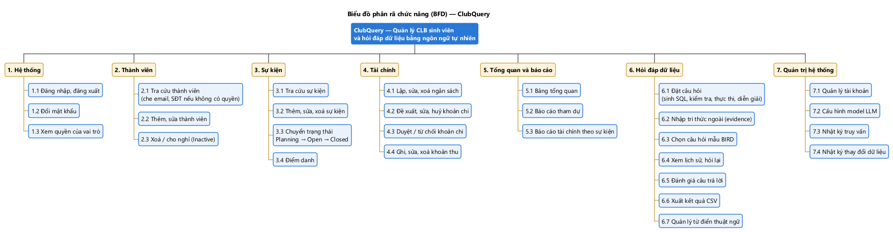

### 4.1.2. Sơ đồ use-case tổng quát

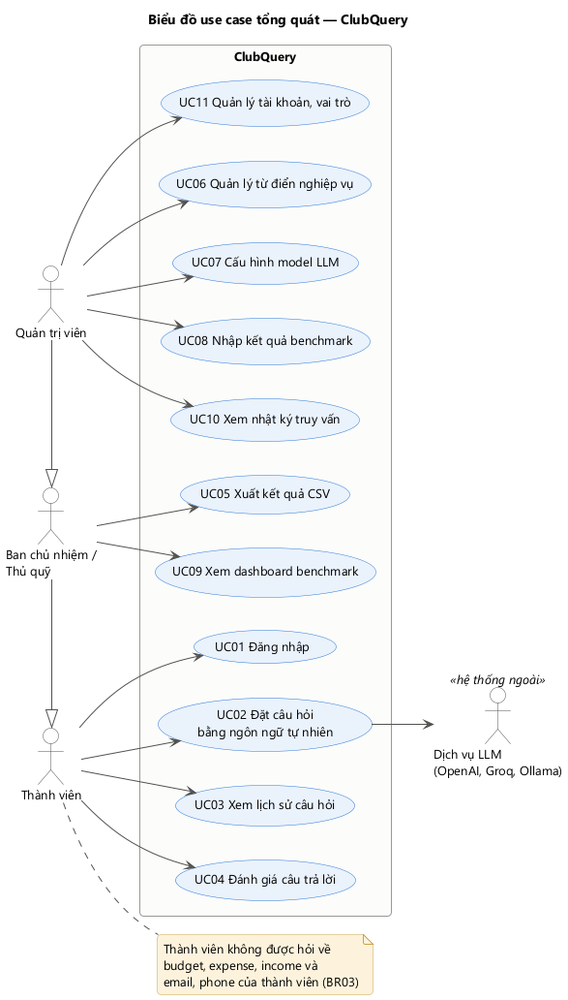

Bốn tác nhân nghiệp vụ đều tổng quát hoá thành Người dùng, nên đều thực hiện được UC01–UC05, UC14, UC15. Các use case khác gắn với quyền cụ thể trong ma trận (Bảng 3.6), không theo cấp bậc kế thừa. Dữ liệu một use case hiển thị cũng tuỳ quyền: tổng quan chỉ có khối tài chính khi vai trò có `finance.read`; danh sách thành viên chỉ hiện email, số điện thoại với Chủ nhiệm.

### 4.1.3. Sơ đồ use-case phân rã UC02 – Hỏi đáp

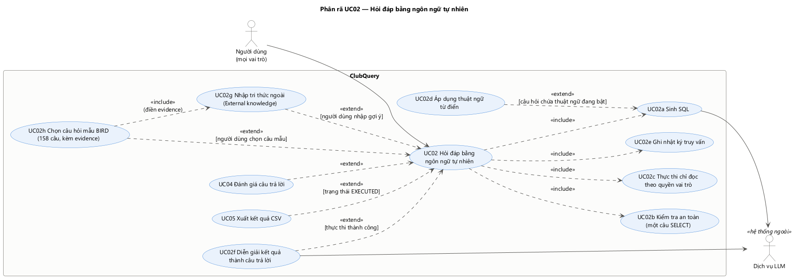

- include: mọi câu hỏi đều qua sinh SQL, kiểm tra an toàn, thực thi chỉ đọc theo quyền và ghi nhật ký.
- extend: nhập tri thức ngoài (UC02g) – người dùng tự gõ gợi ý vào ô External knowledge; chọn câu hỏi mẫu BIRD (UC02h) – chọn một trong 158 câu dev của `student_club`, hệ thống điền cả câu hỏi lẫn evidence của câu đó; áp dụng thuật ngữ từ điển (UC02d) khi câu hỏi chứa thuật ngữ đang bật; diễn giải kết quả khi thực thi thành công; đánh giá (UC04) và xuất CSV (UC05) do người dùng chọn sau khi có kết quả.

Tri thức ngoài chính là evidence của BIRD: trong bài báo, mỗi câu hỏi đi kèm một đoạn tri thức do người gán nhãn viết, và nó được đưa vào prompt ở dòng `-- External Knowledge:`. Ứng dụng giữ đúng cơ chế đó, với hai nguồn tri thức: do người hỏi cung cấp (tự gõ hoặc từ câu mẫu, giữ nguyên văn) và do CLB duy trì (từ điển, đã chuẩn hoá hàm giả).

## 4.2. Đặc tả use-case

### 4.2.1. Use-case Hỏi đáp bằng ngôn ngữ tự nhiên (UC02)

Bảng 4.1. Use-case Hỏi đáp bằng ngôn ngữ tự nhiên

| Use Case ID | UC02 |
|---|---|
| Use Case Description | Người dùng hỏi bằng tiếng Anh (có thể kèm tri thức ngoài, hoặc chọn câu hỏi mẫu BIRD); hệ thống ghép tri thức ngoài và thuật ngữ từ điển thành dòng External Knowledge, sinh SQL, kiểm tra, thực thi chỉ đọc theo quyền và trả lời bằng một câu tiếng Anh dễ hiểu kèm bảng dữ liệu. |
| Actor(s) | Tác nhân chính: Người dùng (mọi vai trò).<br>Tác nhân phụ: Dịch vụ LLM. |
| Priority | Cao |
| Trigger | Người dùng nhập câu hỏi (hoặc chọn câu hỏi mẫu) và bấm "Ask". |
| Pre-Condition | 1. Người dùng đã đăng nhập.<br>2. Có ít nhất một model đang bật. |
| Post-Condition | Một bản ghi `query_log` với trạng thái kết thúc được tạo (BR04). |
| Basic Flow | 1. Người dùng mở màn Ask AI, chọn model (mặc định là model đánh dấu mặc định), nhập câu hỏi (3–500 ký tự); tuỳ chọn gõ gợi ý vào ô "External knowledge (optional)" (tối đa 2000 ký tự) (UC02g); bấm "Ask".<br>2. Hệ thống tìm các thuật ngữ đang bật xuất hiện trong câu hỏi, không phân biệt hoa thường (UC02d).<br>3. Hệ thống dựng tri thức: tri thức ngoài giữ nguyên văn (như evidence trong benchmark BIRD), nối "; " với định nghĩa thuật ngữ dạng "<term> refers to <definition>" (phần này được chuẩn hoá hàm giả DIVIDE, YEAR… sang SQLite hợp lệ). Kết quả là dòng "-- External Knowledge: …" của prompt.<br>4. Hệ thống dựng prompt theo khuôn BIRD: các câu CREATE TABLE chỉ gồm bảng/cột vai trò được xem, rồi tri thức, rồi câu hỏi.<br>5. Hệ thống gửi prompt tới Dịch vụ LLM (temperature = 0) và tách SQL khỏi văn bản trả về (UC02a).<br>6. Hệ thống kiểm tra SQL là đúng một câu SELECT/WITH (UC02b, BR01).<br>7. Hệ thống thực thi trên `club.sqlite` mở ở chế độ chỉ đọc, kèm authorizer theo vai trò và hạn chót 10 giây (UC02c, BR02, BR03).<br>8. Hệ thống gửi câu hỏi và tối đa 30 dòng đầu của kết quả cho Dịch vụ LLM để diễn giải thành 1–3 câu trả lời tiếng Anh (UC02f).<br>9. Hệ thống ghi `query_log`: câu hỏi, model, câu mẫu, tri thức ngoài, thuật ngữ đã dùng, SQL, câu trả lời, trạng thái, độ trễ, số dòng (UC02e).<br>10. Hệ thống hiển thị thẻ kết quả: dòng "Knowledge added to the prompt", câu trả lời, biểu đồ (nếu kết quả có dạng nhãn – số), bảng dữ liệu, mục thu gọn "External knowledge sent to the model" và SQL. |
| Alternative Flow | A1 – Không có tri thức (bước 2–3): ô tri thức ngoài trống và không thuật ngữ nào khớp, prompt không có dòng External Knowledge, đúng như prompt "không evidence" của BIRD.<br>A2 – Chọn câu hỏi mẫu BIRD (UC02h, thay bước 1): người dùng bấm "BIRD sample questions (158)", tìm theo nội dung câu hỏi/evidence, lọc theo độ khó (All / Simple / Moderate / Challenging), chọn một câu. Hệ thống điền câu hỏi và evidence của câu đó, hiện nhãn "BIRD sample #id · difficulty" kèm "evidence attached", hoặc "no evidence in BIRD" với 12 câu mà BIRD để trống evidence. Người dùng có thể sửa trước khi hỏi; mã câu mẫu được ghi vào `query_log.sample_id`.<br>A3 – Hỏi lại: nút "Ask again" trên thẻ kết quả, hoặc hỏi lại từ "Question history", gửi lại cả tri thức ngoài đã dùng.<br>A4 – Kết quả quá 1000 dòng: chỉ trả 1000 dòng đầu, có ghi chú đã cắt.<br>A5 – Diễn giải không dùng được model (bước 8): model lỗi hoặc trả rỗng thì câu trả lời được dựng theo mẫu từ kết quả, ví dụ "Result: 9.", "2 results: Law, Business.", "No matching data was found.".<br>A6 – Đánh giá, xuất CSV: sau bước 10 người dùng có thể bấm "Correct" / "Wrong" (UC04) hoặc "CSV" (UC05). |
| Exception Flow | E0 – Model không tồn tại hoặc đang tắt, câu hỏi quá ngắn, tri thức ngoài quá 2000 ký tự: báo lỗi 422, không tạo log.<br>E1 – Gọi model lỗi (Ollama chưa chạy hoặc chưa pull model, mạng, thiếu khoá Groq): báo không sinh được SQL, kèm lý do. Log: FAILED_GENERATION.<br>E2 – Model trả văn bản không phải SQL: báo không sinh được truy vấn. Log: FAILED_GENERATION.<br>E3 – SQL có nhiều câu lệnh, hoặc là lệnh ghi/DDL: từ chối, không thực thi. Log: REJECTED_UNSAFE.<br>E4 – SQL đọc bảng hoặc cột vai trò không được xem: từ chối, nêu dữ liệu bị cấm. Log: REJECTED_PERMISSION.<br>E5 – Quá 10 giây: huỷ truy vấn. Log: TIMEOUT.<br>E6 – Lỗi cú pháp, sai tên cột: hiện thông báo lỗi của SQLite. Log: EXEC_ERROR. |
| Business Rules | BR01, BR02, BR03, BR04 |

### 4.2.2. Use-case Đề xuất khoản chi (UC11)

Bảng 4.2. Use-case Đề xuất khoản chi

| Use Case ID | UC11 |
|---|---|
| Use Case Description | Thủ quỹ lập đề xuất chi gắn với một ngân sách (sự kiện + hạng mục); đề xuất chờ Chủ nhiệm duyệt. |
| Actor(s) | Thủ quỹ |
| Priority | Cao |
| Trigger | Thủ quỹ bấm "Propose expense" ở màn Finance, tab Expenses. |
| Pre-Condition | 1. Đăng nhập với vai trò có quyền `finance.write`.<br>2. Đã có ngân sách; sự kiện của ngân sách chưa Closed. |
| Post-Condition | Khoản chi mới ở trạng thái chờ duyệt (`approved = 'pending'`), lưu người đề xuất, ghi nhật ký thay đổi – trong cùng một giao dịch. |
| Basic Flow | 1. Thủ quỹ mở Finance, tab Expenses, bấm "Propose expense".<br>2. Chọn ngân sách (sự kiện · hạng mục, kèm số còn lại), nhập mô tả, ngày, số tiền, người chi.<br>3. Hệ thống kiểm tra quyền, ngân sách, trạng thái sự kiện và người chi.<br>4. Hệ thống lưu khoản chi chờ duyệt, ghi người đề xuất và nhật ký thay đổi.<br>5. Khoản chi hiện với nhãn "Pending"; menu Finance của Chủ nhiệm hiện số khoản chờ duyệt. |
| Alternative Flow | A1 – Số tiền vượt ngân sách còn lại: vẫn lưu nhưng kèm cảnh báo Chủ nhiệm sẽ không duyệt được nếu chưa tăng ngân sách (BR07).<br>A2 – Khi còn chờ duyệt, người đã đề xuất có thể sửa hoặc huỷ đề xuất (BR13). |
| Exception Flow | E1 – Thiếu quyền, hoặc sửa/huỷ đề xuất của người khác: 403.<br>E2 – Ngân sách hoặc thành viên không tồn tại: 422.<br>E3 – Sự kiện đã đóng: 409.<br>E4 – Sửa/huỷ khoản đã được xử lý: 409. |
| Business Rules | BR05, BR07, BR10, BR13 |

### 4.2.3. Use-case Duyệt khoản chi (UC12)

Bảng 4.3. Use-case Duyệt khoản chi

| Use Case ID | UC12 |
|---|---|
| Use Case Description | Chủ nhiệm duyệt hoặc từ chối khoản chi đang chờ duyệt. |
| Actor(s) | Chủ nhiệm |
| Priority | Cao |
| Trigger | Chủ nhiệm bấm "Approve" hoặc "Reject" trên một khoản chi chờ duyệt. |
| Pre-Condition | 1. Đăng nhập với vai trò có quyền `expense.approve`.<br>2. Có khoản chi ở trạng thái chờ duyệt. |
| Post-Condition | Duyệt: khoản chi "đã duyệt", ngân sách được tính lại. Từ chối: khoản chi "bị từ chối", lưu lý do. Cả hai: lưu người duyệt, thời điểm, ghi nhật ký – trong một giao dịch trên hai CSDL. |
| Basic Flow | 1. Chủ nhiệm mở Finance, tab Expenses; khoản chờ duyệt xếp đầu, kèm ngân sách còn lại.<br>2. Bấm "Approve"; hộp xác nhận hiện số còn lại trước và sau khi duyệt.<br>3. Hệ thống kiểm tra khoản chi đang chờ, người duyệt khác người đề xuất (BR08), số tiền không vượt ngân sách còn lại (BR07).<br>4. Hệ thống đánh dấu đã duyệt, tính lại `spent` và `remaining` (BR06), ghi người duyệt và nhật ký, commit.<br>5. Ngân sách còn lại giảm tương ứng; số khoản chờ duyệt trên menu giảm. |
| Alternative Flow | A1 – Bấm "Reject", nhập lý do ("Reason for rejection"): khoản chi bị từ chối, ngân sách không đổi. |
| Exception Flow | E1 – Thiếu quyền (ví dụ Thủ quỹ): 403.<br>E2 – Khoản đã xử lý, tự duyệt, vượt ngân sách: 409.<br>E3 – Từ chối không có lý do: 422.<br>E4 – Lỗi giữa chừng: mọi thay đổi trên cả hai CSDL bị huỷ. |
| Business Rules | BR05, BR06, BR07, BR08, BR10 |

### 4.2.4. Use-case Điểm danh (UC09)

Bảng 4.4. Use-case Điểm danh

| Use Case ID | UC09 |
|---|---|
| Use Case Description | Ghi danh sách thành viên tham dự một sự kiện đang diễn ra. |
| Actor(s) | Chủ nhiệm, Ban sự kiện |
| Priority | Trung bình |
| Trigger | Người dùng mở chi tiết một sự kiện ở màn Events & attendance. |
| Pre-Condition | 1. Đăng nhập với vai trò có quyền `attendance.write`.<br>2. Sự kiện đang Open (BR12). |
| Post-Condition | Danh sách điểm danh của sự kiện được thay bằng danh sách mới; nhật ký ghi số người, số thêm, số bớt. |
| Basic Flow | 1. Người dùng mở một sự kiện đang Open.<br>2. Hệ thống hiển thị thành viên, đánh dấu sẵn người đã điểm danh.<br>3. Người dùng đánh dấu/bỏ đánh dấu (có ô "Search members…", "Select all", "Clear"), bấm "Save attendance".<br>4. Hệ thống kiểm tra trạng thái sự kiện và từng thành viên.<br>5. Hệ thống ghi danh sách mới và nhật ký trong một giao dịch, báo số người tham dự. |
| Alternative Flow | A1 – Sự kiện còn Planning: hộp chi tiết hướng dẫn người có quyền `event.write` bấm "Open event", đánh dấu người tham dự rồi "Save attendance".<br>A2 – Sự kiện đã Closed: danh sách điểm danh chỉ xem, không sửa. |
| Exception Flow | E1 – Sự kiện Planning hoặc Closed: 409.<br>E2 – Thành viên không tồn tại: 422.<br>E3 – Thiếu quyền: 403. |
| Business Rules | BR05, BR10, BR11, BR12 |

### 4.2.5. Use-case Quản lý thành viên (UC07)

Bảng 4.5. Use-case Quản lý thành viên

| Use Case ID | UC07 |
|---|---|
| Use Case Description | Tra cứu, thêm, sửa, xoá thành viên CLB. |
| Actor(s) | Xem: mọi vai trò. Thêm, sửa, xoá: Chủ nhiệm. |
| Priority | Trung bình |
| Trigger | Người dùng mở màn Members. |
| Pre-Condition | Đã đăng nhập; thao tác ghi cần quyền `member.write`. |
| Post-Condition | Bảng `member` được cập nhật; nhật ký ghi giá trị trước/sau. |
| Basic Flow | 1. Chủ nhiệm bấm "Add member".<br>2. Nhập họ, tên, email, số điện thoại, chức vụ, size áo, mã bưu chính, ngành.<br>3. Hệ thống kiểm tra danh mục, định dạng email, mã bưu chính và ngành tồn tại.<br>4. Hệ thống sinh mã theo dạng của dữ liệu gốc, lưu, ghi nhật ký. |
| Alternative Flow | A1 – Tra cứu danh sách và chi tiết (số sự kiện đã tham dự); email, số điện thoại bị che khi vai trò thiếu `pii.read`.<br>A2 – Sửa thành viên.<br>A3 – Xoá thành viên chưa có dữ liệu liên quan. |
| Exception Flow | E1 – Dữ liệu không hợp lệ: 422.<br>E2 – Xoá thành viên đã có điểm danh/thu chi: 409, gợi ý chuyển sang Inactive (BR09).<br>E3 – Thiếu quyền: 403. |
| Business Rules | BR05, BR09, BR10 |

### 4.2.6. Use-case Quản lý từ điển nghiệp vụ (UC06)

Bảng 4.6. Use-case Quản lý từ điển nghiệp vụ

| Use Case ID | UC06 |
|---|---|
| Use Case Description | Duy trì các thuật ngữ nghiệp vụ và định nghĩa tương ứng; thuật ngữ đang bật được ghép vào prompt như evidence. |
| Actor(s) | Xem: mọi vai trò. Ghi: Chủ nhiệm, Quản trị. |
| Priority | Trung bình |
| Trigger | Người dùng mở màn Glossary. |
| Pre-Condition | Thao tác ghi cần quyền `glossary.write`. |
| Post-Condition | `glossary_term` được cập nhật (người, thời điểm sửa); nhật ký ghi thay đổi; các câu hỏi sau đó dùng từ điển mới. |
| Basic Flow | 1. Người dùng mở màn Glossary.<br>2. Bấm "Add term", nhập thuật ngữ và định nghĩa.<br>3. Hệ thống kiểm tra quyền và tính duy nhất của thuật ngữ.<br>4. Hệ thống lưu, ghi nhật ký và làm mới danh sách. |
| Alternative Flow | Sửa; tắt thuật ngữ (giữ lại nhưng không ghép vào prompt); xoá (cần xác nhận). |
| Exception Flow | E1 – Thuật ngữ đã tồn tại: 409.<br>E2 – Thiếu quyền: không thấy nút thêm, và API từ chối (403). |
| Business Rules | BR05, BR10; thuật ngữ không trùng, không phân biệt hoa thường (kể cả chữ có dấu). |

### 4.2.7. Use-case Quản lý tài khoản và vai trò (UC18)

Bảng 4.7. Use-case Quản lý tài khoản và vai trò

| Use Case ID | UC18 |
|---|---|
| Use Case Description | Thêm tài khoản, đổi họ tên, vai trò, khoá hoặc mở tài khoản, đặt lại mật khẩu. |
| Actor(s) | Quản trị hệ thống |
| Priority | Cao |
| Trigger | Quản trị mở Administration, tab Accounts. |
| Pre-Condition | Đăng nhập với vai trò có quyền `system.admin`. |
| Post-Condition | Tài khoản được tạo hoặc cập nhật trong `user_account`. |
| Basic Flow | 1. Nhập tên đăng nhập, họ tên, vai trò, mật khẩu.<br>2. Bấm lưu.<br>3. Hệ thống kiểm tra, băm mật khẩu, lưu. |
| Alternative Flow | Sửa tài khoản có sẵn. Tài khoản bị khoá không đăng nhập được, và phiên đang mở bị từ chối ngay ở yêu cầu kế tiếp; đổi vai trò có hiệu lực ngay. |
| Exception Flow | E1 – Trùng tên đăng nhập: 409.<br>E2 – Vai trò không hợp lệ, mật khẩu quá ngắn: 422.<br>E3 – Quản trị tự hạ quyền hoặc tự khoá mình: 422. |
| Business Rules | Mật khẩu tối thiểu 6 ký tự, lưu dạng băm; tên đăng nhập duy nhất; vai trò thuộc 4 vai trò; quản trị không tự hạ quyền hoặc tự khoá mình. |

Các use case còn lại (UC01, UC03–UC05, UC08, UC10, UC13–UC17, UC19) có luồng đơn giản, được mô tả trong Bảng 3.3 và bảng thiết kế API (Bảng 4.11). Riêng UC10, Thủ quỹ lập ngân sách ở Finance → Budgets → "Create budget", hoặc bấm "Add budget" ngay trong hộp chi tiết sự kiện (form chọn sẵn sự kiện); Chủ nhiệm thấy dòng nhắc rằng ngân sách do Thủ quỹ lập.

## 4.3. Sơ đồ hoạt động (Activity diagram)

### 4.3.1. Sơ đồ hoạt động Hỏi đáp (UC02)

Tri thức ngoài (nguyên văn) và thuật ngữ từ điển (đã chuẩn hoá) được nối thành dòng `-- External Knowledge`; cả hai rỗng thì prompt không có dòng này. Mọi nhánh, kể cả nhánh bị từ chối, đều hội tụ về bước ghi nhật ký (BR04).

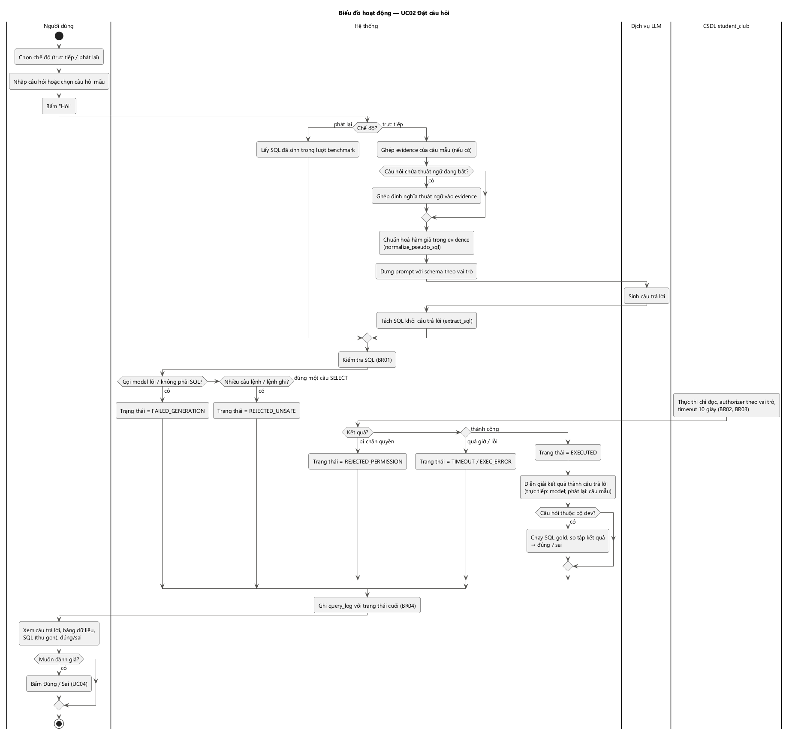

### 4.3.2. Sơ đồ hoạt động Đề xuất và duyệt khoản chi (UC11, UC12)

Ba làn: Thủ quỹ đề xuất, Hệ thống kiểm tra và ghi, Chủ nhiệm quyết định.

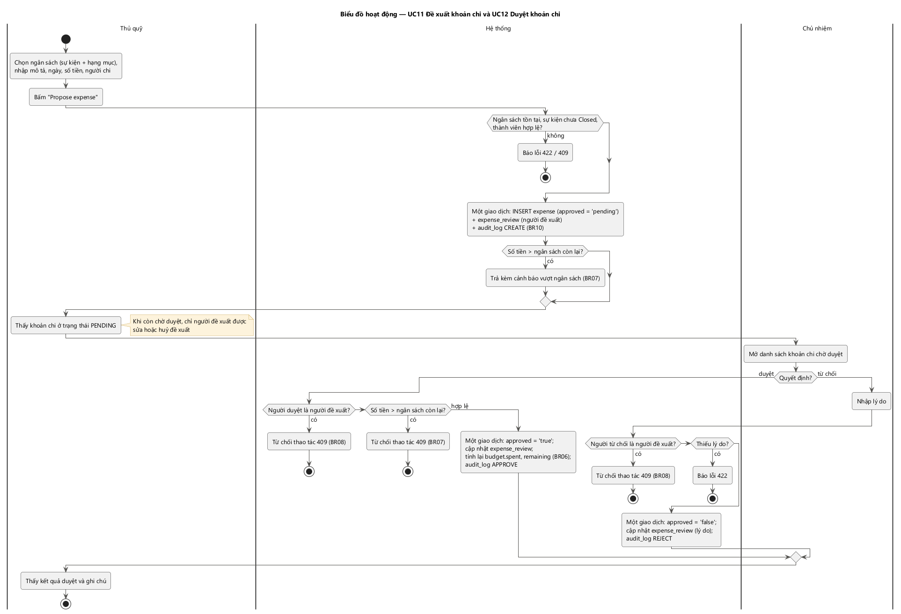

## 4.4. Sơ đồ tuần tự (Sequence diagram)

### 4.4.1. Sơ đồ tuần tự Hỏi đáp (UC02)

Đoạn opt đầu biểu đồ là việc chọn câu hỏi mẫu BIRD; tri thức ngoài và mã câu mẫu đi cùng câu hỏi tới `service.ask()`. Phân quyền được kiểm hai lần: schema trong prompt đã được lọc, và bộ kiểm tra quyền ở tầng engine SQLite chặn tiếp.

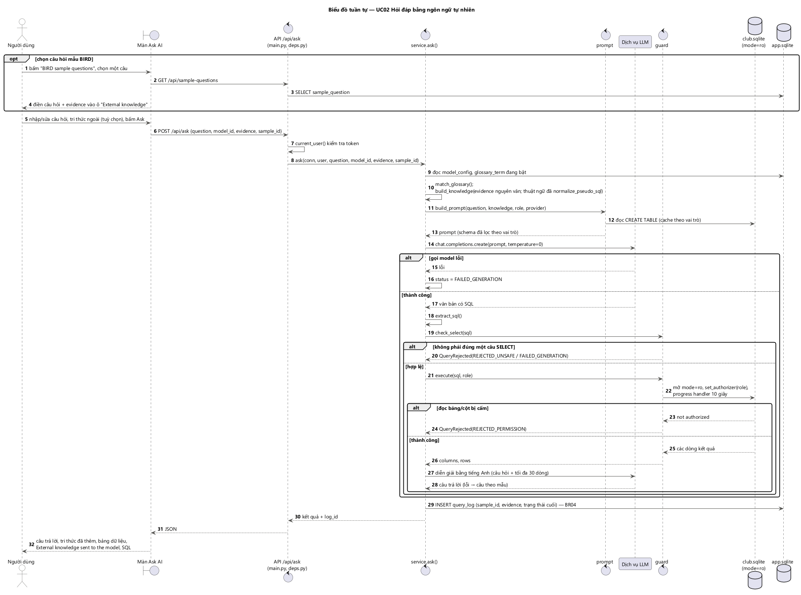

### 4.4.2. Sơ đồ tuần tự Duyệt khoản chi (UC12)

Cập nhật khoản chi và ngân sách (ở `club.sqlite`), ghi người duyệt và nhật ký (ở `app.sqlite`) nằm trong một giao dịch.

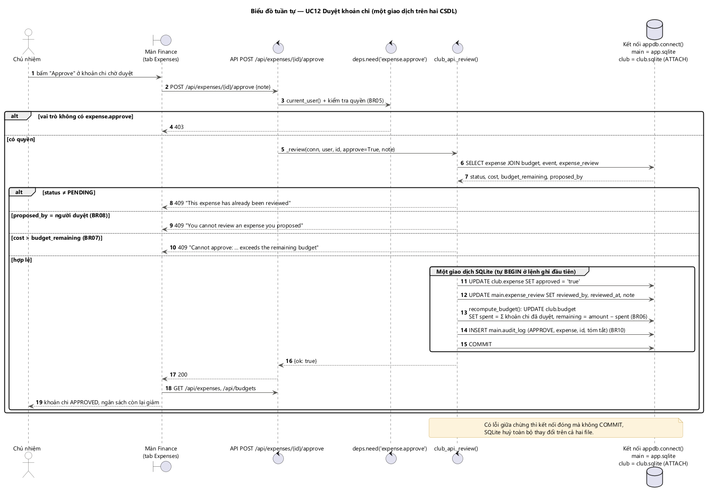

### 4.4.3. Sơ đồ tuần tự Quản lý từ điển nghiệp vụ (UC06)

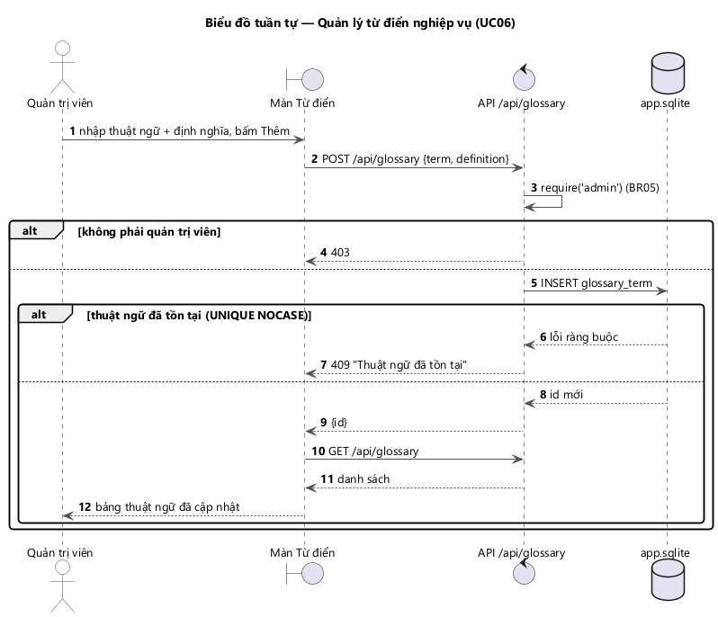

## 4.5. Sơ đồ lớp phân tích (Class diagram)

Các lớp được chia theo mẫu boundary – control – entity. Lớp `MaTranQuyen` được cả `XacThucControl` (API quản lý) lẫn `PromptBuilder`, `QueryGuard` (hỏi đáp) dùng; `AuditLogger` được mọi control ghi dữ liệu gọi.

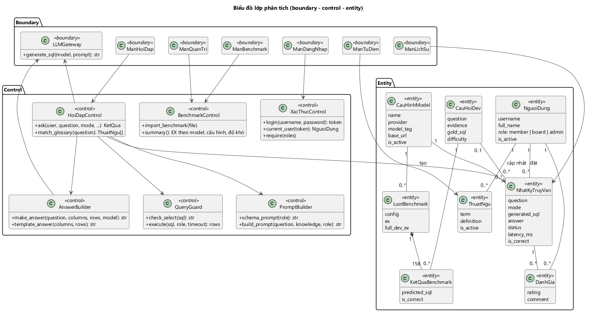

## 4.6. Sơ đồ trạng thái (State diagram)

Một truy vấn: Received, Generated, Validated là các trạng thái trung gian trong bộ nhớ. Cột `query_log.status` lưu một trong sáu trạng thái kết thúc: EXECUTED, FAILED_GENERATION, REJECTED_UNSAFE, REJECTED_PERMISSION, TIMEOUT, EXEC_ERROR.

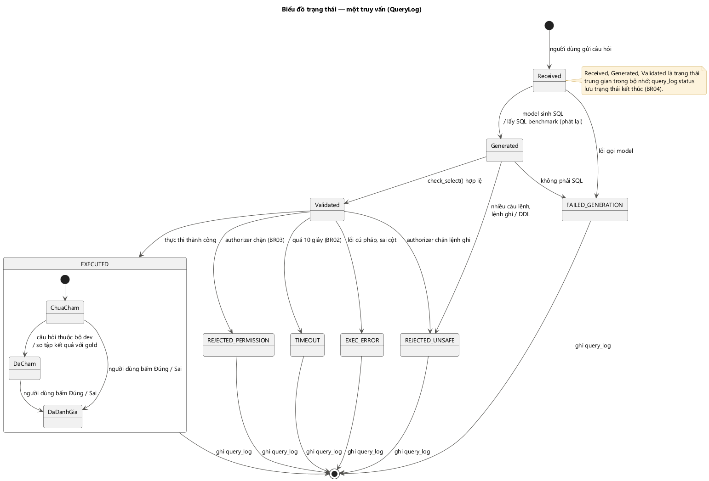

Khoản chi: trạng thái suy ra từ cột `expense.approved`: `'pending'` là chờ duyệt, `'true'` (hoặc NULL ở dữ liệu cũ) là đã duyệt, `'false'` là bị từ chối.

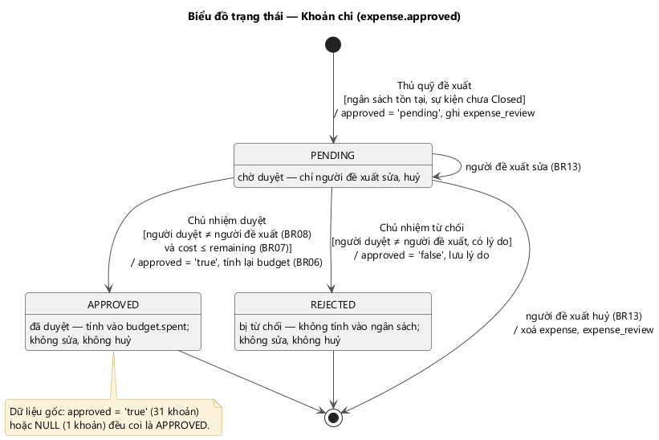

Sự kiện: vòng đời một chiều (BR11); trạng thái quyết định có được điểm danh (BR12), lập ngân sách và đề xuất chi hay không.

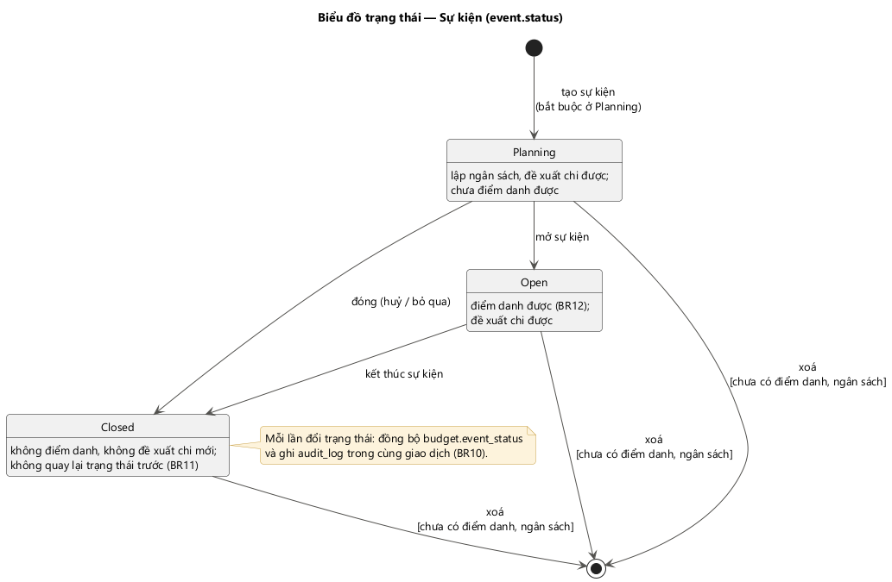

## 4.7. Kiến trúc hệ thống

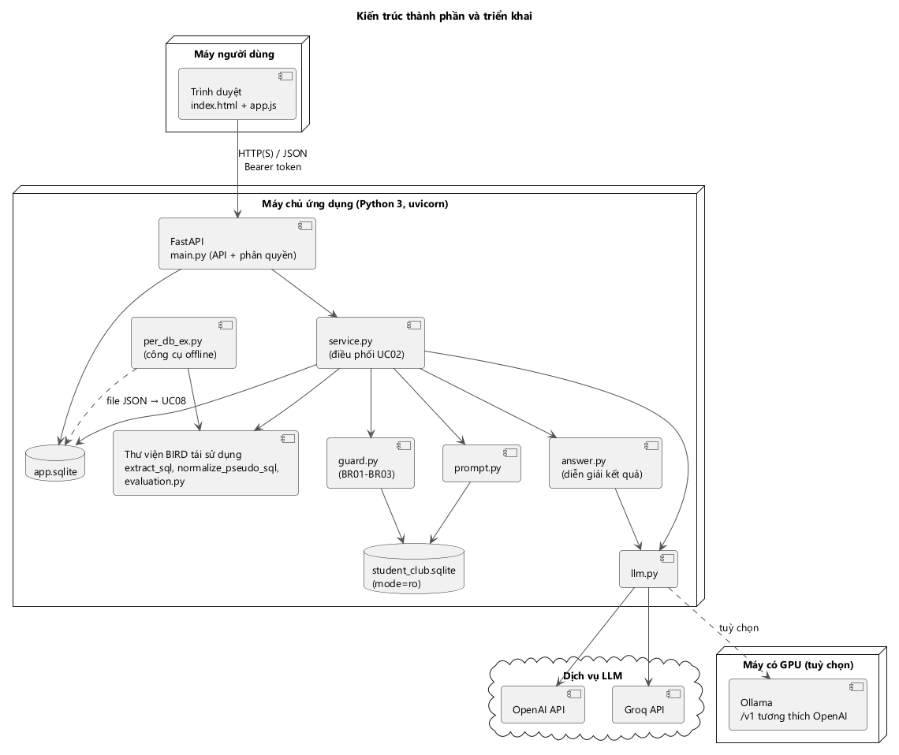

- Phân tầng: giao diện (HTML/JS) → API (FastAPI: `main.py`, `club_api.py`; xác thực, phân quyền trong `deps.py`) → nghiệp vụ (`service.py` cho hỏi đáp, các hàm trong `club_api.py` cho quản lý) → dịch vụ (`prompt`, `guard`, `llm`, `answer`) → dữ liệu (`appdb.py`).
- Một ma trận quyền cho hai đường truy cập dữ liệu: API quản lý kiểm tra `need(quyền)`; hỏi đáp gọi `restrictions(role)` để lọc schema và cấu hình authorizer. Sửa ma trận ở một chỗ thì cả hai cùng đổi.
- Tái sử dụng mã nghiên cứu: `extract_sql()` tách SQL khỏi khối mã trong câu trả lời của model; `normalize_pseudo_sql()` chuẩn hoá định nghĩa từ điển (mục 2.7). Prompt giữ khuôn của BIRD (schema, `-- External Knowledge`, câu hỏi) và kết thúc bằng câu yêu cầu tường minh "chỉ trả về SQL trong khối mã", đúng phát hiện ở mục 2.7 rằng kỹ thuật mồi SELECT không hợp với model chat.
- Một giao diện cho mọi nhà cung cấp: Ollama (chạy nội bộ, mặc định) và Groq đều có API chuẩn Chat Completions, gọi qua cùng một thư viện client. Thêm model chỉ cần thêm một dòng cấu hình. Ứng dụng không dùng dịch vụ OpenAI, nên với model mặc định, dữ liệu CLB không rời máy chủ.
- Câu trả lời trước, SQL sau: người dùng nghiệp vụ cần câu trả lời, không cần câu SQL. `answer.py` biến bảng kết quả thành một câu trả lời; bảng dữ liệu và SQL (thu gọn) vẫn được hiển thị để ai cần thì kiểm tra lại.

## 4.8. Thiết kế dữ liệu

### 4.8.1. Tổ chức CSDL và mô hình quan hệ thực thể

Hệ thống dùng ba file SQLite với vai trò tách biệt:

Bảng 4.8. Ba CSDL của hệ thống

| CSDL | Nội dung | Cách mở |
|---|---|---|
| `student_club.sqlite` (BIRD) | Dữ liệu gốc | Chỉ để chép một lần sang `club.sqlite`, không bao giờ bị sửa |
| `club.sqlite` | Dữ liệu nghiệp vụ CLB, giữ nguyên lược đồ 8 bảng của BIRD | Quản lý: đọc ghi qua kết nối chung (ATTACH as `club`). Hỏi đáp: kết nối riêng chỉ đọc (`mode=ro`) cộng authorizer |
| `app.sqlite` | Dữ liệu ứng dụng: 8 bảng | Kết nối chính |

Lý do thiết kế:

- SQL do model sinh chạy trên một kết nối chỉ đọc chỉ thấy `club.sqlite`, nên không bao giờ chạm được vào tài khoản, nhật ký hay quy trình duyệt.
- Giữ nguyên lược đồ BIRD cho dữ liệu nghiệp vụ, nên prompt vẫn đúng khuôn BIRD và kết quả nghiên cứu áp dụng trực tiếp được. Thông tin chỉ ứng dụng cần (ai đề xuất, ai duyệt, lý do) để ở bảng `expense_review` bên `app.sqlite`.
- `appdb.connect()` ATTACH `club.sqlite` vào kết nối của `app.sqlite`, nên một thao tác nghiệp vụ chạm cả hai file vẫn là một giao dịch (SQLite đảm bảo commit nguyên tử trên các CSDL đã ATTACH [6]).

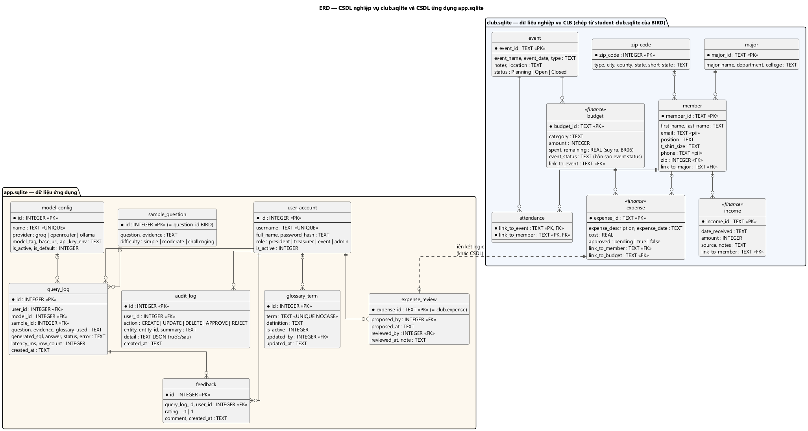

Phần `club.sqlite` được đảo ngược từ các khoá ngoại thật trong file SQLite. Hệ thống dùng thêm giá trị `'pending'`, `'false'` cho cột `expense.approved` (dữ liệu gốc chỉ có `'true'` và một giá trị NULL) và giữ `budget.event_status` đồng bộ với `event.status`.

### 4.8.2. Từ điển dữ liệu của app.sqlite

Bảng 4.9. Từ điển dữ liệu của app.sqlite

| Bảng | Cột chính | Ràng buộc |
|---|---|---|
| `user_account` | `username`, `full_name`, `password_hash`, `role`, `is_active` | `username` duy nhất; `role` ∈ {president, treasurer, event, admin}; mật khẩu băm PBKDF2-SHA256 có salt |
| `model_config` | `name`, `provider`, `model_tag`, `base_url`, `api_key_env`, `is_active`, `is_default` | `name` duy nhất; `provider` ∈ {groq, openrouter, ollama}. Chỉ lưu tên biến môi trường chứa khoá API, không lưu khoá |
| `glossary_term` | `term`, `definition`, `is_active`, `updated_by`, `updated_at` | `term` duy nhất, không phân biệt hoa thường |
| `sample_question` | `id` (= `question_id` trong `dev.json`), `question`, `evidence`, `difficulty` | 158 câu dev BIRD của `student_club`, nạp khi khởi tạo; `difficulty` ∈ {simple, moderate, challenging} |
| `query_log` | `user_id`, `question`, `model_id`, `sample_id`, `evidence`, `glossary_used`, `generated_sql`, `answer`, `status`, `error`, `latency_ms`, `row_count`, `created_at` | `status` là trạng thái kết thúc |
| `feedback` | `query_log_id`, `user_id`, `rating`, `comment`, `created_at` | Mỗi người đánh giá một câu một lần (ghi đè khi đánh giá lại); `rating` ∈ {-1, 1} |
| `expense_review` | `expense_id`, `proposed_by`, `proposed_at`, `reviewed_by`, `reviewed_at`, `note` | `expense_id` là mã khoản chi bên `club.sqlite` (liên kết logic, khác CSDL) |
| `audit_log` | `user_id`, `action`, `entity`, `entity_id`, `summary`, `detail`, `created_at` | `action` ∈ {CREATE, UPDATE, DELETE, APPROVE, REJECT}; `detail` là JSON giá trị trước/sau |

## 4.9. Thiết kế an toàn truy vấn

SQL do LLM sinh là dữ liệu không tin cậy. Hệ thống áp dụng phòng thủ nhiều lớp:

Bảng 4.10. Các lớp phòng thủ khi thực thi SQL do model sinh

| Lớp | Cơ chế | Chặn được |
|---|---|---|
| 1 | Prompt chỉ chứa schema mà vai trò được xem | Model không biết bảng bị cấm nên ít khi sinh truy vấn vào đó |
| 2 | `check_select()`: tách câu lệnh bằng `sqlparse`, chỉ nhận đúng một SELECT/WITH | Nhiều câu lệnh, DELETE, DROP, PRAGMA, ATTACH… |
| 3 | Kết nối riêng tới `club.sqlite` với `mode=ro` | Mọi thao tác ghi |
| 4 | `sqlite3.set_authorizer` theo vai trò | Đọc bảng/cột bị cấm, kể cả COUNT(*) và SELECT *; lệnh ghi giấu trong CTE |
| 5 | `set_progress_handler` với hạn chót 10 giây | Truy vấn chạy quá lâu |

Bước diễn giải chỉ nhận các dòng đã qua kiểm tra quyền, nên model không thể "kể" cho một vai trò những dữ liệu mà vai trò đó không được xem.

Tri thức ngoài do người dùng nhập chỉ đi vào prompt, không đi vào SQL; SQL sinh ra vẫn phải qua lớp 2–5, nên tri thức ngoài không mở rộng được quyền đọc dữ liệu.

Lớp 4 là điểm then chốt. Nếu chỉ ẩn bảng khỏi prompt, model vẫn có thể đoán tên bảng `expense`. Authorizer chặn ở tầng engine SQLite, nên mọi đường đọc dữ liệu đều bị kiểm tra, bất kể câu SQL viết thế nào.

## 4.10. Thiết kế API

Bảng 4.11. Danh sách API

| Phương thức | Đường dẫn | Use case | Quyền |
|---|---|---|---|
| POST, GET | `/api/login`, `/api/logout`, `/api/me`, `/api/me/password`, `/api/roles` | UC01 | – / đã đăng nhập |
| POST | `/api/ask` (question, model_id, evidence tối đa 2000 ký tự, sample_id) | UC02 | Đã đăng nhập |
| GET | `/api/sample-questions`, `/api/models` | UC02 | Đã đăng nhập |
| GET | `/api/history` | UC03 | Đã đăng nhập |
| POST | `/api/feedback` | UC04 | Người đặt câu hỏi |
| GET | `/api/export/{log_id}` | UC05 | Người đặt câu hỏi |
| GET; POST, PUT, DELETE | `/api/glossary[/{id}]` | UC06 | Đọc: đã đăng nhập; ghi: `glossary.write` |
| GET; POST, PUT, DELETE | `/api/members[/{id}]` | UC07 | Đọc: đã đăng nhập; ghi: `member.write` |
| GET; POST, PUT, DELETE | `/api/events[/{id}]` | UC08 | Đọc: đã đăng nhập; ghi: `event.write` |
| PUT | `/api/events/{id}/attendance` | UC09 | `attendance.write` |
| GET; POST, PUT, DELETE | `/api/budgets[/{id}]` | UC10 | Đọc: `finance.read`; ghi: `finance.write` |
| GET; POST, PUT, DELETE | `/api/expenses[/{id}]` | UC11 | Đọc: `finance.read`; ghi: `finance.write` |
| POST | `/api/expenses/{id}/approve`, `/api/expenses/{id}/reject` | UC12 | `expense.approve` |
| GET; POST, PUT, DELETE | `/api/incomes[/{id}]` | UC13 | Đọc: `finance.read`; ghi: `finance.write` |
| GET | `/api/dashboard` | UC14 | Đã đăng nhập (tài chính nếu có `finance.read`) |
| GET | `/api/reports/attendance`, `/api/reports/finance` | UC15 | Đã đăng nhập; báo cáo tài chính cần `finance.read` |
| GET | `/api/audit` | UC16 | `audit.read` |
| PUT | `/api/models/{id}` | UC17 | `system.admin` |
| GET, POST, PUT | `/api/users[/{id}]` | UC18 | `system.admin` |
| GET | `/api/logs` | UC19 | `system.admin` |

Mã lỗi thống nhất: 401 chưa đăng nhập; 403 thiếu quyền; 404 không tìm thấy; 409 vi phạm quy tắc nghiệp vụ; 422 dữ liệu nhập không hợp lệ.

## 4.11. Thiết kế giao diện

Giao diện một trang, toàn bộ bằng tiếng Anh: nhãn, thông báo lỗi của API (ví dụ "You cannot review an expense you proposed"), ngày dạng "07 Apr 2020", câu trả lời theo mẫu ("Result: 9.", "No matching data was found."), tên vai trò President / Treasurer / Event team / System admin. Lý do: câu hỏi, schema và evidence của BIRD đều bằng tiếng Anh; một ngôn ngữ thống nhất giúp model hiểu đúng và người dùng đối chiếu được câu trả lời với SQL. Báo cáo trích nguyên văn các nhãn tiếng Anh khi cần.

Menu chia ba nhóm: General (Dashboard, Ask AI, Question history), Management (Members, Events & attendance, Finance, Reports), System (Glossary, Change log, Administration). Menu chỉ hiện các mục vai trò có quyền; các nút thêm/sửa/duyệt hiện theo danh sách quyền của người dùng (nút sửa/huỷ khoản chi chỉ hiện với người đề xuất).

Bảng 4.12. Màn hình và vai trò được thấy

| Màn hình | Vai trò thấy |
|---|---|
| Sign in (Đăng nhập) | – |
| Dashboard (Tổng quan) | Tất cả (khối tài chính: Chủ nhiệm, Thủ quỹ, Quản trị) |
| Ask AI (Hỏi đáp), BIRD sample questions, Question history | Tất cả |
| Members (Thành viên) | Tất cả (ghi: Chủ nhiệm) |
| Events & attendance (Sự kiện, điểm danh) | Tất cả (ghi: Chủ nhiệm, Ban sự kiện) |
| Finance: Expenses / Budgets / Income | Chủ nhiệm, Thủ quỹ, Quản trị |
| Reports (Báo cáo) | Tất cả (tài chính theo quyền) |
| Glossary (Từ điển) | Tất cả (ghi: Chủ nhiệm, Quản trị) |
| Change log (Nhật ký thay đổi) | Chủ nhiệm, Quản trị |
| Administration: Accounts / AI models / Query log / Permissions | Quản trị |

### 4.11.1. Giao diện Đăng nhập

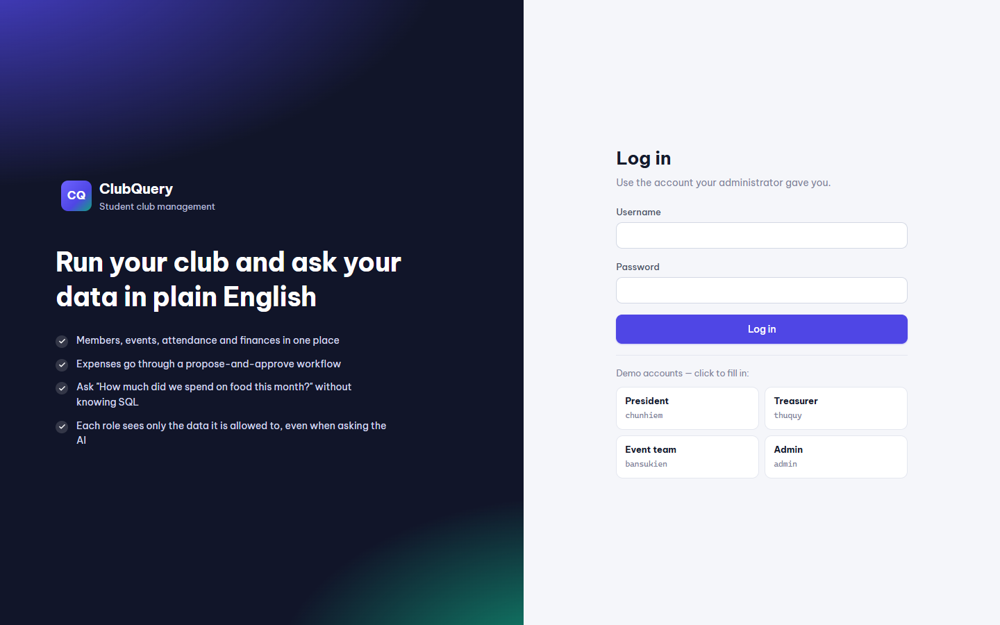

### 4.11.2. Giao diện Tổng quan

Tài khoản Chủ nhiệm: thẻ chỉ số (thành viên đang hoạt động, sự kiện sắp tới, tham dự trung bình, ngân sách còn lại, khoản chi chờ duyệt), ô hỏi nhanh, biểu đồ thu chi theo tháng, danh sách sự kiện sắp tới, chi theo hạng mục và nguồn thu. Khối tài chính chỉ hiện với vai trò có `finance.read`.

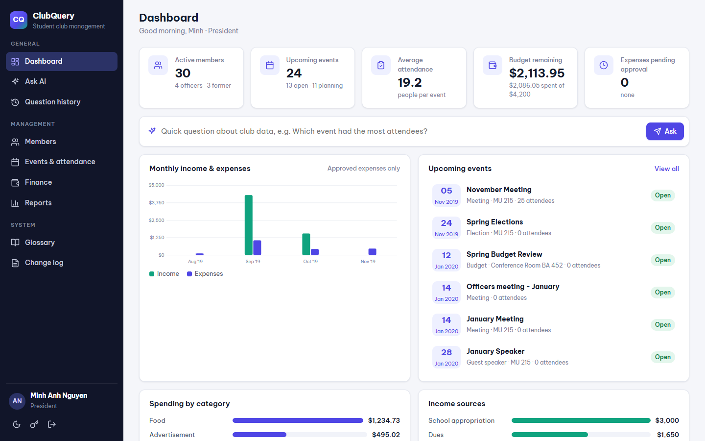

### 4.11.3. Giao diện Hỏi đáp

Ô câu hỏi; ô "External knowledge (optional)"; chọn model; nút "BIRD sample questions (158)"; nút "Ask"; câu hỏi gợi ý theo nhóm; khung "Your data access" (vai trò được đọc gì) và "Recent questions". Mỗi thẻ kết quả có trạng thái, model, độ trễ, số dòng, nhãn "BIRD sample #id" (nếu dùng câu mẫu), dòng "Knowledge added to the prompt", câu trả lời tiếng Anh, biểu đồ, bảng dữ liệu, mục "External knowledge sent to the model", SQL, và các nút "Correct / Wrong", "CSV", "Ask again". Ảnh là thẻ kết quả của câu mẫu BIRD #1379 chạy bằng Qwen2.5-Coder.

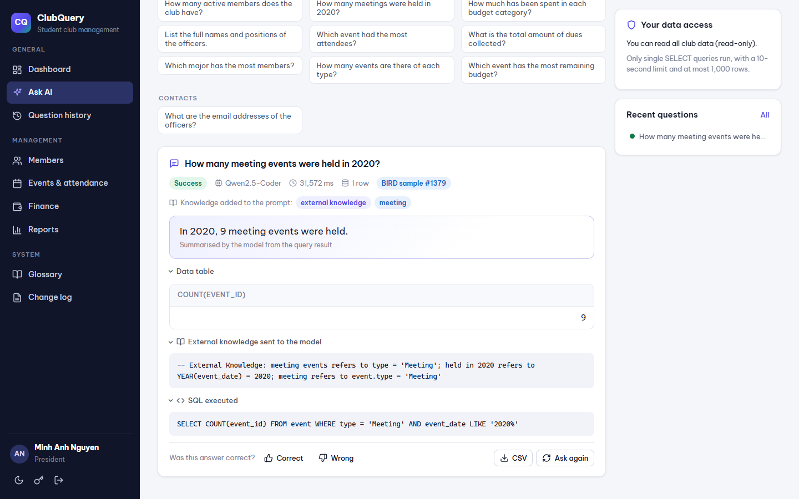

### 4.11.4. Giao diện Chọn câu hỏi mẫu BIRD

Hộp chọn 158 câu hỏi dev của BIRD trên `student_club`; tìm theo câu hỏi hoặc evidence, lọc All / Simple / Moderate / Challenging; mỗi câu hiện mã, độ khó và evidence (hoặc nhãn "no evidence"). Chọn một câu thì câu hỏi và evidence được điền vào màn Ask AI, kèm nhãn "BIRD sample #id · difficulty" và "evidence attached" hoặc "no evidence in BIRD".

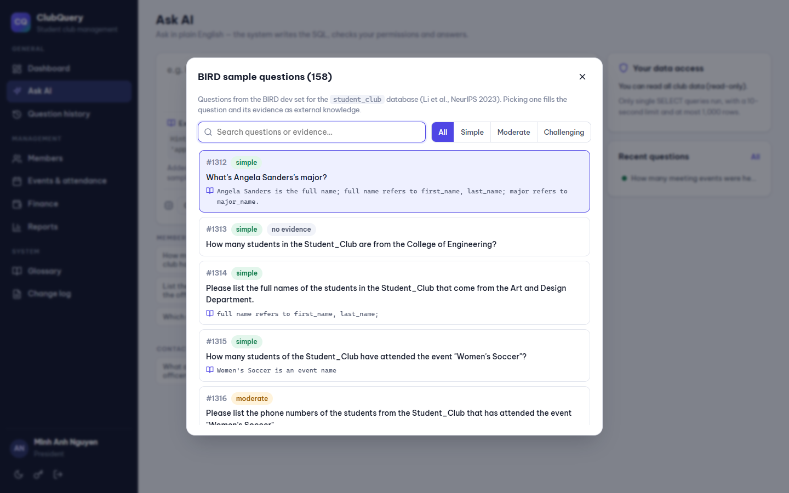

### 4.11.5. Giao diện Thành viên

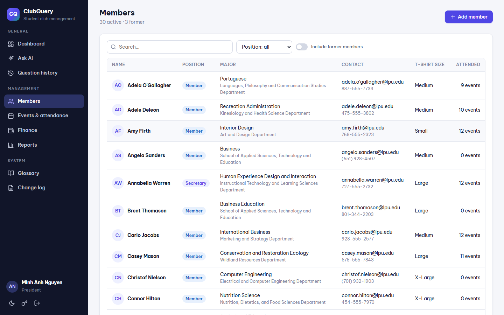

### 4.11.6. Giao diện Sự kiện và điểm danh

Hộp chi tiết của một sự kiện đang mở, gồm khung Budget theo hạng mục (Budget / Spent) và Attendance với ô chọn từng thành viên, "Search members…", "Select all", "Clear"; các nút "Edit", "Open event" / "Close event", "Save attendance". Khi sự kiện còn Planning, hộp này nhắc: "click Open event below, tick the members who came, then Save attendance". Trong khung Budget, Thủ quỹ có nút "Add budget" (mở form "Create budget" chọn sẵn sự kiện); Chủ nhiệm thấy dòng "Budgets are created by the Treasurer (Finance → Budgets)".

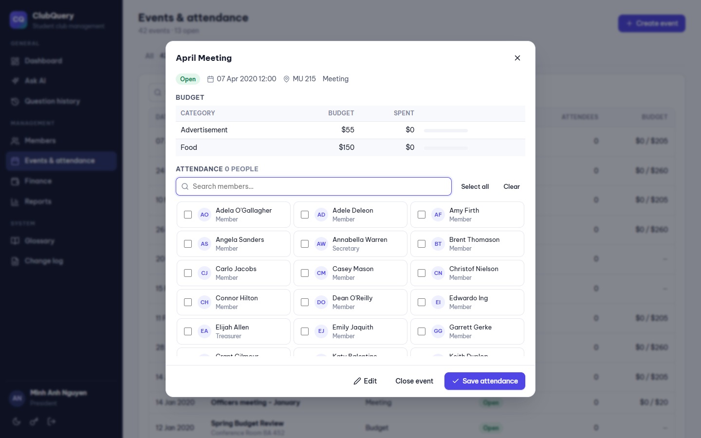

### 4.11.7. Giao diện Tài chính

Thẻ Total budget, Spent, Remaining, Total income, Pending approval; ba tab Expenses (Propose expense, Approve, Reject) / Budgets (theo sự kiện, hạng mục, trạng thái sự kiện, cột Usage) / Income.

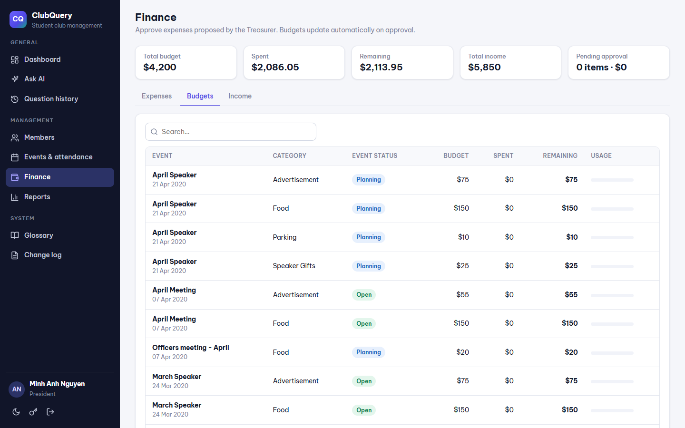

### 4.11.8. Giao diện Báo cáo

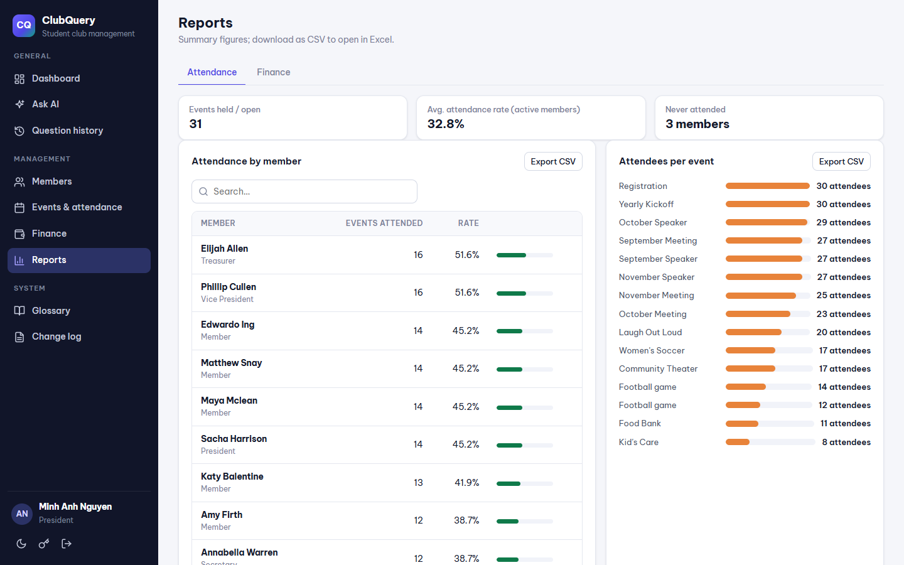

### 4.11.9. Giao diện Từ điển nghiệp vụ

11 thuật ngữ mẫu tiếng Anh (active member, meeting, pending expense…) với định nghĩa dạng SQL; khung giải thích liên hệ với bài báo BIRD; nút "Add term".

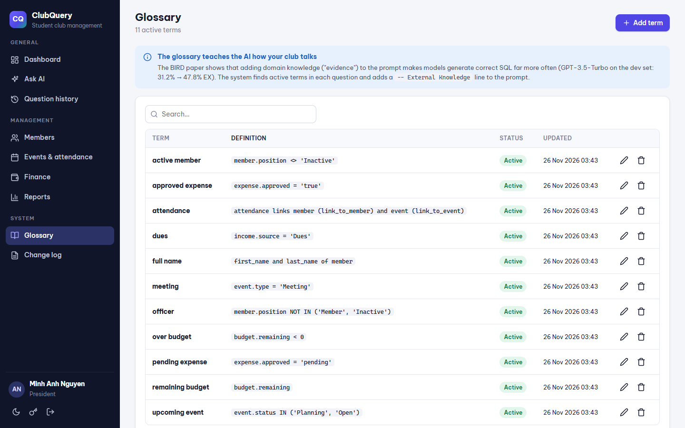

### 4.11.10. Giao diện Quản trị

Bốn tab Accounts, AI models, Query log, Permissions. Ảnh chụp tab Permissions: ma trận quyền × vai trò lấy trực tiếp từ cấu hình, cũng là ma trận dùng cho hỏi đáp.

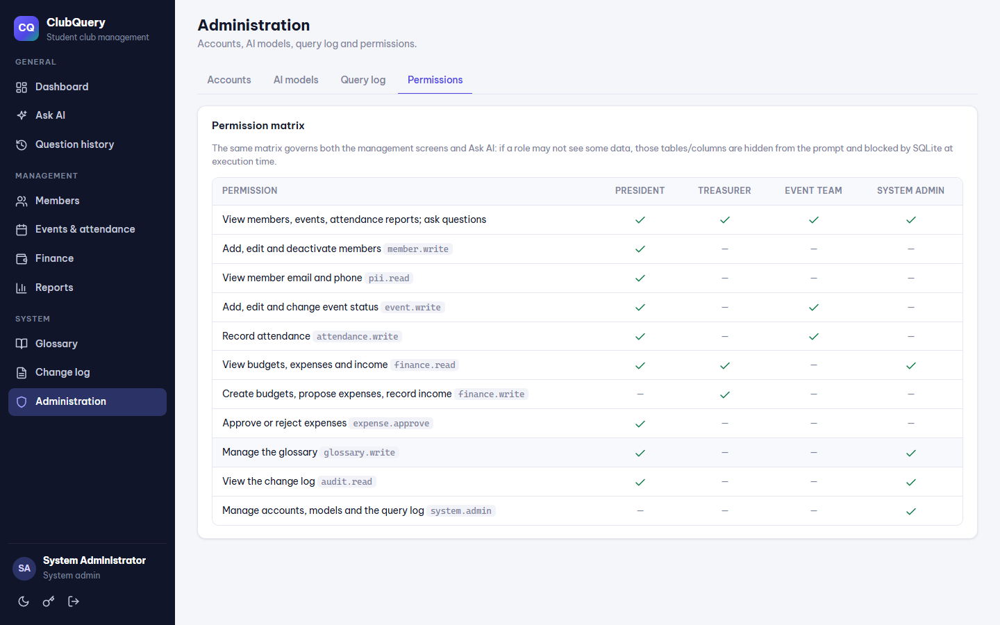

### 4.11.11. Giao diện trên điện thoại

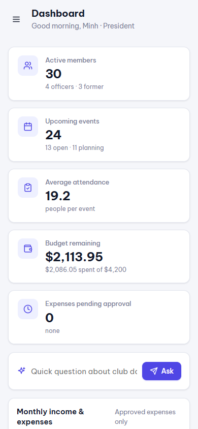{width=6}

# CHƯƠNG V. CÀI ĐẶT

## 5.1. Môi trường và công nghệ

Hệ thống được cài đặt bằng các công nghệ đã nêu ở Bảng 1.1: backend Python/FastAPI, CSDL SQLite, frontend HTML/CSS/JavaScript thuần; model chạy qua Ollama (nội bộ) hoặc Groq, gọi qua API chuẩn Chat Completions.

## 5.2. Cấu trúc mã nguồn

```
app/
  backend/
    config.py     đường dẫn, giới hạn truy vấn, vai trò, ma trận quyền,
                  restrictions() (BR03, BR05)
    deps.py       kết nối CSDL theo yêu cầu, phiên đăng nhập, need(quyền) (BR05)
    appdb.py      lược đồ app.sqlite, chép club.sqlite, ATTACH, dữ liệu khởi tạo,
                  audit() (BR10)
    main.py       đăng nhập, hỏi đáp, câu hỏi mẫu, lịch sử, đánh giá, CSV,
                  model, tài khoản
    club_api.py   thành viên, sự kiện, điểm danh, ngân sách, khoản chi + duyệt,
                  khoản thu, tổng quan, báo cáo, từ điển, nhật ký thay đổi
                  (BR06–BR13)
    service.py    điều phối hỏi đáp, ghép tri thức ngoài và từ điển,
                  ghi nhật ký (BR04)
    prompt.py     dựng prompt theo khuôn BIRD, lọc schema theo vai trò
    guard.py      kiểm tra SELECT, authorizer theo vai trò, timeout (BR01–BR03)
    llm.py        gọi dịch vụ LLM, tách SQL
    answer.py     diễn giải kết quả thành câu trả lời
  frontend/       index.html, style.css, js/core.js, js/app.js,
                  js/views/*.js (mỗi màn một module)
  data/           club.sqlite, app.sqlite (tự tạo)
  scripts/        per_db_ex.py: chấm EX theo CSDL bằng evaluation.py gốc
                  (phần khảo nghiệm)
  tests/          test_guard.py, test_answer.py, test_api.py
docs/pttk/        tài liệu, diagram (.puml và .png), ảnh màn hình
```

## 5.3. Trích đoạn cài đặt chính

### 5.3.1. Ma trận quyền và dữ liệu bị ẩn khi hỏi đáp (BR03, BR05)

Bảng/cột bị cấm khi hỏi đáp được suy ra từ ma trận, không khai báo riêng:

```python
PERMISSIONS = {
    'president': {'member.write', 'pii.read', 'event.write', 'attendance.write',
                  'finance.read', 'expense.approve', 'glossary.write',
                  'audit.read'},
    'treasurer': {'finance.read', 'finance.write'},
    'event': {'event.write', 'attendance.write'},
    'admin': {'finance.read', 'glossary.write', 'audit.read', 'system.admin'},
}

def restrictions(role):
    return {'tables': set() if can(role, 'finance.read') else set(FINANCE_TABLES),
            'columns': set() if can(role, 'pii.read') else set(PII_COLUMNS)}
```

Mọi API kiểm tra quyền bằng cùng ma trận:

```python
def need(*perms):
    def dep(user=Depends(current_user)):
        if not any(config.can(user['role'], p) for p in perms):
            raise HTTPException(403, 'You do not have permission to perform '
                                     'this action')
        return user
    return dep
```

### 5.3.2. Phân quyền ở tầng engine (BR03)

Authorizer được SQLite gọi cho mỗi bảng và cột mà truy vấn đọc. Với COUNT(*), SQLite vẫn gọi SQLITE_READ với tên bảng và cột rỗng, nên kiểu truy vấn này cũng bị chặn.

```python
def _authorizer(role, denied):
    r = config.restrictions(role)
    def auth(action, arg1, arg2, _db, _src):
        if action not in ALLOWED_ACTIONS:   # chỉ SELECT, READ, FUNCTION, RECURSIVE
            denied.append(('unsafe', action)); return sqlite3.SQLITE_DENY
        if action == sqlite3.SQLITE_READ:
            if arg1 in r['tables']:                  # bảng bị cấm
                denied.append(('permission', arg1)); return sqlite3.SQLITE_DENY
            if (arg1, arg2) in r['columns']:         # cột bị cấm
                denied.append(('permission', f'{arg1}.{arg2}'))
                return sqlite3.SQLITE_DENY
        return sqlite3.SQLITE_OK
    return auth
```

### 5.3.3. Lọc schema trong prompt theo vai trò

Đây là lớp phòng thủ thứ nhất:

```python
for name, sql in tables:
    if name == 'sqlite_sequence' or name in r['tables']:
        continue                                     # bỏ hẳn bảng bị cấm
    for table, column in r['columns']:
        if table == name:                            # bỏ dòng khai báo cột bị cấm
            sql = re.sub(rf'^\s*{re.escape(column)}\s+\w+,?\s*\n', '', sql,
                         flags=re.MULTILINE)
    parts.append(sql)
```

### 5.3.4. Tri thức ngoài và từ điển trở thành evidence (UC02d, UC02g)

Tri thức ngoài (người dùng nhập hoặc evidence của câu mẫu BIRD) giữ nguyên văn như lúc benchmark; định nghĩa từ điển được chuẩn hoá hàm giả (mục 2.7); rỗng cả hai thì prompt không có dòng External Knowledge:

```python
def match_glossary(conn, question):
    q = question.lower()
    terms = conn.execute('SELECT term, definition FROM glossary_term '
                         'WHERE is_active = 1').fetchall()
    return [dict(t) for t in terms if t['term'].lower() in q]

def build_knowledge(evidence, terms):
    parts = [evidence.strip()] if evidence and evidence.strip() else []
    if terms:
        defs = '; '.join(f"{t['term']} refers to {t['definition']}" for t in terms)
        parts.append(normalize_pseudo_sql(defs))
    return '; '.join(parts) or None
```

### 5.3.5. Duyệt chi trong một giao dịch (BR06, BR07, BR08, BR10)

`club.sqlite` được ATTACH vào kết nối của `app.sqlite`; mọi lệnh ghi ở hai file chạy trước một `commit()` duy nhất:

```python
def _review(conn, user, expense_id, approve, note):
    x = _expense(conn, expense_id)
    if x['status'] != 'PENDING':
        raise HTTPException(409, 'This expense has already been reviewed')
    if x['proposed_by'] == user['id']:                                   # BR08
        raise HTTPException(409, 'You cannot review an expense you proposed')
    if approve and x['cost'] > (x['budget_remaining'] or 0):              # BR07
        raise HTTPException(409, 'Cannot approve: the expense exceeds the '
                                 'remaining budget ...')
    if not approve and not (note or '').strip():
        raise HTTPException(422, 'Please enter a reason for rejection')
    conn.execute('UPDATE expense SET approved = ? WHERE expense_id = ?',
                 ('true' if approve else 'false', expense_id))
    conn.execute('UPDATE expense_review SET reviewed_by = ?, reviewed_at = ?, '
                 'note = ? WHERE expense_id = ?', ...)
    recompute_budget(conn, x['link_to_budget'])                           # BR06
    audit(conn, user, 'APPROVE' if approve else 'REJECT', 'expense',
          expense_id, ...)                                              # BR10
    conn.commit()
```

### 5.3.6. Diễn giải kết quả và ghi nhật ký (UC02f, BR04)

Câu trả lời do model diễn giải từ tối đa 30 dòng đã qua kiểm tra quyền; model lỗi thì dùng câu theo mẫu:

```python
def make_answer(question, columns, rows, model=None):
    if model is not None:
        try:
            text = llm_answer(model, question, columns, rows)  # tối đa 30 dòng
            if text:
                return text, 'llm'
        except llm.LLMError:
            pass
    return template_answer(columns, rows), 'template'  # "Result: 9.", ...
```

Lệnh ghi `query_log` đặt trong khối `finally` của `service.ask()`, nên câu hỏi bị từ chối hay lỗi cũng được ghi (BR04).

## 5.4. Hướng dẫn chạy

```
venv/Scripts/python -m pip install fastapi "uvicorn[standard]" openai python-dotenv \
    sqlparse pytest httpx
venv/Scripts/python -m app.backend.appdb      # (tuỳ chọn) tạo lại hai CSDL
venv/Scripts/python -m uvicorn app.backend.main:app --port 8000
```

Mở http://127.0.0.1:8000. Tài khoản demo: `chunhiem/chunhiem123` (Chủ nhiệm), `thuquy/thuquy123` (Thủ quỹ), `bansukien/bansukien123` (Ban sự kiện), `admin/admin123` (Quản trị).

- Các chức năng quản lý không cần model.
- Hỏi đáp cần Ollama chạy tại `localhost:11434` (model mặc định `qwen2.5-coder:7b`), hoặc `GROQ_API_KEY` trong `.env` để dùng GPT-OSS-20B qua Groq.

Dữ liệu BIRD (CSDL, `dev.json`, SQL đáp án) có dung lượng lớn và được nhóm tác giả phát hành theo giấy phép riêng (CC BY-SA 4.0), nên không đưa vào repo. Người dùng tự tải từ https://bird-bench.github.io/ [2]; hệ thống cần `student_club.sqlite` để tạo dữ liệu mồi và `dev.json` để nạp câu hỏi mẫu.

# CHƯƠNG VI. KIỂM THỬ VÀ ĐÁNH GIÁ

## 6.1. Kế hoạch kiểm thử

Bảng 6.1. Kế hoạch kiểm thử

| Mức | Nội dung | Số trường hợp |
|---|---|---|
| Đơn vị (`test_guard.py`) | BR01 (chỉ SELECT), BR02 (timeout, chỉ đọc), BR03 (phân quyền ở tầng engine theo 4 vai trò), lọc schema theo ma trận quyền | 35 |
| Đơn vị (`test_answer.py`) | Câu trả lời theo mẫu: rỗng, một giá trị, một dòng, danh sách, bảng | 5 |
| Chức năng (`test_api.py`) | Từng use case qua API theo từng vai trò; tri thức ngoài và câu hỏi mẫu BIRD; quy tắc BR04–BR13; model được giả lập | 28 |
| Phân quyền trên câu hỏi thật | 158 câu SQL do GPT-3.5 sinh, chạy với từng vai trò | 158 × 4 |
| Giao diện | Playwright: đăng nhập từng vai trò, các màn hình, khổ điện thoại | 11 màn hình |
| Tích hợp model thật | Qwen2.5-Coder 7B qua Ollama: câu mẫu BIRD #1379 kèm evidence; bật/tắt thuật ngữ (mục 6.3) | 5 câu |

Test tự tạo `app.sqlite` và `club.sqlite` tạm, không đụng dữ liệu làm việc và không gọi model thật. Kết quả: `pytest app/tests` → 68/68 trường hợp đạt.

Bảng 6.2. Một số trường hợp kiểm thử tiêu biểu

| Trường hợp | Đầu vào | Mong đợi | Kết quả |
|---|---|---|---|
| Lệnh ghi | `DELETE FROM member` | REJECTED_UNSAFE | Đạt |
| Nhiều câu lệnh | `SELECT 1; DROP TABLE member` | REJECTED_UNSAFE | Đạt |
| Lệnh ghi giấu trong CTE | `WITH x AS (SELECT 1) DELETE FROM member` | Authorizer chặn, REJECTED_UNSAFE | Đạt |
| Ban sự kiện đếm khoản chi | `SELECT COUNT(*) FROM expense` | REJECTED_PERMISSION | Đạt |
| Ban sự kiện SELECT * | `SELECT * FROM member` (gồm email, phone) | REJECTED_PERMISSION | Đạt |
| Thủ quỹ, Quản trị đọc liên lạc | `SELECT email FROM member` | REJECTED_PERMISSION; Chủ nhiệm chạy được | Đạt |
| Truy vấn vô hạn | CTE đệ quy không điểm dừng, timeout 0,5 giây | TIMEOUT | Đạt |
| Ghi qua kết nối hỏi đáp | `UPDATE member …` | Lỗi readonly | Đạt |
| Thuật ngữ thành evidence | Ban sự kiện hỏi "How many meetings were held?" | Prompt có dòng External Knowledge với "meeting refers to event.type = 'Meeting'"; không có `expense`, `email` | Đạt |
| Tri thức ngoài, câu mẫu BIRD | Hỏi bằng câu mẫu có evidence; tự nhập tri thức kèm câu chứa "meeting"; tri thức chỉ có khoảng trắng | Evidence nằm nguyên văn sau External Knowledge, `query_log` lưu `evidence` và `sample_id`; hai nguồn nối bằng "; "; không có dòng External Knowledge | Đạt |
| Model lỗi | Giả lập mất kết nối | FAILED_GENERATION, vẫn ghi log | Đạt |
| Duyệt chi | Thủ quỹ đề xuất 7,5; Chủ nhiệm duyệt | `spent` +7,5, `remaining` −7,5; duyệt lại → 409 | Đạt |
| Tách nhiệm vụ | Chủ nhiệm lập chi; Thủ quỹ duyệt | 403; 403 | Đạt |
| Vượt ngân sách (BR07) | Đề xuất lớn hơn số còn lại | Có cảnh báo; duyệt → 409; từ chối không lý do → 422 | Đạt |
| Chỉ người đề xuất sửa, huỷ (BR13) | Thủ quỹ khác sửa/huỷ đề xuất | 403 | Đạt |
| Tự duyệt (BR08) | Người đề xuất được đổi sang Chủ nhiệm rồi duyệt | 409 | Đạt |
| Xoá thành viên (BR09) | Xoá người đã điểm danh | 409 | Đạt |
| Nhật ký thay đổi (BR10) | Thêm, sửa, xoá một thành viên | `audit_log`: CREATE, UPDATE, DELETE | Đạt |
| Vòng đời sự kiện (BR11, BR12) | Điểm danh khi Planning; mở lại sự kiện Closed | 409; 422 | Đạt |
| Ngân sách | Sửa nhỏ hơn số đã chi; trùng hạng mục; lập cho sự kiện Closed; xoá khi có khoản chi | 422; 409; 409; 409 | Đạt |
| Trùng thuật ngữ | "TIỆC CUỐI NĂM" khi đã có "tiệc cuối năm" | 409 | Đạt |
| Quản trị tự hạ quyền | PUT `/api/users/{id của mình}` với vai trò khác | 422 | Đạt |

## 6.2. Đánh giá phân quyền trên câu hỏi thật

Lấy 158 câu SQL mà GPT-3.5-Turbo (có evidence) đã sinh cho các câu hỏi dev của `student_club` trong phần khảo nghiệm, chạy qua lớp an toàn của hệ thống với từng vai trò:

Bảng 6.3. Phát lại 158 câu SQL thật theo vai trò

| Vai trò | Chạy được | Bị chặn quyền | Lỗi thực thi |
|---|---|---|---|
| Chủ nhiệm | 131 | 0 | 27 |
| Thủ quỹ | 123 | 9 | 26 |
| Quản trị | 123 | 9 | 26 |
| Ban sự kiện | 65 | 76 | 17 |

Gần một nửa số câu hỏi thực tế chạm tới dữ liệu tài chính hoặc thông tin liên lạc, nên phân quyền khi hỏi đáp là yêu cầu thật của bài toán, không phải chi tiết trang trí.

## 6.3. Thử nghiệm với model thật: tác dụng của tri thức ngoài

Các lần chạy dưới đây dùng Qwen2.5-Coder 7B qua Ollama (model mặc định), tài khoản Chủ nhiệm.

### 6.3.1. Câu hỏi mẫu BIRD kèm evidence

Chọn câu mẫu #1379 (simple) trong hộp "BIRD sample questions": "How many meeting events were held in 2020?". Hệ thống điền evidence của BIRD vào ô External knowledge: "meeting events refers to type = 'Meeting'; held in 2020 refers to YEAR(event_date) = 2020". Câu hỏi còn chứa thuật ngữ "meeting" của từ điển, nên dòng tri thức gửi cho model là:

```
-- External Knowledge: meeting events refers to type = 'Meeting';
   held in 2020 refers to YEAR(event_date) = 2020;
   meeting refers to event.type = 'Meeting'
```

Bảng 6.4. Kết quả câu mẫu #1379 với Qwen2.5-Coder

| SQL model sinh | Trạng thái | Câu trả lời | Độ trễ |
|---|---|---|---|
| `SELECT COUNT(event_id) FROM event WHERE type = 'Meeting' AND event_date LIKE '2020%'` | EXECUTED | "In 2020, 9 meeting events were held." | khoảng 31,8 giây |

- Evidence của câu mẫu được truyền nguyên văn, giống hệt cách benchmark BIRD đưa evidence vào prompt; vì vậy nó vẫn chứa hàm giả `YEAR()` mà SQLite không có (mục 2.7). Ở lần chạy này model không chép `YEAR()` mà tự dùng `LIKE '2020%'`; với model khác hoặc câu khác, chép nguyên hàm giả sẽ gây EXEC_ERROR. Phần thuật ngữ từ điển thì đã được chuẩn hoá.
- Thẻ kết quả hiện nhãn "BIRD sample #1379", dòng "Knowledge added to the prompt" (nhãn external knowledge và meeting) và mục "External knowledge sent to the model" với đúng dòng ở trên, nên người dùng thấy model đã nhận tri thức gì.

### 6.3.2. Bật/tắt một thuật ngữ từ điển

Lần đo này thực hiện ở phiên bản trước, khi giao diện, câu hỏi và từ điển còn bằng tiếng Việt: câu hỏi "Có bao nhiêu thành viên đang hoạt động?", thuật ngữ "thành viên đang hoạt động" = `member.position <> 'Inactive'` (nay thuật ngữ này có tên tiếng Anh là "active member", định nghĩa không đổi). Kết quả được giữ lại vì nó tách riêng đúng một biến: có hay không có tri thức.

Bảng 6.5. Bật/tắt thuật ngữ "thành viên đang hoạt động"

| Thuật ngữ | Dòng tri thức trong prompt | SQL model sinh | Trạng thái | Câu trả lời |
|---|---|---|---|---|
| Bật | "-- External Knowledge: thành viên đang hoạt động refers to member.position <> 'Inactive'" | `SELECT COUNT(*) FROM member WHERE position != 'Inactive'` | EXECUTED | "Có 30 thành viên đang hoạt động." (đúng: 33 − 3 Inactive) |
| Tắt | (không có) | `SELECT COUNT(*) FROM member WHERE status = 'active'` | EXEC_ERROR (no such column: status) | Không có |

Khi không có tri thức, model đoán một cột `status` không tồn tại trong bảng `member` – đúng nhóm lỗi "hiểu sai nội dung CSDL" mà BIRD mô tả (Bảng 2.5). Một dòng định nghĩa do CLB tự viết là đủ để biến câu hỏi từ lỗi thành đúng. Đây là minh hoạ trực tiếp nhất cho phát hiện của bài báo khi đưa vào hệ thống thật.

Độ trễ đo được khoảng 11–55 giây mỗi câu, do model 7B chạy cục bộ trên máy thử nghiệm và mỗi câu gọi model hai lần (sinh SQL, diễn giải). Đây là hạn chế về hạ tầng, không phải của thiết kế; có thể giảm bằng GPU mạnh hơn hoặc chọn model qua Groq.

## 6.4. Kết quả khảo nghiệm trên student_club

Phần này là kết quả nghiên cứu (chạy bằng script `per_db_ex.py` với bộ chấm gốc `evaluation.py` của BIRD, ngoài ứng dụng), dùng để biện minh cho thiết kế tri thức ngoài và từ điển nghiệp vụ. 158 câu, gồm 101 simple, 48 moderate, 9 challenging. Đơn vị: % EX.

Bảng 6.6. EX trên 158 câu student_club theo cấu hình (%)

| Model | Không evidence | Có evidence | Evidence chuẩn hoá | Toàn dev, có evidence (lượt cuối) |
|---|---|---|---|---|
| GPT-3.5-Turbo | 37,97 | 50,00 | 51,90 | 47,72 |
| DeepSeek-Coder-V2* | 36,08 | 51,90 | 53,80 | 41,98 |
| Gemma3* | 49,37 | 71,52 | 70,89 | 48,50 |
| Qwen2.5-Coder* | 46,84 | 72,15 | 73,42 | 53,85 |

(*) Ba cột student_club của 3 model chạy qua Ollama được chấm từ lượt chạy trước khi sửa prompt (mục 2.7). Cột toàn dev là số đã chốt ở Bảng 2.6. Cần chấm lại lượt chạy cuối bằng `per_db_ex.py` để đồng bộ.

Bảng 6.7. EX theo độ khó, cấu hình có evidence (%)

| Model | Simple (101) | Moderate (48) | Challenging (9) |
|---|---|---|---|
| GPT-3.5-Turbo | 60,40 | 35,42 | 11,11 |
| DeepSeek-Coder-V2 | 57,43 | 45,83 | 22,22 |
| Gemma3 | 78,22 | 62,50 | 44,44 |
| Qwen2.5-Coder | 82,18 | 58,33 | 33,33 |

Nhận xét:

1. Evidence tăng EX ở mọi model, từ 12 đến 25 điểm, cùng chiều với kết luận của bài báo. Đây là căn cứ cho ô tri thức ngoài và từ điển nghiệp vụ: từ điển là evidence do chính tổ chức duy trì, được ghép tự động vào prompt.
2. `student_club` dễ hơn mức trung bình của bộ dev. Qwen2.5-Coder đạt 72,15% ở đây nhưng 53,85% trên toàn dev. Không lấy số của một CSDL để kết luận cho cả benchmark.
3. Sai số khoảng ±8 điểm với 158 câu, nên chênh lệch giữa Gemma3 và Qwen2.5 (dưới 1 điểm) hay giữa hai cấu hình evidence (dưới 2 điểm) không có ý nghĩa. Riêng nhóm challenging chỉ có 9 câu, không nên diễn giải.
4. Phân tích lượt GPT-3.5 có evidence: 79 câu đúng, 52 câu chạy được nhưng sai kết quả, 27 câu lỗi thực thi. Trong 158 câu, có 51 câu cả 4 model đều đúng và 30 câu cả 4 model đều sai.

## 6.5. Phân tích hai ca sai tiêu biểu

### 6.5.1. Câu #1324 – "What is the average attendance of meetings in 2020?"

Cả 4 model đều sai.

- Evidence gợi ý `DIVIDE(COUNT(event_id), COUNT(DISTINCT event_name))`, tức đếm sự kiện chứ không đếm lượt điểm danh.
- GPT-3.5 làm theo nguyên văn và bỏ qua bảng `attendance`:

```sql
SELECT AVG(COUNT(event_id) * 1.0 / COUNT(DISTINCT event_name))
FROM event WHERE type = 'Meeting' AND strftime('%Y', event_date) = '2020'
```

- Đáp án đúng phải JOIN `attendance` và chia số lượt điểm danh cho số buổi họp.
- Đây đúng là nhóm lỗi "hiểu sai evidence" của BIRD, ở lớp ngữ nghĩa: chuẩn hoá cú pháp không cứu được câu này. Bài học cho hệ thống: định nghĩa trong từ điển phải do người hiểu nghiệp vụ viết và kiểm tra.

### 6.5.2. Câu #1318 – "What is the event that has the highest attendance...?"

- GPT-3.5 tìm đúng sự kiện nhưng trả thêm cột `event_id` và `attendance_count`. EX so khớp tập kết quả nên câu bị tính sai.
- Các model còn lại hiểu "students from the Student_Club" là một điều kiện lọc (`position = 'Student_Club'`), một lỗi liên kết schema/giá trị.
- Ca này cho thấy EX là thước đo chặt, có thể đánh giá thấp model so với cảm nhận của người dùng. Vì vậy hệ thống có thêm chức năng đánh giá của người dùng (UC04).

## 6.6. Đánh giá yêu cầu phi chức năng

Bảng 6.8. Kết quả đánh giá yêu cầu phi chức năng

| Mã | Chỉ tiêu | Kết quả |
|---|---|---|
| NFR1 | Toàn vẹn dữ liệu | Mọi thao tác ghi và nhật ký chạy trước một `commit()`; hai CSDL được ATTACH vào cùng kết nối nên commit nguyên tử |
| NFR2 | An toàn khi hỏi đáp | `mode=ro` cộng authorizer; có test (lệnh ghi, CTE, bảng/cột bị cấm) |
| NFR3 | Bảo vệ dữ liệu gốc | `student_club.sqlite` chỉ được chép, không mở để ghi |
| NFR4 | Bảo mật tài khoản | PBKDF2-SHA256, 100.000 vòng, có salt; `model_config` chỉ lưu tên biến môi trường của khoá |
| NFR5 | Truy vết | `audit_log` có người, thời điểm, giá trị trước/sau; `query_log` có câu hỏi, tri thức ngoài, SQL, trạng thái |
| NFR6 | Độ trễ hỏi đáp | Ghi `latency_ms` từng câu; với Qwen2.5-Coder 7B chạy cục bộ đo được khoảng 11–55 giây/câu – chấp nhận được cho demo, còn chậm cho sử dụng thường xuyên |
| NFR7 | Tối thiểu dữ liệu gửi ra ngoài | Tối đa 30 dòng đã qua kiểm tra quyền; model mặc định chạy nội bộ qua Ollama nên dữ liệu không rời máy chủ |
| NFR8 | Khả dụng | Giao diện tiếng Anh thống nhất; không tràn ngang ở khổ 390px |

# CHƯƠNG VII. KẾT LUẬN VÀ HƯỚNG PHÁT TRIỂN

## 7.1. Kết quả đạt được

### 7.1.1. Về nghiên cứu

- Phân tích đóng góp, phương pháp đánh giá và kết quả của bài báo BIRD.
- Phát hiện một số điểm lệch giữa bài báo và mã nguồn.
- Khảo nghiệm lại với các model hiện có trên toàn bộ tập dev: GPT-3.5-Turbo hiện tại đạt 47,72% EX có evidence; model tốt nhất là Qwen2.5-Coder 7B với 53,85%.
- Đề xuất chuẩn hoá evidence, với mức cải thiện có ý nghĩa thống kê ở hai model.

### 7.1.2. Về phân tích thiết kế

- Xác định 4 vai trò nghiệp vụ và 1 hệ thống ngoài, ma trận 10 quyền, 19 use case trong 7 nhóm chức năng, 13 quy tắc nghiệp vụ, 8 yêu cầu phi chức năng.
- Xây dựng đủ bộ mô hình: phân rã chức năng, use case, đặc tả, hoạt động, tuần tự, lớp, ba sơ đồ trạng thái (truy vấn, khoản chi, sự kiện), ERD hai CSDL, kiến trúc.

### 7.1.3. Về hệ thống

- ClubQuery quản lý được thành viên, sự kiện, điểm danh, ngân sách, khoản thu và khoản chi có quy trình đề xuất – duyệt với tách nhiệm vụ; có tổng quan, báo cáo và nhật ký thay đổi cho mọi dữ liệu nghiệp vụ.
- Một ma trận quyền dùng chung cho chức năng quản lý và hỏi đáp; phân quyền khi hỏi đáp được thực thi ở tầng engine SQLite.
- Phát hiện chính của BIRD (evidence tăng độ chính xác) được đưa vào hệ thống theo đúng cơ chế của bài báo – dòng `-- External Knowledge` trong prompt – với hai nguồn: tri thức ngoài do người hỏi cung cấp (hoặc evidence của 158 câu hỏi mẫu BIRD, giữ nguyên văn) và từ điển nghiệp vụ do CLB tự duy trì.
- 68 trường hợp kiểm thử tự động đều đạt.

## 7.2. Trả lời câu hỏi của bài báo

"LLM đã đủ sức làm giao diện CSDL chưa?" Với dữ liệu CLB, model tốt nhất đạt khoảng 72% có evidence; trên toàn bộ tập dev, con số này là 53,85%, vẫn cách xa 92,96% của con người. Con số này đủ để hỗ trợ người dùng, nhưng chưa đủ để thay thế người hiểu dữ liệu. Vì vậy một hệ thống thực tế cần:

- hiển thị SQL và tri thức đã dùng để người dùng kiểm tra;
- tri thức nghiệp vụ do tổ chức tự duy trì;
- phân quyền và nhật ký, vì SQL do model sinh là đầu vào không tin cậy.

ClubQuery được thiết kế theo đúng ba yêu cầu đó. Đồng thời, hỏi đáp chỉ là một phần của hệ thống: các nghiệp vụ cần chính xác tuyệt đối (duyệt chi, ngân sách, điểm danh) được làm bằng chức năng quản lý có quy tắc nghiệp vụ rõ ràng, còn hỏi đáp phục vụ tra cứu và thống kê linh hoạt.

## 7.3. Hạn chế

- Kết quả trên student_club của 3 model chạy qua Ollama vẫn được chấm từ lượt chạy trước khi sửa prompt.
- Giao diện, từ điển và câu trả lời bằng tiếng Anh (thống nhất với BIRD); hỏi bằng tiếng Việt vẫn chạy được nhưng độ chính xác chưa được đo.
- Evidence của câu mẫu BIRD được gửi nguyên văn, kể cả hàm giả như `YEAR()`, `DIVIDE()` (chỉ thuật ngữ từ điển được chuẩn hoá); model có thể chép hàm giả và gây lỗi thực thi.
- Lỗi nhập liệu ở bước kiểm tra đầu vào (model không tồn tại, câu hỏi quá ngắn) trả 422 và không được ghi vào nhật ký truy vấn.
- Phiên đăng nhập lưu trong bộ nhớ tiến trình, nên khởi động lại máy chủ thì phải đăng nhập lại. Đủ cho demo, chưa đủ cho triển khai thật.
- Từ điển khớp thuật ngữ theo chuỗi con, chưa xử lý từ đồng nghĩa hay biến thể.
- Model mặc định 7B chạy cục bộ nên chậm. Chọn Groq thì nhanh hơn nhưng khi đó tối đa 30 dòng kết quả được gửi ra dịch vụ bên ngoài ở bước diễn giải.
- Thay đổi tài khoản, cấu hình model chưa được ghi vào nhật ký thay đổi.
- Mới đánh giá trên một CSDL.

## 7.4. Hướng phát triển

- Chấm lại lượt chạy cuối của các model mã nguồn mở trên student_club; đánh giá thêm model mới.
- Thêm tuỳ chọn chuẩn hoá evidence của câu mẫu và đo EX trực tiếp trên ứng dụng bằng 158 câu mẫu (so với SQL đáp án).
- Xây bộ câu hỏi tiếng Việt cho student_club để đo độ chính xác khi hỏi tiếng Việt.
- Dùng đánh giá đúng/sai của người dùng (UC04) để bổ sung thuật ngữ vào từ điển, tạo vòng cải tiến liên tục.
- Khớp thuật ngữ theo ngữ nghĩa (embedding) thay vì chuỗi con.
- Lưu phiên vào CSDL hoặc dùng JWT; triển khai qua HTTPS; ghi nhật ký cả thay đổi tài khoản và cấu hình.
- Thêm thông báo (email) khi có khoản chi chờ duyệt; nhập/xuất danh sách thành viên.
- Mở rộng sang các CSDL khác của BIRD (ví dụ financial) để kiểm tra tính tổng quát của thiết kế.

# TÀI LIỆU THAM KHẢO

[1]. J. Li, B. Hui, G. Qu, et al., Can LLM Already Serve as A Database Interface? A BIg Bench for Large-Scale Database Grounded Text-to-SQLs, NeurIPS 2023 Datasets and Benchmarks Track, 2023. https://arxiv.org/abs/2305.03111

[2]. BIRD-SQL benchmark, trang chủ và dữ liệu. https://bird-bench.github.io/

[3]. AlibabaResearch/DAMO-ConvAI, mã nguồn gốc của BIRD (thư mục bird/). https://github.com/AlibabaResearch/DAMO-ConvAI

[4]. T. Yu et al., Spider: A Large-Scale Human-Labeled Dataset for Complex and Cross-Domain Semantic Parsing and Text-to-SQL Task, EMNLP 2018.

[5]. SQLite Documentation, Compile-Time Authorization Callbacks (sqlite3_set_authorizer). https://www.sqlite.org/c3ref/set_authorizer.html

[6]. SQLite Documentation, ATTACH DATABASE và Atomic Commit In SQLite. https://www.sqlite.org/lang_attach.html, https://www.sqlite.org/atomiccommit.html

[7]. FastAPI Documentation. https://fastapi.tiangolo.com/

[8]. PlantUML Language Reference Guide. https://plantuml.com/

# PHỤ LỤC

Bảng PL.1. Tài khoản demo

| Tên đăng nhập | Mật khẩu | Họ tên | Vai trò |
|---|---|---|---|
| chunhiem | chunhiem123 | Minh Anh Nguyen | Chủ nhiệm (President) |
| thuquy | thuquy123 | Thu Ha Tran | Thủ quỹ (Treasurer) |
| bansukien | bansukien123 | Quoc Bao Le | Ban sự kiện (Event team) |
| admin | admin123 | System Administrator | Quản trị hệ thống (System admin) |

Bảng PL.2. Từ điển nghiệp vụ mẫu

| Thuật ngữ | Định nghĩa |
|---|---|
| full name | first_name and last_name of member |
| active member | member.position <> 'Inactive' |
| officer | member.position NOT IN ('Member', 'Inactive') |
| meeting | event.type = 'Meeting' |
| upcoming event | event.status IN ('Planning', 'Open') |
| dues | income.source = 'Dues' |
| approved expense | expense.approved = 'true' |
| pending expense | expense.approved = 'pending' |
| remaining budget | budget.remaining |
| over budget | budget.remaining < 0 |
| attendance | attendance links member (link_to_member) and event (link_to_event) |

Ngoài ra, 158 câu dev của `student_club` (101 simple, 48 moderate, 9 challenging; 146 câu có evidence) được nạp từ `dev.json` vào bảng `sample_question` làm câu hỏi mẫu.

Bảng PL.3. Model được cấu hình

| Tên | Nhà cung cấp | Model tag | Mặc định |
|---|---|---|---|
| Qwen2.5-Coder | ollama | qwen2.5-coder:7b | x |
| DeepSeek-Coder-V2 | ollama | deepseek-coder-v2:16b | |
| Gemma3 | ollama | gemma3:12b | |
| GPT-OSS-20B (Groq) | groq | openai/gpt-oss-20b | |

Bảng PL.4. Kịch bản demo (8–10 phút)

| # | Tài khoản | Thao tác | Điều cần chứng minh |
|---|---|---|---|
| 1 | bansukien / bansukien123 | Mở Dashboard | Không có khối tài chính; menu không có Finance |
| 2 | bansukien | Events & attendance → Create event "Git Workshop" → mở sự kiện | Sự kiện mới ở Planning; hộp chi tiết hướng dẫn Open event rồi điểm danh (BR12) |
| 3 | bansukien | Bấm Open event, điểm danh 3 người (Save attendance); thử chuyển về Planning | Điểm danh được; không đi lùi trạng thái (BR11) |
| 4 | bansukien | Ask AI: "How many meetings were held in 2020?" | Thuật ngữ meeting tự ghép vào prompt; trả lời một câu tiếng Anh, kèm SQL |
| 5 | bansukien | Hỏi "How much has been spent in each budget category?" | REJECTED_PERMISSION ở tầng engine (BR03), vẫn ghi log (BR04) |
| 6 | thuquy / thuquy123 | Mở sự kiện "Git Workshop" → Add budget (Food); Finance → Expenses → Propose expense một khoản nhỏ và một khoản vượt ngân sách còn lại | Ngân sách gắn đúng sự kiện; cả hai khoản chờ duyệt; khoản thứ hai có cảnh báo (BR07); Thủ quỹ không có nút Approve |
| 7 | chunhiem / chunhiem123 | Dashboard → thẻ Pending approval → Approve khoản nhỏ | Ngân sách còn lại giảm đúng số tiền (BR06) |
| 8 | chunhiem | Approve khoản vượt ngân sách → bị chặn → Reject kèm lý do | BR07; từ chối bắt buộc có lý do |
| 9 | chunhiem | Members → xoá một thành viên đã từng điểm danh → chuyển sang Inactive | BR09; Chủ nhiệm thấy email, số điện thoại |
| 10 | chunhiem | Ask AI → BIRD sample questions → lọc Simple → chọn #1379 → Ask | Evidence của BIRD được điền vào External knowledge và gửi nguyên văn; xem "External knowledge sent to the model" |
| 11 | chunhiem | Glossary → Add term "year-end party" = event.type = 'Social' → hỏi "How many year-end party events are there?" | Tri thức nghiệp vụ do CLB tự duy trì đi thẳng vào prompt |
| 12 | chunhiem | Change log | Mọi thao tác ở bước 2–11 có người, thời điểm, giá trị trước/sau (BR10) |
| 13 | admin / admin123 | Administration → Query log, AI models, Accounts, Permissions | Thống kê theo trạng thái có cả lần bị chặn; đổi model mặc định; khoá/mở tài khoản; ma trận quyền |

Khi nói về độ chính xác của hỏi đáp, cần nêu số tổng thể của khảo nghiệm (Qwen2.5-Coder có evidence: 72,15% trên 158 câu student_club), để các câu demo không bị hiểu là chỉ chọn câu đẹp. Model 7B chạy cục bộ mất 10–60 giây mỗi câu, nên hỏi trước vài câu để có sẵn trong lịch sử.
